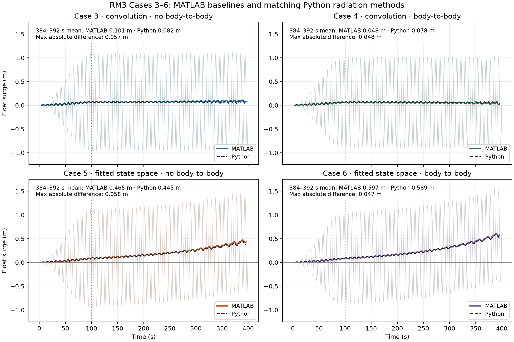
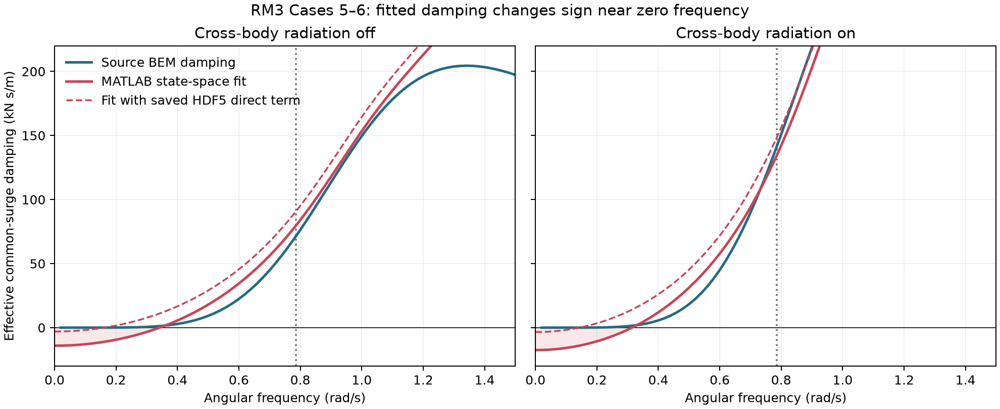
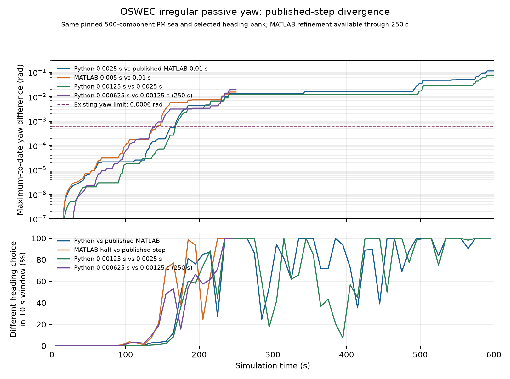
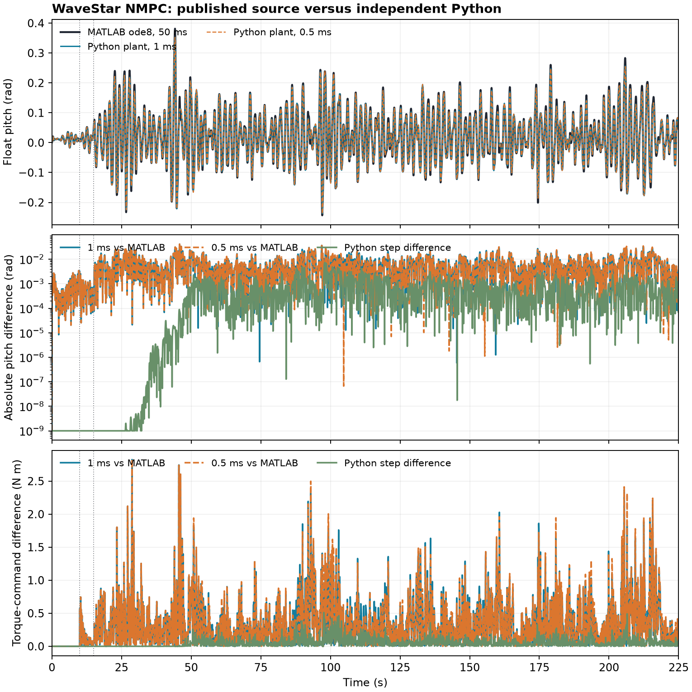
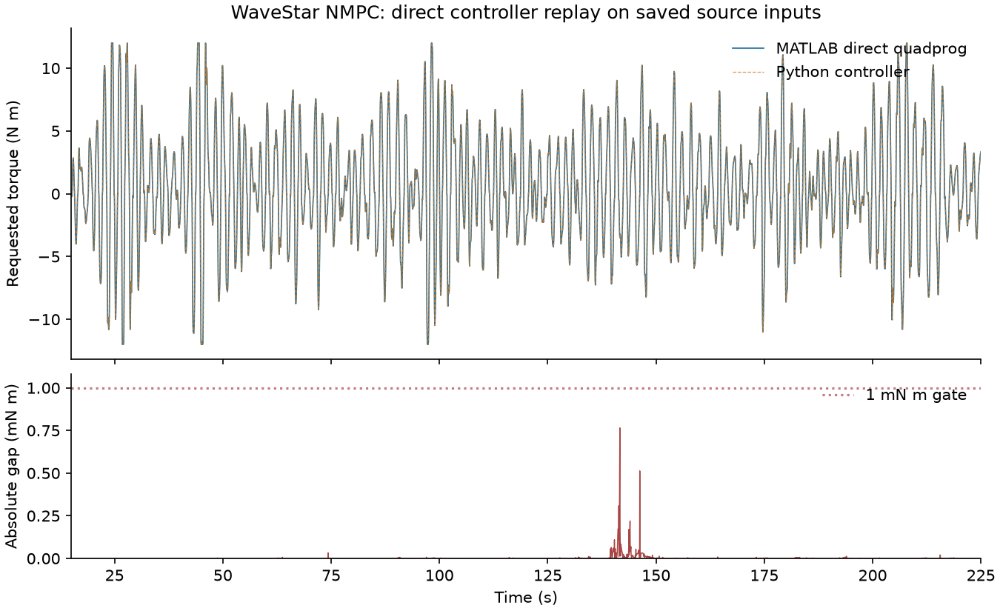

# MATLAB WEC-Sim comparison

This fork started from THREDgroup/WEC-Sim-Python `c04ef427` (October 2021).
The current MATLAB reference reviewed for this baseline is
[WEC-Sim/WEC-Sim `0753b2e47f2457c078751dcfe5d251d1767b80ab`](https://github.com/WEC-Sim/WEC-Sim/tree/0753b2e47f2457c078751dcfe5d251d1767b80ab).
The original Python repository includes MATLAB-generated fixtures. Local
MATLAB R2025b is now available for focused checks. The `MATLAB reference
parity` GitHub Actions workflow also checks out the pinned MATLAB revision,
runs its `waveClass`, and compares the generated outputs with the production
Python code. The live wave comparison passed on 6 October 2026; the workflow
saves its MATLAB outputs as an artifact.

| Behavior | Reference | Baseline result |
| --- | --- | --- |
| Regular-wave elevation, ramp, and three gauge positions | Original MATLAB-generated `regular_1_test` files; pinned R2025b finite-depth, 30° [zero-ramp gauge fixture](tests/fixtures/matlab/zero_ramp_regular_gauges.csv) | Production `WaveClass` agrees within `1e-12` absolute error, including three off-origin gauges without a ramp. The [source generator](tests/matlab/zero_ramp_regular_gauges.m) reproduces the compact fixture locally. |
| Core no-wave and regular-CIC preprocessing | Local R2025b Update 7 [source generator](tests/matlab/core_cic_wave_reference.m) and [compact fixture](tests/fixtures/matlab/core_cic_wave/README.md) at 25 m depth and 0.4–2 rad/s BEM frequencies | `WaveClass` reproduces `noWave`, unset-period `noWaveCIC`, and 30° `regularCIC` frequency, period, wavenumber, amplitude, and all 21 origin samples within `1e-12`; the regular-CIC marker and power gaps are below `4.5e-15` m and `5.1e-11` W/m. A public 2 s `WEC.run` regular-CIC sea also matches every source origin sample. This is wave preprocessing and dispatch, not a new full-duration RM3 motion gate. |
| Finite-depth wave number | Current MATLAB `calcWaveNumber.m` dispersion relation | Python residual is checked to relative tolerance `1e-13`. |
| Finite-depth regular-wave power | Current MATLAB `waveClass.m` group-velocity equation | Corrected denominator to `sinh(2kh)`; tested at 25 m depth. |
| Current PM and JONSWAP spectra and seeded elevation | Pinned MATLAB `waveClass` with Traditional, EqualEnergy, and narrowed EqualEnergy 64-frequency discretizations, 8 s peak period, significant heights of 2.5 m and 4 m, and its Threefry phase output; [live R2025b gate](https://github.com/cmudrc/wec-sim-python/actions/runs/37780011107) | Production `WaveClass.waveSetup` uses the current height-dependent PM and JONSWAP equations, including inferred JONSWAP `gamma`. Its explicit `phaseGenerator="matlab"` now independently generates all six saved phase matrices from `phaseSeed=1` within `1e-13` rad, including three incident PM directions. All six live wave comparisons pass locally without a phase file. In the equal-energy pairs, the maximum difference across frequency, width, and spectrum entries is `5.4e-15`; deep-water power differs by at most `2.2e-11` W/m, and origin and three-marker elevation by at most `7.4e-15` m. NumPy remains the default phase generator. |
| Automatic JONSWAP peak-factor extremes | Local R2025b Update 7 run of pinned `waveClass` at 8 s period with 9 m and 1 m heights, 64 equal-energy bins, seed 1; [source script](tests/matlab/regular_wave_reference.m) and [portable archive](tests/fixtures/matlab/wave_reference.zip) | MATLAB selects gamma 5 and 1, respectively; the existing 4 m case covers the interpolated branch. Python independently reproduces the source bins within `4.9e-14`, phase within `4.9e-15` rad, and public `WEC.run` origin elevation within `8.8e-15` m over 2 s. Fresh source generation reproduced the eight archived arrays byte for byte. This gates wave preprocessing and public wave dispatch, not a new published coupled-motion case. |
| Narrowed PM and JONSWAP frequency ranges | Same pinned MATLAB `waveClass`, with `bem.range=[0.5,1.5]` rad/s inside a `[0.4,2.0]` rad/s BEM interval; [passing R2025b gate](https://github.com/cmudrc/wec-sim-python/actions/runs/37780011107) | The public `PMWave` and `JONSWAPWave` settings now pass an optional range through the hydrodynamic `WEC` runner. The production component builders' selected frequencies, widths, and spectral values differ from MATLAB by at most `5.8e-15`; replayed origin elevation differs by at most `1.9e-14` m. The live gate also checks power and three marker elevations through `WaveClass`. Out-of-BEM range endpoints clamp to HDF5 limits as in MATLAB; hydrodynamic bodies retain HDF5 water depth. This validates wave preprocessing and API propagation, not a new coupled-motion case. |
| Traditional PM and JONSWAP production components | Pinned R2025b `waveClass` with 64 uniform bins, saved phases, and origin elevation from the live wave gate above | The production irregular-wave builders now reproduce both source frequency grids and spectra within `2e-12` relative and `1e-14` absolute tolerances, and origin elevation within `2e-12` m. The public `PMWave` and `JONSWAPWave` use 1000 bins by default when `discretization="traditional"`; the RM3 floating-joint runner accepts a single zero-heading irregular sea. This is wave preprocessing and a short local coupled-run check; the published RM3 MoorDyn visualization trajectory remains unpaired. |
| Public fixed-hinge PM and JONSWAP equal-energy waves | The same pinned R2025b six-sea phase, bin, and elevation archive | Production component builders independently generate all six Traditional, EqualEnergy, and narrowed EqualEnergy source seas from the MATLAB substream seed: phase error is below `1e-13` rad, frequency and spectrum satisfy `2e-12` relative and `1e-14` absolute limits, and origin elevation satisfies `2e-12` m. The public `WEC.fixed_hinge` path now accepts PM frequency ranges and JONSWAP waves; its two unnarrowed EqualEnergy 2 s origin histories also pass the `2e-12` m gate. This verifies wave preprocessing and dispatch, not a new published coupled-motion case. |
| Irregular Bretschneider equal-energy binning | Original MATLAB-era test constants | Production `WaveClass` agrees after NumPy/SciPy API updates. This is historical compatibility only: current MATLAB WEC-Sim rejects the `BS` option. |
| Wave-surface grid for no-wave, regular, and directional irregular waves | Current MATLAB `waveClass.waveElevationGrid` equations | Implemented and checked for regular and two-direction irregular cases. |
| RM3 and OSWEC hydrodynamic preprocessing | Pinned R2025b `bodyClass.hydroForcePre` on both bodies of each geometry, using the same bundled HDF5 in MATLAB and Python | The four regular-CIC comparisons cover all hydrostatic restoring and infinite-frequency added-mass entries, 101 samples of each 6×6 radiation kernel, and all regular-wave excitation coefficients. The two additional OSWEC irregular comparisons cover three headings and 64 frequencies across all six excitation channels. Each Python body runs both from its HDF5 file and from an in-memory BEM structure, matching MATLAB's MCR input route. Restoring, added mass, and irregular excitation are bit-equal; the largest kernel and regular-excitation differences are `7.51e-9` and `4.66e-10` in their respective units, below fixed `1e-10` relative and `1e-5` absolute gates. A [compact source fixture](tests/fixtures/matlab/README.md) runs in ordinary CI and the MATLAB workflow regenerates fresh outputs. This checks force preprocessing, not coupled published-case motion. |
| Current pinned RM3 HDF5 hydrodynamic preprocessing | Pinned R2025b `bodyClass.hydroForcePre` on both bodies of the core example's `rm3.h5` (`a909360c` SHA-256), with identical data read by Python from HDF5 or an in-memory BEM structure | Fresh paired regular-CIC gates cover 6×6 restoring and infinite-frequency added mass, 101 samples of each 6×6 radiation kernel, and complex excitation on all six channels. Restoring and added mass are bit-equal; local maximum kernel and excitation differences are `9.31e-10` and `4.66e-10`, below the same fixed `1e-10` relative and `1e-5` absolute limits. This separately checks the current core input, which differs from the bundled RM3 file; it does not gate coupled published-case motion. |
| Published RM3 and OSWEC `Wave_Markers` elevations | Pinned MATLAB Applications inputs with 25 world XY markers, 400 s regular waves, and focused R2025b runs for [RM3](https://github.com/cmudrc/wec-sim-python/actions/runs/37934252549) and [OSWEC](https://github.com/cmudrc/wec-sim-python/actions/runs/37932186068) | Public `RegularWave.elevation_at` independently samples the source marker locations from wave height, period, direction, BEM water depth, and 100 s ramp. Against all 4,001 times and 25 markers per case, maximum elevation errors are `3.76e-11` m (RM3, 200 m depth) and `7.12e-14` m (OSWEC, 10.9 m depth), below a `1e-10` m gate. Source origin elevation and marker ordering are checked separately. Both complete numerical elevation pairs now run in ordinary Python CI from compact pinned fixtures, including the [RM3 source export](tests/fixtures/matlab/rm3_wave_markers/README.md). Marker glyph style, size, color, and visualization files remain unpaired. |
| Published RM3 and OSWEC `Wave_Markers` body and PTO motion | The same pinned 400 s R2025b runs as the marker elevations above, including both bodies and the published linear PTO in each case | The public `WEC.floating_joint` and `WEC.fixed_hinge` builders independently advance the 2.5 m, 8 s regular-wave devices over all 4,001 samples. The paired gate checks all six position and velocity channels on both bodies and PTO stroke, speed, force, and absorbed power, with MATLAB's opposite power sign accounted for. RM3 maximum active errors are 36.8 mm body surge, 4.18 mm heave, `6.72e-4` rad pitch, 5.04 mm PTO stroke, 4.74 kN force, and 5.72 kW absorbed power; OSWEC maxima are 20.7 mm body surge, 7.91 mm heave, `0.00444` rad pitch, `0.00444` rad PTO stroke, 39.3 N m torque, and 19.8 W absorbed power. Inactive axes and the fixed OSWEC base agree within `1e-10` in their units. Both full-duration local pairs pass explicit per-channel limits. Compact source trajectories for [RM3 and OSWEC](tests/fixtures/matlab/README.md) now keep both full-body and PTO comparisons active in ordinary Python CI. The portable RM3 gate also integrates absorbed PTO power over the full 400 s and three ramp/steady windows: Python produces 93.517 MJ versus MATLAB's 92.782 MJ total, and the largest window work gap is 0.8034%, below a fixed 1% bound in each window. The portable OSWEC run uses the bundled HDF5, while the existing external-source test uses the exact generated HDF5; both pass the same gates. These add durable checks to already counted cases. Marker glyph rendering remains unpaired. |
| OSWEC `Wave_Markers` accumulated PTO work | Pinned 400 s source and three local R2025b step refinements from 0.1 to 0.05, 0.025, and 0.0125 s, retaining the 0.1 s output grid, incident wave, and damping; the regenerated source HDF5 reproduces the archived 0.05 s run exactly; [portable step fixture](tests/fixtures/matlab/oswec_wave_markers_step/README.md) and [exact published hydro fixture](tests/fixtures/matlab/oswec_wave_markers/README.md) | The predeclared 1% published-work gate fails in all four ramp/steady/full intervals: independent physical-default Python using the exact source HDF5 is 1.911–2.161% below the published source, 2.130% over 400 s. MATLAB's own full-run work moves −1.615%, −0.394%, then −0.0973%, with identical shared wave samples. The last three source works show observed order 2.023; second-order extrapolation gives 164,801.09 J versus physical-default Python's 164,801.47 J, a 0.000228% gap. Every refined-source comparison passes the original 1% work limit. Separately, the opt-in public `wecsim_ode4` path advances from the source-generated 36-heading HDF5 and regular-wave input with source-style delayed added mass. Its [400 s gate](tests/test_oswec_wave_markers_source_ode4.py) pairs all 4,001 output samples: a local run with the exact source hydro values gives maximum pitch and pitch-speed gaps of `5.77e-14` rad and `4.02e-14` rad/s, PTO torque `3.35e-7` N m, and full-run relative work gap `1.39e-13`. The previously used bundled 10-heading HDF5 accounts for the small source-solver residual (`1.09e-6` rad pitch and `0.000522%` work), so the portable gate now uses the published hydro input. All four work windows pass the existing `0.01%` relative limit. This closes the numerical published-step work comparison; it does not replace the failed physical-default gate or prove mathematical convergence. Body/PTO pointwise motion gates remain counted, the physical work gap stays qualified, and badges are unchanged. |
| OSWEC regular-wave source solver generalization | A fresh local R2025b 60 s run changes the Wave Markers sea to 1.3 m height and 6.5 s period, with a 15 s ramp and the same bundled HDF5 and published 0.1 s `ode4` step; [source fixture and predeclared gates](tests/fixtures/matlab/oswec_regular_derived_60s/README.md) | The public opt-in `wecsim_ode4` solver independently advances all 601 samples from HDF5 and wave settings. [Portable gates](tests/test_oswec_regular_derived_source_ode4.py) pair wave, active flap motion, PTO stroke/speed/torque, and four work windows. Maximum pitch and pitch-speed differences are `1.05e-15` rad and `9.58e-16` rad/s; PTO torque differs by at most `8.06e-9` N m; full-run PTO work differs by `4.27e-14` relative. The physical implicit default instead differs from this source by `0.001138` rad pitch and `1.399%` work. This is a derived numerical solver check, not another published-case or physical-default gate; badges stay unchanged. |
| Core OSWEC irregular PTO work and solver step | The pinned 400 s OSWEC `ode4` input, its 0.1 s fixture, and [three local R2025b step refinements](tests/fixtures/matlab/oswec_core_step_work/README.md) at 0.05, 0.025, and 0.0125 s with identical waves | The 1% physical-default accumulated-work gate against the published 0.1 s source **fails**: independent public Python gives 18,677.37 J versus MATLAB 18,885.16 J, a 1.1003% gap. MATLAB work at the three finer steps is 18,758.89, 18,730.10, and 18,723.17 J. Independent Python at 0.0125 s gives 18,720.22 J, a 0.0130% direct gap; full-duration body motion, PTO torque, and four work intervals pass portable derived-step gates. The last three source steps show observed order about 2.05; second-order work extrapolations differ by 0.000252% between MATLAB and Python. A separate opt-in public `wecsim_ode4` path now samples excitation at half steps, extrapolates source radiation through RK4, and uses delayed added mass. From only the pinned HDF5 and 500 wave phases it pairs the published 400 s flap motion and PTO on all 4,001 output samples: local maximum flap-surge position and speed gaps are `4.31e-14` m and `3.79e-14` m/s, PTO force `5.69e-9` N, and full-run relative PTO-work gap `2.08e-14`. The [portable public gate](tests/test_oswec_core_source_ode4.py) checks motion, pointwise PTO, and four work windows with a `1e-8` relative work limit. This closes the **numerical source-step** PTO-work comparison; the default physical work gate still fails by 1.1003%. The refined comparisons support a shared physical solution without proving exact convergence. The already counted OSWEC motion case and badges are unchanged. |
| Core OSWEC `ode4` solver-only PTO-work isolation | The same pinned 400 s OSWEC case in [three fresh local R2025b arms](tests/fixtures/matlab/oswec_core_fixedstep_only/README.md), changing only Simulink `FixedStep` from 0.1 to 0.05 to 0.025 s after WEC-Sim setup; wave, radiation, nonlinear, and output clocks remain 0.1 s | The fresh 0.1 s arm reproduces the archived published PTO trace and body pitch. MATLAB work changes from 18,885.16 to 18,700.86 to 18,661.34 J, or −0.9759% then −0.2113%, with identical incident elevation at every output sample. Independent public Python at 0.1 s gives 18,677.37 J, within 0.0859% of the 0.025 s solver-only source in full-run work and within 0.1612% across four intervals; bounded body and PTO differences are gated in ordinary CI. This isolates the leading published-step work bias to the MATLAB solver step, while changing all WEC-Sim clocks to 0.025 s instead gives 18,730.10 J. Neither source convergence nor the failed original 1% work gate is established; case and badge status are unchanged. |
| RM3 HDF5 hydrodynamic input | Original `rm3.h5` | Both bodies load, including their names and water depth, under NumPy 2. |
| Current RM3 and OSWEC HDF5 hydrodynamic inputs | Pinned current MATLAB core examples | Both bodies in each model load and complete regularCIC or directional irregular preprocessing with finite restoring, added-mass, excitation, and radiation arrays. This is input compatibility, not motion parity. |
| RM3 regular-wave force preprocessing | Original MATLAB-generated `body_1_test` constants and files | Production `BodyClass` agrees for restoring stiffness, added mass, excitation, and radiation IRF through both HDF5 reading and in-memory `loadHydroData`; the RM3 runner now completes preprocessing. This is a force-preprocessing gate, not a new motion case. |
| RM3 irregular-wave force preprocessing | Original MATLAB-generated `body_2_test` files | Production `BodyClass` agrees for restoring stiffness, added mass, excitation, and radiation IRF. |
| RM3 body interaction force preprocessing | Original MATLAB-generated `body_4_test` through `body_9_test` files | All six regular/regularCIC variants, including body-to-body coupling on/off and state-space radiation on/off, agree for both RM3 bodies on restoring stiffness, added mass, excitation, radiation IRF, and state-space matrices where present. |
| OSWEC directional irregular force preprocessing | Original MATLAB-generated `body_3_test` files | Production `BodyClass` agrees for restoring stiffness, added mass, radiation IRF, and three-direction excitation after replacing removed SciPy `interp2d`. |
| OSWEC imported-elevation heading preprocessing | Pinned current MATLAB `bodyClass`, the bundled ten-heading OSWEC HDF5, and a [fresh R2025b source run](https://github.com/cmudrc/wec-sim-python/actions/runs/38927257242) | `ImportedElevationWave(direction=15)` passes an interior BEM heading through a public two-body, shared-HDF5 `WEC.run`; both bodies' six-component excitation histories match the 201-sample MATLAB convolution within `4.19e-9` N or N m, with an unchanged `1e-5` absolute plus `1e-10` relative test gate. The same imported elevation at 0° and 15° produces distinct independently advanced flap yaw. The wave and force histories are pinned in ordinary CI. This is a derived force-preprocessing check, not a published-case motion gate, so badge counts are unchanged. |
| Sphere `noWaveCIC` heave free decay (0 m, 1 m, 1 m with Morison elements, 3 m, 5 m) | Current MATLAB WEC-Sim and MATLAB-generated Sphere HDF5 | The focused Python linear heave solver agrees over 40 s to maximum differences of 0.45 mm position, 0.64 mm/s velocity, and 363 N total force in the 5 m case. All five source trajectories and their generated HDF5 now have a [portable pinned fixture](tests/fixtures/matlab/README.md), so body motion and heave-force gates run in ordinary Python CI; the public `WEC` builder is checked on the 5 m case. The Morison element has only x-direction coefficients in the published 1 m case, so it does not affect heave. |
| Sphere body linear damping, derived 1 m free decay | Pinned Applications `Free_Decay/1m` input with only a 100,000 N s/m body heave damper added; local R2025b Update 7 source run and [portable fixture](tests/fixtures/matlab/sphere_linear_damping/README.md) | `WEC.body(linear_damping=...)` accepts the source's finite 6×6 matrix in mapped-coordinate layouts. The general dynamics runner adds this damping to constant-frequency or convolution radiation rather than replacing it. Over all 4,001 samples, independent public Python heave and speed differ from MATLAB by at most 0.0426 mm and 0.0621 mm/s, below 0.12 mm and 0.16 mm/s gates. The added damper changes MATLAB's heave by 0.310 m versus the published undamped case, so the test exercises the setting. This derived case does not change the published Sphere badge. |
| Sphere body hydrostatic stiffness, derived 1 m free decay | Pinned Applications `Free_Decay/1m` with only the heave restoring entry increased to 1,155,583.665 N/m; local R2025b source runs and [portable fixtures](tests/fixtures/matlab/sphere_hydrostatic_stiffness/README.md) | `WEC.body(hydrostatic_stiffness=...)` passes a finite 6×6 override through the public mapped-coordinate solver; an all-zero matrix still uses the HDF5 restoring values. The derived input changes MATLAB heave by 0.937 m versus the published control. At 0.01 s, the physical default missed the predeclared 0.12 mm heave and 0.16 mm/s speed limits by reaching 0.199 mm and 0.356 mm/s. A new 0.005 s source changes MATLAB's own heave and speed by only 0.00533 mm and 0.00948 mm/s; the unchanged physical Python solver at that matched step differs by 0.0498 mm and 0.0889 mm/s, passing the original limits over 40 s. The narrow opt-in one-body CIC `solver="wecsim_ode4"` still reproduces the original 0.01 s source trajectory within `1.28e-10` m and `2.39e-10` m/s. This is a derived matched-step gate, not a published-step physical-default gate; the Sphere badge is unchanged. |
| Sphere body quadratic drag, derived 1 m free decay | Pinned Applications `Free_Decay/1m` input with a 250,000 N s²/m² heave quadratic damper; local R2025b Update 7 source runs and [portable fixtures](tests/fixtures/matlab/sphere_quadratic_drag/README.md) | `WEC.body(quadratic_drag=...)` projects the source's finite 6×6 matrix into mapped-coordinate dynamics. The separate `quadratic_drag_coefficient` and `quadratic_drag_area` vectors reproduce WEC-Sim's `0.5ρcdA` fallback; the two full-duration MATLAB exports are byte-identical. MATLAB's logged viscous term agrees with `D @ (v * abs(v))` within `2.5e-9` N. Across 4,001 samples, independent public Python heave and speed differ by at most 0.0289 mm and 0.0377 mm/s, below 0.1 mm and 0.1 mm/s gates; the damper changes MATLAB heave by 0.427 m versus the undamped control. A separate synthetic off-diagonal matrix pairs surge, heave, and pitch motion, including maximum 0.1184 mm surge position error against a 0.2 mm gate. These are derived configuration checks; the published Sphere badge is unchanged. |
| Sphere sampled-elevation heave | Pinned `Free_Decay/0m` Sphere model with only its no-wave input replaced by a reproducible two-frequency `elevationImport` record; [fresh R2025b paired run](https://github.com/cmudrc/wec-sim-python/actions/runs/37785332545) | The public `WEC.run(ImportedElevationWave(...))` path reuses the production imported-elevation convolution and runs all 4,001 samples over 40 s. With the source body block's second force ramp explicitly selected, maximum MATLAB/Python differences are `6.7e-15` m elevation, `3.7e-9` N or N m across six excitation components, 0.0243 mm heave, and 0.0323 mm/s speed. Paired gates are `1e-12` m, `1e-6` N or N m, 0.1 mm, and 0.1 mm/s. The same full-duration gates now run in ordinary Python CI from the [compact source fixture](tests/fixtures/matlab/sphere_elevation_import/README.md), while the fresh-source path retains the original files. This derived case validates one-body heave dynamics with a sampled sea; the published two-body RM3 MooringMatrix imported-elevation motion remains separately paired through its floating-joint solver. |
| Fixed monopile Cartesian Morison force | Pinned MATLAB Applications `Morison_Element/morisonElement` and R2025b run, with no HDF5 bodies | The public `WEC.fixed_body` and `WEC.morison_element` configuration replays the published 400 s, three-heading PM sea and its six-component stationary-body force using `PMWave(seed=5, phase_generator="matlab")` without saved phases. All 1,500 phase values match the source within `1e-13` rad. All 500 equal-energy frequencies, spectral amplitudes, widths, and finite-depth wavenumbers agree within `1e-12`; elevation agrees within `1.9e-13` m. On all 40,001 samples, the largest force/moment difference is `7.3e-6` N m against a `1e-3` paired gate, and both body positions and velocities agree exactly. The source logs the negative of physical Morison force. Its `irregWaveMorison.m` uses the first random-phase column for every force heading even though wave elevation uses heading-specific phases; Python's explicit `phase_mode="matlab_shared"` reproduces that source behavior while the default uses heading-specific phases. The same full-duration force, wave, and two-body stationarity gates now run in ordinary Python CI from a [compact pinned source fixture](tests/fixtures/matlab/fixed_morison_published/README.md) with unchanged limits; this improves durability for an already counted case. This validates the published fixed Cartesian element, not moving elements or normal/tangential coefficient mode. |
| Fixed hydrodynamic monopile and tower | Pinned MATLAB Applications `Morison_Element/monopile`, generated `monopile.h5`, and [fresh R2025b source run](https://github.com/cmudrc/wec-sim-python/actions/runs/37858193863) | The public `run_fixed_hydro_monopile` synthesizes the published 500-bin PM sea, six-component hydrodynamic excitation, two stationary-body force traces, and two fixed-joint reactions. On all 40,001 samples over 400 s, maximum elevation error is `2.1e-13` m, excitation and hydro-body total-force error `5.9e-7` N or N m, and joint-reaction error `2.6e-7` N or N m, against paired gates of `1e-10` m and `1e-5` N or N m. Both positions and velocities agree exactly. Source radiation, added mass, Morison force, damping, and acceleration are zero in this stationary case. The tower's weight and joint reactions close static force and moment balance. This verifies the published fixed hydrodynamic case, not a moving monopile or general constraint solver. The exact generated HDF5 and all 40,001 source samples of wave, both-body motion and force, and both joint reactions now have a [portable gate](tests/test_monopile_hydro_portable.py) in ordinary Python CI with the same limits; this adds durability to an already counted case. |
| MBARI `Cable` coupled three-body regular-wave case | Pinned Applications `Cable`, generated `mbari.h5`, and [fresh R2025b force and joint export](https://github.com/cmudrc/wec-sim-python/actions/runs/37859525482) | The public `run_mbari_cable` independently advances both hydrodynamic bodies and the nonhydrodynamic cylinder with the published spherical joint, axial spring/damper, and drag on both cable endpoint bodies. Over all 12,001 samples and 120 s, maximum body-position error is 4.3 cm, pitch error 0.0084 rad, and body-speed error 0.424 m/s at a stiff cable snap. Cable force differs by 3.04 kN RMS and 40.0 kN at its worst instant against a 200 kN source peak; signed force-impulse error is 231 N s. The paired gates require positions below 5 cm, active speeds below channel-specific limits up to 0.45 m/s, cable force below 45 kN pointwise and 3.5 kN RMS, and impulse error below 500 N s. The source radiation, hydrostatic, and viscous body force laws reconstruct on saved states within `1e-7` N or N m; the source HDF5 added-mass and damping matrices agree with Python within `1e-8`. Given the saved body poses, rates, and accelerations, cable axial force, endpoint drag, and each 1 kg endpoint inertia reconstruct the source lower/upper vertical joint loads within 2/7 N. The independent runner retains physical implicit added mass and includes both 1 kg endpoint point masses; the pinned Simscape source shifts added mass into rigid bodies with delayed acceleration feedback. Adding the point masses changes the published-step maximum position error from 42.58 to 42.69 mm, so they do not explain the cable-snap gap. A [fresh three-step source audit](https://github.com/cmudrc/wec-sim-python/actions/runs/38161060298) keeps the published assembly and `ode45` solver and changes only `simu.dt` from 0.01 to 0.005 to 0.0025 s. Source 0.01-to-0.005 s changes maximum body position by 43.0 mm and cable force by 40.0 kN; 0.005-to-0.0025 s changes fall to 1.04 mm and 1.62 kN. Python 0.01-to-0.005 s changes position by 6.53 µm and cable force by 10.8 N. Against all 24,001 samples of the 0.005 s MATLAB run, independent Python at 0.005 s differs by at most 1.39 mm position, 0.0196 m/s speed, and 2.03 kN cable force. Against the 0.0025 s MATLAB run at common 0.005 s times, differences fall to 0.515 mm, 0.00433 m/s, and 560 N, with 80.7 N RMS force and 27.0 N s signed impulse error. Explicit refined-step gates cover position, speed, force peak/RMS, and impulse. These three source steps show a strong convergence trend but do not prove asymptotic convergence or isolate which source interval causes the coarse snap. This is planar published-case trajectory parity, not a general six-DOF cable or constraint solver. |
| WaveBot `Load_Mitigating_Controls/CalcImpedance` three-DOF system identification | Pinned Applications multisine A, WAMIT/BEMIO `waveBotBuoy.h5`, and a fresh R2025b run of the published 600 s no-wave case | `run_wavebot_impedance` independently integrates surge, heave, and pitch with 10 s radiation memory, implicit added mass, mooring stiffness/damping, quadratic drag, and the published multisine force. Source-convention motion differs from MATLAB by at most 0.13 mm surge, 0.20 mm heave, and 0.00028 rad pitch over all 60,001 samples; speed differences stay below 1.7 mm/s. Source force diagnostics reconstruct actuation, mooring, quadratic drag, and linear damping; the independent mooring-force error stays below 3.1 N. The published input uses `linearDamping(1:2:5)`, which fills the first matrix column in MATLAB and couples heave/pitch damping to surge speed. Its pitch command is applied with a negative sign. `source_linear_damping=True` reproduces that source input; the default uses a dissipative diagonal matrix and differs from the MATLAB heave/pitch trajectories by up to 17.7 mm/0.0079 rad. The source damping matrix delivers positive instantaneous power during 42% of samples, although net work is dissipative over the run. This is the open-loop system-identification case; adaptive `ControlTests` is paired below. |
| WaveBot `Load_Mitigating_Controls/ControlTests` adaptive power controller | Pinned Applications `ControlTests` input, `Z_included.mat` and `f_vec.mat`, WAMIT/BEMIO `waveBotBuoy.h5`, and [fresh 100 s R2025b source run](https://github.com/cmudrc/wec-sim-python/actions/runs/37863811457) | `run_wavebot_power_control` independently synthesizes the 500-bin PM sea, integrates surge/heave/pitch with the published mooring, radiation memory, drag, and PI actuation, samples velocity and delayed command at 0.25 s, estimates complex excitation with a 1024-point Hamming FFT, and updates six gains every 8 s using the source power-only objective. Replaying MATLAB's saved signals reproduces all 13 complex excitation estimates within `2e-12` and reconstructs the PI force within `1e-8` N or N m. In the independent 10,001-sample closed loop, maximum source-convention differences are 0.093/0.228 mm surge/heave, 0.000228 rad pitch, 1.25 mm/s speed, 1.10 N or N m actuator command, 33.3 gain units, and 0.060 N or N m complex excitation estimate. The same full-duration independent comparison now runs in ordinary Python CI from a [portable pinned source fixture](tests/fixtures/matlab/wavebot_control/README.md). The first optimizer update has a shallow, nonunique surge/pitch objective: SciPy and MATLAB can return different gains from the same estimate while attaining near-equal cost. The source input's indexed linear damping is opt-in (`source_linear_damping=True`); the Python default remains dissipative and will follow a different trajectory. The supplied impedance has bins with negative real damping, so this is numerical parity for the published controller, not a passivity claim or a general controller API. |
| WaveStar `WECCCOMP/WECCCOMP` unforced base case | Pinned Applications base input, BEMIO-generated `wavestar.h5`, and [fresh 141.2 s R2025b source run](https://github.com/cmudrc/wec-sim-python/actions/runs/37866626954) | The public `run_wavestar_published` independently integrates the float and arm around their common revolute pivot, body-local B-to-C PTO stroke, 500-bin JONSWAP excitation, implicit infinite-frequency added mass, restoring and linear damping, and the published 92-state active-input radiation fit. The five-body source has a fixed frame and an unforced PTO, so those elements reduce to one moving coordinate in this case. Python reproduces frequency bins within `5e-14` rad/s, wave elevation within `9e-15` m, and six excitation components within `1.2e-12` N or N m. Across all 14,121 paired samples, maximum float position errors are 3.95 µm surge, 7.60 µm heave, and `1.57e-5` rad pitch; pitch-speed error is `1.58e-4` rad/s, PTO stroke and speed errors are 3.11 µm and 0.032 mm/s, and six-component radiation error is below 0.001 N or N m. Replaying saved MATLAB velocities through the same fit reconstructs logged radiation within 0.003 N; source force balance closes to numerical precision. At the base case's observed pitch angles, the fitted active-joint damping stays positive at sampled frequencies but differs substantially in magnitude from the BEM table; the larger-pitch NMPC diagnostic below finds negative low-frequency damping. This is numerical parity for the published fit rather than a general passivity or physical-accuracy claim. The pinned input names lowercase `.stl` files while Git stores uppercase `.STL`; the MATLAB baseline corrects only those filenames in its temporary checkout. Fault and nonlinear predictive control variants remain open. |
| Fixed monopile with uniform, power-law, and linear current | Three derived 20 s, one-heading cases from pinned `Morison_Element/morisonElement`; [R2025b paired run](https://github.com/cmudrc/wec-sim-python/actions/runs/37820035413) | `PMWave(current=Current(.8, 45, profile, 30))` adds a ramped horizontal current to the fixed element's fluid velocity. Each profile has a full 2,001-sample MATLAB wave and six-component force time-series pair. The largest force/moment errors are `1.23e-6`, `1.23e-6`, and `1.16e-6` N or N m for uniform, one-seventh power, and linear profiles, respectively, against a `1e-3` gate. Wave elevation passes a `1e-10` m gate for each. The same full-duration [portable fixture](tests/fixtures/matlab/fixed_morison_current/README.md) now runs all three six-component force and wave gates in ordinary Python CI from the pinned source phases, without source force or body motion as input. Active current with multiple wave headings is rejected because the pinned MATLAB force function counts it once per heading. Regular-wave current on a moving element is supported separately below. One coupled normal/tangential Sphere trajectory is paired; the Cartesian option-1 axial comparison remains unpaired. |
| Moving Cartesian Morison source force in regular waves | Pinned `regWaveMorison.m` option 1, called at eight prescribed six-DOF states during the [MORISON_FIXED MATLAB baseline](https://github.com/cmudrc/wec-sim-python/actions/runs/37768083149) | The separate `regular_morison_source_force` diagnostic matches all six MATLAB force and moment components within `5.5e-12` N or N m, including nonzero body velocity and acceleration, angular motion, wave ramp, and an emerged zero-force state. Those eight source force vectors now have a [compact portable fixture](tests/fixtures/matlab/morison_moving_regular/README.md) and run in ordinary Python CI. A fresh local R2025b call at 100 m depth [reproduces the deep-water branch](tests/matlab/morison_deep_ramp_reference.m) both during and after the ramp: all six force and moment channels agree with the portable Python source diagnostic within `1e-9` N or N m and with an independently computed fluid-inertia/drag balance. The physical axial law has the same zero-motion limit and a separate pitched-current invariant verifies length-preserving orientation and dissipative drag. These are prescribed-state force checks, **not coupled moving-body trajectory parity**. The source matrix changes body-local vector length under pitch ([upstream issue #1664](https://github.com/WEC-Sim/WEC-Sim/issues/1664)) and its angular kinematics use the unrotated local point; the diagnostic reproduces those source rules without changing the physical default. General moving Morison layouts remain unsupported in the public `WEC` runner. |
| Moving normal/tangential Morison source force in regular waves | Pinned `regWaveMorison.m` with `bodyMorison=2` at eight prescribed moving six-DOF states; [R2025b source run](https://github.com/cmudrc/wec-sim-python/actions/runs/38107157315) | The separate `regular_morison_source_force(..., body_morison=2, element_axes=...)` diagnostic projects fluid and body velocity and acceleration onto a nonunit body-local element axis, then applies the two drag and added-mass coefficients. Against all six source force and moment channels, the local maximum difference is `4.8e-12` N or N m (gate `1e-8`). The pinned source retains its nonorthogonal rotation convention. This is a prescribed-state source-force comparison, **not** a coupled six-DOF trajectory. A separate physical three-coordinate public `WEC` path is paired below. |
| Moving normal/tangential Morison on a coupled Sphere | A derived 40 s R2025b run keeps the pinned `Free_Decay/1m-ME` Sphere geometry and floating surge/heave/pitch joint, selects the input file's commented option 2 with its unit local Y axis, and changes to a 1 m/8 s regular wave with a 10 s ramp; [fresh source run](https://github.com/cmudrc/wec-sim-python/actions/runs/38141357067) and [portable source fixture](tests/fixtures/matlab/sphere_normal_current/README.md) | `WEC.morison_element(..., axis=(0, 1, 0))` independently advances the body with projected normal/tangential drag and a symmetric positive-semidefinite six-coordinate added-mass matrix. On all 4,001 samples, local maximum position differences are 5.06 mm surge, 1.03 mm heave, and `1.81e-4` rad pitch; speed differences are below 0.271/1.34 mm/s and `9.29e-5` rad/s. Morison force/moment differences after the first second are below 29.8/110 N and 818 N m; motion gates cover all 4,001 samples, while force gates start after the source acceleration-feedback transient. On the same MATLAB states, the physical law differs from the source log by up to 40.3/59.8 N and 822 N m after startup; the separate pinned-source diagnostic reconstructs that log within 0.897/9.63 N and 1.80 N m, isolating the physical/source kinematic convention as the main difference. At the three unrotated states in the existing direct option-2 fixture, the physical law matches all six MATLAB force/moment channels within `4.3e-13` N or N m. The full-duration motion and source-force gates also run in ordinary Python CI. This validates one planar coupled normal/tangential layout; arbitrary six-DOF moving Morison bodies remain unsupported in the public runner. |
| Moving normal/tangential Morison on a coupled Sphere with current | A derived 40 s R2025b run keeps the pinned `Free_Decay/1m-ME` Sphere geometry, three-coordinate floating joint, option-2 normal/tangential element, and 1 m/8 s regular wave, then adds a 0.8 m/s one-seventh-power current. Its no-current control is generated from the same pinned model and settings; a [portable source fixture](tests/fixtures/matlab/sphere_normal_current/README.md) preserves both full histories. | The public `WEC` advances surge, heave, and pitch independently in both seas. Across all 4,001 samples, current-run maximum position differences are 5.38 mm surge, 1.20 mm heave, and `1.96e-4` rad pitch; speed differences are below 0.471/1.51 mm/s and `1.05e-4` rad/s. Current changes the MATLAB trajectory by 14.213 m surge, 0.0327 m heave, and 0.01635 rad pitch. The Python current-minus-no-current trajectory differs from that source effect by at most 1.74 mm surge, 0.248 mm heave, and `8.68e-5` rad pitch. Differential speed errors stay below 0.269/0.257 mm/s and `4.09e-5` rad/s. Gates cover both absolute motion and the current-induced difference, with minimum-effect assertions so this cannot pass on negligible current loading. The same full-duration gates now run in ordinary Python CI; the two MATLAB wave histories are identical. On the saved MATLAB states, the source-convention current-force increment matches direct MATLAB `regWaveMorison.m` within `1.15e-6` N or N m, and the physical Python increment stays within 2% of each active source-channel peak. This validates one planar option-2 regular-wave current case, not the source's Cartesian option-1 convention or general six-DOF moving Morison motion. |
| Moving normal/tangential Sphere with a linear PTO | The pinned `Controls/Passive (P)` Sphere model is copied with its translational PTO and proportional controller, shortened to 40 s, and given an option-2 element at body-local `(0,0,-2)` in its 2.5 m/9.6664 s regular sea; [fresh R2025b paired run](https://github.com/cmudrc/wec-sim-python/actions/runs/38143982621) | The public `WEC` configuration advances its own heave and Morison force while keeping the 50 kN/m native PTO spring, 100 kN s/m native damper, and 860.87 kN s/m proportional velocity controller as separate Python settings. Its PTO history reports the controller force and absorbed power separately from the combined force. Across all 2,001 samples, maximum heave and speed differences are 0.104 mm and 0.0914 mm/s, with PTO stroke and speed differences the same. Combined PTO force differs by 87.9 N, native/controller powers by 5.15/32.2 W, and the three active Morison force/moment components by 1.64 N surge, 9.85 N heave, and 3.28 N m pitch; all stay below explicit paired gates. Wave elevation agrees within `1e-14` m and inactive body axes are exactly fixed. Evaluating the physical option-2 law directly on saved MATLAB body states and accelerations reconstructs surge and pitch force within `1e-6` in their units and heave force within 4.14 N. This validates one constrained heave body with a linear PTO and Morison element; it does not establish arbitrary PTO control or six-DOF joint combinations. |
| Moving Morison source force with regular-wave current | The pinned `regWaveMorison.m` option-1 function was evaluated at eight prescribed six-DOF states for each of uniform, one-seventh power, and linear currents in a [fresh R2025b baseline](https://github.com/cmudrc/wec-sim-python/actions/runs/38021058710). | The separate `regular_morison_source_force` diagnostic reproduces all six force/moment channels within `5.5e-12` N or N m for every profile, against a `1e-9` gate. The public `RegularWave(current=Current(...))` and three-coordinate moving axial Morison runner add ramped current through relative velocity; a finite-depth public run and an analytical tilted-element drag check pass locally. This option-1 result is a prescribed-state source-force pair and a public-path check, **not** coupled option-1 current-trajectory parity. The public force uses a proper pitch rotation while the diagnostic retains the pinned source rotation convention. |
| Sphere moving Morison with a power-law current, coupled diagnostic | A [fresh 40 s R2025b derived run](https://github.com/cmudrc/wec-sim-python/actions/runs/38022837805) keeps the pinned `Free_Decay/1m-ME` Sphere joint, 1 m/8 s regular wave, and axial heave coefficients while adding a 0.8 m/s, zero-heading, 30 m-deep one-seventh-power current. The run exports all 4,001 six-DOF body states and direct `regWaveMorison.m` current-minus-no-current force on those same states. | The wave elevation matches Python within `3.8e-15` m. The separate Python source-convention diagnostic reproduces the direct MATLAB current-force increment within `3.7e-12` N or N m across all 4,001 states (gate `1e-6`). MATLAB option 1 adds exactly zero heave force from this horizontal current and at most 24.7 N surge force and 49.4 N m pitch moment. The physical axial Python law on those same MATLAB states adds up to 1.172 kN heave force; its current increment differs from the source by up to 58.1 N surge and 49.4 N m pitch moment. Relative to their respective no-current runs, the 40 s source trajectories change by at most 0.321 mm surge and 0.000640 mm heave, while independent Python changes by 4.965 mm surge and 1.581 mm heave. Direct Python-versus-MATLAB current-run position differences reach 16.96 mm surge, 1.903 mm heave, and `1.203e-4` rad pitch. This **does not establish coupled current parity**: the source Cartesian option-1 coefficient transform and Python proper-rotation axial loading give different force channels at nonzero pitch. The physical Python default is retained. |
| Sphere moving Morison heave free decay | The pinned `Free_Decay/1m-ME` application with its originally surge-only element changed to axial heave coefficients (`Cd=Ca=1`, area 100 m², volume 20 m³); [fresh R2025b run](https://github.com/cmudrc/wec-sim-python/actions/runs/37770321922) | The public `WEC.morison_element` couples body-local axial drag and acceleration-dependent added mass to a hydrodynamic heave body in still water. Over all 4,001 samples, independent Python motion differs by at most 0.325 mm heave and 0.952 mm/s speed. After the first second, physical Morison force differs by at most 43.2 N; the 40 s signed force-impulse difference is 198 N s. MATLAB logs its acceleration-feedback Morison force as zero at the first two samples and has a 41.2 kN pointwise difference from Python during startup; reconstructing MATLAB force from its *saved* acceleration only agrees within 14 N after 0.5 s. Python keeps implicit added mass rather than reproducing that source feedback transient. This derived case validates coupled single-body heave in still water. |
| Sphere moving Morison heave in regular waves | The same pinned `Free_Decay/1m-ME` Sphere case, with heave coefficients above and a 1 m, 8 s regular wave ramped over 10 s; [passing R2025b paired run](https://github.com/cmudrc/wec-sim-python/actions/runs/37773024911) | The public single-body heave solver evaluates fluid velocity and acceleration at the moving body-local element, uses relative velocity for drag, and includes the element's added mass in the acceleration solve. Across 4,001 samples over 40 s, wave elevation differs by at most `3.8e-15` m, heave by 2.26 mm, and speed by 2.52 mm/s. After the first second, physical Morison force differs from the logged source force by at most 0.935 kN over a roughly 65 kN peak. The source floating joint also permits surge and pitch: its surge reaches 1.42 m and pitch 0.0293 rad, whereas the Python configuration only moves in heave. On the source's actual six-DOF states, direct `regWaveMorison.m` replay matches the logged force within 10.1 N after startup; projection onto heave alone changes that source force by up to 0.973 kN. The Python heave force matches the pinned source function on those projected states within `5.9e-10` N, against a `1e-6` N gate. This is **reduced heave comparison**, not full three-DOF trajectory parity. The initial source acceleration-feedback force spike is excluded from the post-startup force gate. Other moving layouts and coupled current trajectories remain unpaired. |
| Sphere moving Morison in three-DOF regular waves | The derived 1 m/8 s `Free_Decay/1m-ME` case with its published surge/heave/pitch floating joint; [fresh passing R2025b run](https://github.com/cmudrc/wec-sim-python/actions/runs/37776059648) | The public `WEC` integrates a body-local axial element through all three active coordinates using a proper pitch rotation, relative fluid velocity, fluid acceleration, and an implicit positive-semidefinite added-mass matrix. Against the 4,001-sample, 40 s MATLAB trajectory, the independent Python run differs by at most 12.2 mm surge, 1.01 mm heave, and `9.8e-5` rad pitch; velocities differ by at most 1.32 mm/s surge and heave, and `4.6e-5` rad/s pitch. After the first second, force and moment maxima differ by 429 N surge, 149 N heave, and 176 N m pitch, with explicit paired gates on each channel. The [pinned ordinary-CI gate](tests/fixtures/matlab/sphere_wave_morison/README.md) now repeats full-duration independent surge, heave, pitch, and force comparisons from bundled HDF5 and source output, with inactive motion channels checked too. Evaluating the physical Python force law on the saved MATLAB states separates source rotation conventions from trajectory error: differences are at most 427 N surge, 91 N heave, and 180 N m pitch. The source-specific `regWaveMorison.m` diagnostic remains separate from the physical default. This validates the published three-coordinate Sphere case; general six-DOF moving elements and other coefficient layouts remain unsupported; a separate option-2 current-loaded coupled trajectory is paired above. |
| Sphere `Controls/MPC` closed-loop heave and PTO | Pinned MATLAB Applications `Controls/MPC` at `d53d4d4`, pinned core at `0753b2e`, and [instrumented R2025b baseline](https://github.com/cmudrc/wec-sim-python/actions/runs/37743807105) | The public `run_sphere_mpc` solves the 400 s published case independently with 500 JONSWAP bins, a fourth-order radiation fit, 201-row AR excitation forecast, constrained 31-variable QP, delayed force-rate actuation, and physical heave radiation memory. Replayed phase frequencies, spectra, and widths agree within `1e-12`, wave elevation within `3e-12` m, and heave excitation within `1e-7` N. All prediction and QP matrices agree within `1e-10`; all 597 forecasts after a full history differ by at most `5e-7` N, and all 391 active QP first commands agree within 1 N/s using MATLAB's logged state and forecast. A [portable direct-optimizer gate](tests/fixtures/matlab/sphere_mpc_independent_qp/README.md) also feeds the published MATLAB `mpcFcn` all 391 states and forecasts from Python's own closed loop: first force-rate commands differ by at most `0.836804` N/s (`0.215995` N/s RMS), below predeclared `2` and `0.5` N/s gates, with no infeasible MATLAB solves. This checks the optimizer on independent inputs; it does not replace the coupled-motion gate. In an independent Python closed-loop run, maximum 40,001-sample differences are 1.011 mm physical heave, 1.501 mm/s speed, 17.2 N/s command rate, 16.8 N PTO force, and 2.89 kW source-signed instantaneous power. The MATLAB controller's internal plant is distinct from the physical body; its position is relative to equilibrium. The 2.5 m/8 s input infers JONSWAP `gamma=1`. The source's actual PTO force reaches 2.39 MN despite its 2 MN predicted constraint. A [portable pinned fixture](tests/fixtures/matlab/sphere_mpc/README.md) now gates the full 40,001-sample independent closed loop, the saved prediction/QP matrices, and all 597 developed-history excitation forecasts in ordinary Python CI; signed PTO work differs by `0.00834%` (gate `0.1%`). This gate covers this single-body, heave-only application and published settings; general multi-body MPC remains unsupported. |
| Sphere `Mean_Drift` regularCIC application | Pinned MATLAB Applications `Mean_Drift` input and its BEMIO-generated Sphere HDF5 | The public Python `WEC` builder selects the control-surface mean-drift coefficient and runs the published 100 s surge, heave, and pitch case with 10 s radiation memory. The source excitation equals the first-order regular force plus amplitude-squared mean drift, each with one ramp factor; the surge drift component is 12.247 N after ramp. Paired maximum position differences are 0.043 mm surge, 0.551 mm heave, and `3.2e-7` rad pitch; velocity differences are below 0.081 mm/s surge, 1.738 mm/s heave, and `1.7e-7` rad/s pitch. The wave elevation matches within `3e-15` m, and reconstructed radiation forces differ by at most 0.24 N surge, 2.95 N heave, and `0.0002` N m pitch. The MATLAB linear model moves 16.41 m in surge by 100 s, so agreement is numerical parity, not evidence that the small-motion hydrodynamics remain physically accurate over that travel. |
| Derived Sphere momentum-conservation mean drift | The pinned `Mean_Drift` input with only `body(1).meanDrift` changed from 1 to 2; local R2025b Update 7 and pinned BEMIO | A [portable full-duration public `WEC.run` gate](tests/test_sphere_momentum_drift_parity.py) independently advances the 100 s surge/heave/pitch motion using the existing Sphere HDF5 and [fresh MATLAB trace](tests/fixtures/matlab/sphere_momentum_drift/README.md). It retains the published control-surface case's numerical limits; maximum position differences are 0.0421 mm surge, 0.551 mm heave, and `4.62e-8` rad pitch, and speed differences are 0.0805 mm/s, 1.738 mm/s, and `1.32e-7` rad/s. Wave and excitation differences stay below `2.85e-15` m and `9.30e-12` N or N m. The active HDF5 momentum-drift coefficients match the fresh BEMIO file exactly. This is a derived option check and does not change the Sphere badge. |
| Sphere spectral mean drift in PM waves | A [local R2025b derived 30 s input](tests/fixtures/matlab/sphere_irregular_mean_drift/README.md) from the pinned `Mean_Drift` application, retaining its control-surface coefficients and three-coordinate joint | The public `WEC.run` now permits mean drift in irregular PM, JONSWAP, and imported-spectrum mapped-coordinate cases and weights each HDF5 coefficient by spectral energy as pinned `irregExcF` does. On the 0.5 m, 8 s PM realization, independent Python matches all 3,001 MATLAB samples within `5.1e-15` m wave elevation, `1.4e-10` N or N m six-component excitation, 0.043/0.134 mm surge/heave, and `5.2e-8` rad pitch. The largest active speed error is 0.425 mm/s. Omitting drift changes final Python surge by 0.081 m and pitch by 0.0252 rad. This closes a configuration and force-path gap, but the derived variant is not another published input; the 63-case badge is unchanged. |
| Sphere pressure-integration mean drift in PM waves | The [same derived 30 s Sphere PM input](tests/fixtures/matlab/sphere_pressure_drift/README.md), changing only `body(1).meanDrift` from 1 to 3; local R2025b run of the pinned application | Public `WEC.body(mean_drift="pressure_integration")` now selects the HDF5 pressure-integration coefficients, which MATLAB `readBEMIOH5` also supports. The independent 3,001-sample Python run matches wave elevation within `5.1e-15` m, all six excitation channels within `1.3e-10` N or N m, surge/heave within 0.0425/0.134 mm, and pitch within `5.2e-8` rad; maximum active speed error is 0.425 mm/s. A separate HDF5 spectral-energy calculation gates the reported drift force. With the same sea and model, MATLAB's pressure-integration option moves final surge by 18.95 mm and pitch by 0.00329 rad relative to control surface. This is a derived configuration gate and leaves the published-case count unchanged. |
| Sphere momentum-conservation mean drift in PM waves | The [derived 30 s Sphere PM input](tests/fixtures/matlab/sphere_irregular_momentum_drift/README.md), changing only `body(1).meanDrift` from 1 to 2; two bit-identical local R2025b source runs | Public `WEC.body(mean_drift="momentum_conservation")` independently regenerates all 500 PM components and advances the three-coordinate body. Across 3,001 samples, the maximum wave and six-component excitation gaps are `5.1e-15` m and `1.3e-10` N or N m; surge/heave/pitch gaps are 0.0425/0.134 mm and `5.2e-8` rad, with at most 0.425 mm/s active speed error. A separate HDF5 spectral-energy calculation agrees with the reported drift force within `1.2e-16` N. The selected momentum coefficient has no non-surge term; MATLAB final pitch changes from 0.025389 to 0.000197 rad relative to control surface. This derived variant does not add a published case or change badges. |
| RM3 regular-wave heave, excitation, and PTO | Current MATLAB RM3 example and current RM3 HDF5 | A focused two-body linear heave solver with relative-motion PTO damping agrees locally over 400 s within 5.9 mm position and 6.1 mm/s velocity for both bodies. Heave excitation matches to less than `1e-5` N; PTO internal force differs by at most 8.2 kN over a 1.63 MN range. The pinned full-duration source channels are retained in a [portable fixture](tests/fixtures/matlab/README.md), so the reduced force, motion, and PTO comparison now runs in ordinary Python CI. This reduced model does not cover surge, pitch, or full Simscape joint mechanics. |
| RM3 coupled surge, heave, pitch, and PTO | Current MATLAB RM3 example and current RM3 HDF5 | A four-coordinate two-body model uses the published pitched-slider geometry, body inertias, regular-wave forcing, and nonlinear rotation kinematics. Over 400 s, the two body surge positions differ by at most 36.8 mm, heaves by 4.18 mm, shared pitch by 0.000672 rad, and PTO force by 4.74 kN. It covers the canonical active DOFs but not general Simscape joint mechanics or other RM3 cases. |
| RM3 body-to-body Cases 1 and 2 | Pinned MATLAB Applications inputs and RM3 HDF5 generated with current BEMIO | Both published regular-wave cases run for 400 s with coupling off and on. Across the two, body positions differ by at most 36.8 mm surge, 4.57 mm heave, and 0.000948 rad pitch; PTO force differs by at most 5.38 kN over a 1.65 MN range. The public `WEC.floating_joint` path now has [ordinary-CI gates](tests/test_rm3_b2b_parity.py) against the archived source for both complete trajectories, including PTO stroke, speed, force, instantaneous power, and integrated work; its largest observed work difference is 0.82%. A separate short regular-wave check verifies that cross-body radiation damping gives the same motion under two coordinate bases. Turning on cross-body coupling substantially reduces the body-1 heave error against Case 2. These are reduced-model comparisons, not full Simscape mechanics. |
| RM3 body-to-body Cases 3 and 4 | Pinned MATLAB Applications `regularCIC` cases, with coupling off and on | Both the ordinary implicit-mass solver and the opt-in `simulink_delay` comparison are paired over 400 s. The ordinary solver differs by at most 67.2 mm surge, 3.64 mm heave, 0.00162 rad pitch, and 4.78 kN PTO force across both bodies and cases. A [full-duration public `WEC.floating_joint` gate](tests/test_rm3_cic_public_work.py) independently advances both ordinary convolution cases and compares body motion, PTO stroke, speed, force, power, and integrated work against the archived MATLAB trajectories. The source and Python absorbed works are 93.062/93.710 MJ in Case 3 and 95.497/96.178 MJ in Case 4, or 0.696% and 0.713% differences, within the predeclared 1% work gate. The source-numerics setting reduces the motion and force maxima to 28.2 mm surge, 0.253 mm heave, 0.0000325 rad pitch, and 0.292 kN PTO force; PTO stroke, speed, and power then differ by at most 0.235 mm, 0.244 mm/s, and 0.392 kW. Cases 5 and 6 use MATLAB's fitted radiation state-space model and have separate opt-in numerical motion gates below. |
| RM3 MooringMatrix with imported elevation | Pinned MATLAB Applications `Mooring/MooringMatrix` input, its 3,600 s `etaData.mat`, and BEMIO-generated RM3 HDF5 | The public `run_case` interface loads the MAT elevation, applies the configured joint surge spring, and runs the full 400 s comparison. The source wave agrees with Python interpolation and ramp to `8e-14` m. Production `BodyClass` uses the source's linear excitation-IRF interpolation and noncausal `same` convolution; an explicit opt-in reproduces the source body block's additional force ramp. All logged excitation-force components agree within `1e-3` N or N m. The logged mooring force equals `−100,000` N/m times its surge displacement within `1e-5` N. On all 40,001 samples, implicit-added-mass dynamics agree within 9.77 mm surge, 2.53 mm heave, 0.000605 rad pitch, 2.55 mm PTO stroke, 0.279 mm/s PTO speed, 334 N PTO force, and 1.17 kN mooring force. General mooring layouts remain unsupported. |
| RM3 MoorDyn coupled mooring | Pinned MATLAB Applications `Mooring/MoorDyn`, its 3,600 s elevation input, BEMIO RM3 HDF5, and native MoorDyn v2; [fresh 40,001-sample source baseline](https://github.com/cmudrc/wec-sim-python/actions/runs/37886952244) | The public Python `WEC.floating_joint(..., moordyn=MoorDyn(...), moordyn_point=spar.at(0,0,21.5))` configuration advances native MoorDyn from its own predicted connection motion and feeds the resulting six-component load back to the constrained two-body solver once per 0.01 s step. The 400 s paired run uses the full imported-elevation record and the source body block’s second force ramp; every saved source wave-force component matches to numerical precision. A local ARM64 run against the pinned MATLAB output differs by at most 0.785 mm spar surge, 0.0277 mm spar heave, 0.0147 mrad pitch, 116 N PTO force, 61.2 N surge connection force, 41.4 N heave connection force, 573 N m pitch moment, and 42.7 N fairlead tension. Explicit CI gates compare both bodies’ active positions and speeds, PTO force, six-component connection pose/velocity/force, and all three fairlead tensions over all 40,001 samples. The force is evaluated at a predicted pose once per step because legacy MoorDyn cannot roll back an implicit force trial. This validates the reduced RM3 floating joint and published mooring attachment, not arbitrary mooring layouts or the ParaView output. |
| RM3 End_Stops force law and refined-step trajectory | Pinned MATLAB Applications `End_Stops` input; R2025b runs at published 0.1 s and diagnostic 0.025/0.0125 s steps through the published 400 s duration | Effective stroke bounds are ±0.6 m, each spring is 100 MN/m, stop damping is zero, and the 0.0001 m transition is active. The source's logged stop force matches the Python smooth-stop law within `1e-5` N even at saved samples inside the transition. The 0.025-to-0.0125 s source stroke difference is at most 2.79 mm over 400 s; the published 0.1 s run differs from the refined source by up to 286 mm after contact. The opt-in Python adaptive solver with implicit added mass agrees with the 0.0125 s MATLAB trajectory over 400 s within 0.986 mm PTO stroke, 6.77 mm/s PTO speed, 98.2 kN PTO force, and 0.139% ordinary damper energy. Paired gates cover both active body positions and velocities, PTO motion and force, and integrated energy; a separate source convergence gate checks both refined MATLAB steps. The public `WEC.run(..., solver="wecsim_ode45")` independently pairs the published 120 s prefix. A 400 s total-work check passes locally but fails the same 0.7% limit in Linux CI, so no portable full-run gate is claimed; the complete published-motion case remains qualified. |
| Public RM3 MCR eight-condition PTO sweep | The pinned 400 s R2025b Option 1 array outputs, [archived without rounding](tests/fixtures/matlab/rm3_mcr_array/README.md) | An [ordinary-CI public `WEC.floating_joint` gate](tests/test_rm3_mcr_public_portable.py) independently advances all eight published height × period × damping settings. With the explicit source-delay mass-feedback option, maximum active body differences are 75.1 mm surge, 0.386 mm heave, and 0.000181 rad pitch; PTO stroke, speed, force, and absorbed power differ by at most 0.412 mm, 0.231 mm/s, 478 N, and 485 W. Integrated PTO work differs by at most 0.0597% and the eight MCR mean powers by at most 155 W. A separate check keeps the ordinary implicit-mass default dissipative across all eight conditions and its PTO work within 0.697% of source, while its larger motion gap is not claimed as source parity. These are stronger output gates for already counted inputs; the badge does not change. |
| RM3 radiation force options: constant, convolution, FIR, and state-space | Pinned MATLAB Applications `Radiation_Force_Options`, BEMIO-generated RM3 HDF5, 12 s regular waves | All four published 500 s settings are checked against the Python floating-joint solver. The FIR path uses sampled kernel taps with a held radiation force during each RK4 step. Across all four cases, the largest differences are 30.7 mm surge, 2.11 mm heave, 0.00144 rad pitch, 3.25 mm PTO stroke, 1.55 mm/s PTO speed, 1.86 kN PTO force, and 1.57 kW PTO power. Full-run and three interval PTO-work gates add a 1% bound for each mode; locally the largest interval relative differences are 0.546% constant, 0.027% convolution, 0.012% FIR, and 0.432% state-space. Direct FIR radiation-force differences remain under their paired gates. MATLAB FIR differs from MATLAB convolution by up to 345 mm surge, so the methods are not interchangeable for this case. The opt-in `radiation_method="state_space"` advances its 72 active fitted states with the independent RM3 body motion and passes the same full-duration gates; its force law on prescribed source motion is checked separately below. The fitted model has negative low-frequency damping, so this is numerical source parity, not physical passivity evidence. |
| RM3 state-space radiation force on prescribed motion | Pinned MATLAB Applications `Radiation_Force_Options` state-space setting and [focused R2025b gate](https://github.com/cmudrc/wec-sim-python/actions/runs/37935700135) | `wecsim.hydrodynamics.radiation.replay_rm3_fitted_radiation` advances the HDF5 A/B/C channel fits from zero state using the saved six-component velocity histories, scales C by water density, and sets D to zero as the pinned MATLAB block does. Over 5,001 samples on both bodies, every radiation-force channel differs by less than `0.026%` of its source peak; the gate allows `0.03%` with a `0.0009` N floor for nearly stationary channels. This is a prescribed-motion force replay, not an independently coupled trajectory or evidence that the fitted model is passive. The default convolution solver is unchanged. |

| RM3 PTO extension float and spar free decays | Pinned MATLAB Applications `RM3_PTO_Extension` inputs and BEMIO-generated RM3 HDF5; [three-step R2025b audit](https://github.com/cmudrc/wec-sim-python/actions/runs/38130573831) and [passing fourth-step audit](https://github.com/cmudrc/wec-sim-python/actions/runs/38324343546) | The no-wave floating-joint solver initializes the float at +5 m or the spar at −5 m, reproducing each published case's +5 m PTO stroke. At the published 0.1 s step, maximum 30 s active-heave differences are 47.1 mm for float and 6.84 mm for spar, with speed differences of 86.0 and 1.87 mm/s. Changing only MATLAB `simu.dt` from 0.05 to 0.025 to 0.0125 s changes the source float heave by 15.81 then 8.53 mm and spar heave by 3.82 then 1.96 mm; the last changes are 54.0% and 51.2% of the previous ones. The corresponding float-speed changes are 77.96 then 39.14 mm/s, and spar-speed changes are 2.443 then 1.222 mm/s. At matched 0.025/0.0125 s steps, independent Python float-heave errors fall from 11.37 to 5.69 mm and spar-heave errors from 1.72 to 0.861 mm; speed errors fall from 21.40 to 10.69 mm/s and from 0.467 to 0.233 mm/s. The 0.0125 s gate allows 9/1.5 mm heave and 17/0.4 mm/s speed for float/spar and requires each error to fall below 75% of its 0.025 s value. PTO stroke and speed have the same errors as active heave and speed within numerical precision; PTO force and power are zero in Python and below `3.5e-8` in MATLAB output. Both CI cases pass full 30 s source self-change and independent Python motion/PTO gates. The passive body remains stationary within numerical precision. This is refined-step numerical evidence, not a passing gate for either published 0.1 s case, proof of asymptotic convergence, or a general no-wave joint solver. |
| RM3 PTO extension `ode4` fixed-step isolation | Pinned full 30 s float and spar applications, local R2025b runs of each untouched 0.1 s input and a derived arm changing only Simulink `FixedStep` to 0.0125 s after initialization; all WEC-Sim force/output clocks stay at 0.1 s | The unchanged copied source reproduces the archived published traces within `1e-7` in logged units. Against the archived `simu.dt=0.0125` source, fixed-step refinement alone removes 99.379%/99.323% of the float heave/speed squared gap and 99.9998%/99.9998% of the spar gap at all 301 common samples. Float maximum heave/speed residuals fall from 64.68 mm/192.54 mm/s to 6.65 mm/11.60 mm/s; spar residuals fall from 13.08 mm/6.19 mm/s to 0.030 mm/0.0041 mm/s. An independent public physical Python solve is 4.54 mm/12.17 mm/s from the fixed-step-only float and 1.98 mm/0.335 mm/s from the spar, versus 64.61 mm/204.53 mm/s and 15.06 mm/6.52 mm/s from unchanged published MATLAB. [Ordinary-CI and fresh-source gates](tests/test_rm3_pto_extension_fixedstep_only.py) check both bodies, PTO stroke and zero force/power, clock identity, source self-change, and independently advanced motion. This isolates the leading source numerical mechanism but does not establish convergence or parity for either untouched published 0.1 s trajectory; both remain qualified. |
| RM3 Multiple Condition Runs Option 1 physical sweep | Pinned MATLAB Applications RM3 input, expanded to eight scalar height × period × PTO-damping combinations | The Python `regularCIC` floating-joint solver agrees across all eight 400 s conditions within 75.1 mm surge, 0.387 mm heave, 0.000183 rad pitch, 0.413 mm PTO stroke, 0.231 mm/s PTO speed, 0.479 kN PTO force, and 0.487 kW PTO power. These scalar runs validate each physical condition; all three MCR drivers are separately checked below. |
| RM3 Multiple Condition Runs Options 1–3 orchestration | Pinned MATLAB Applications arrays, Option 2 Excel grid, Option 3 MAT file, and three actual MATLAB R2025b `wecSimMCR` runs | The Python loaders produce the same ordered eight-case table for all three published inputs. Each driver has a separate paired gate for every body's 4,001 position and velocity samples, every PTO stroke, speed, force, and power trace, the eight mean powers, and two 2×2 power matrices with period rows and height columns. Python mean absorbed powers differ from MATLAB by at most 0.155 kW or 0.059% across eight conditions in the MAT driver. The Option 2 Excel and Option 3 MAT driver outputs agree numerically exactly; Option 1 array and Option 3 MAT body positions differ by at most `1.9e-12` m. MATLAB's PTO power sign is opposite Python's positive absorbed-power convention. Phase-seed sweeps, multiple PTOs, and other postprocessing are not yet paired. |
| Public RM3 floating-joint configuration | Pinned MATLAB MCR Option 1 array condition 1 and published MooringMatrix application; fresh paired [MCR](https://github.com/cmudrc/wec-sim-python/actions/runs/37787926107) and [mooring](https://github.com/cmudrc/wec-sim-python/actions/runs/37787936962) runs | `WEC.floating_joint` routes a Python-configured two-body device through the already paired pitched-slider solver and returns named body, four-coordinate, and PTO histories. In the 400 s MCR case, maximum differences are 35.1 mm surge, 0.228 mm heave, `3.46e-6` rad pitch, 0.243 mm PTO stroke, 163 N PTO force, and 118 W absorbed power; explicit gates cover positions, speeds, stroke, force, and power at all 4,001 samples. A second public configuration reproduces the 400 s imported-elevation MooringMatrix run, including its initial spar offset and joint surge spring, under the existing 40,001-sample body/PTO/mooring gates. Both fresh MATLAB jobs pass. The builder's implicit added-mass default remains physical; source-compatible delayed feedback is explicit for the MCR comparison. This layout does not represent arbitrary Simscape joints or off-axis PTO endpoints. |
| RM3 imported-spectrum sea-state MCR | Pinned MATLAB Applications `RM3_MCROPT3_SeaState` and three actual MATLAB MCR runs | All three imported component tables agree to `4.9e-15`, wave elevations to `1.0e-13` m, and active excitation forces and moments to `3.8e-8` N or N m. The public [`WEC.floating_joint` imported-spectrum gate](tests/test_rm3_imported_spectrum_public.py) now independently advances the full four-coordinate RM3 motion and PTO from each pinned MAT spectrum and HDF5, without saved source body motion or force as input. Across all 4,001 samples in each 400 s case, its wave elevation differs by at most `1.0e-13` m. It uses the explicit source-delay added-mass option; the implicit physical default is unchanged. On MATLAB body velocities, the 60 s radiation convolution matches every logged force component within `5.4e-9` N or N m. The applied added-mass force reconstructs from the exported matrix and delayed acceleration within `7e-7` N or N m. The exact pitched-slider geometry and source-compatible mass feedback bring all three 400 s paired trajectories within 14.4 mm surge, 1.03 mm heave, and 0.000638 rad pitch; velocity differences are below 3.26 mm/s surge, 0.883 mm/s heave, and 0.000256 rad/s pitch. PTO stroke, speed, force, and absorbed power differ by at most 2.44 mm, 1.41 mm/s, 1.69 kN, and 1.19 kW. Mean absorbed power differs by at most 29 W, and the new public full-duration PTO-work difference stays below 0.052%. The specialized MCR solver and public `WEC` path both have paired gates, including a fresh local R2025b Update 7 full-duration direct-source check with HDF5 regenerated by pinned BEMIO. The ordinary implicit default remains dissipative and its integrated PTO work differs by at most 0.891% across the three seas, below a separate 1% gate, but its body surge differs by up to 0.268 m; this work check does not establish default-motion parity. These results deepen three already counted inputs and do not change badges. |
| Derived two-column imported-spectrum sea | A local R2025b Update 7 run of pinned WEC-Sim `waveClass` with seven frequency/density rows, Sphere HDF5 BEM bounds, phase substream 1, and no saved phase column; [portable fixture](tests/fixtures/matlab/imported_spectrum_two_column/README.md) | The public `ImportedSpectrumWave(..., seed=1, phase_generator="matlab")` filters to five BEM-range bins before drawing phases. All five phase values differ from MATLAB by at most `1.34e-15` rad, and all 201 public Sphere wave-elevation samples through 20 s differ by at most `2.84e-15` m. A short RM3 floating-joint run checks the same generated sea reaches that public adapter. The RM3 sea-state MCR helper now accepts the seed and phase generator for two-column MAT tables; a two-second run matches all 21 available MATLAB wave-elevation samples within `1e-12` m and produces finite PTO power. This is wave-input evidence, not an independent MATLAB RM3 motion gate. It is a derived input and adds no published-case badge. |
| Derived RM3 seeded two-column spectrum motion | Pinned WEC-Sim RM3 model with the same seven-row, phase-seed-1 MAT spectrum, a 1 s ramp, and a local R2025b Update 7 30 s `ode4` run; [source fixture and generator](tests/fixtures/matlab/rm3_two_column_motion/README.md) | The public `WEC.floating_joint` path independently advances both bodies and the PTO from only the MAT spectrum and bundled HDF5, with the explicit source-delay mass-feedback option. Five retained frequency/phase bins pair with MATLAB, and all 301 wave samples differ by at most `2.70e-15` m. Across the 30 s trajectory, maximum active position errors are 0.352 mm surge, 0.129 mm heave, and `6.40e-6` rad pitch; speed errors are 0.849 mm/s surge, 0.269 mm/s heave, and `1.24e-5` rad/s pitch. PTO stroke, speed, force, and absorbed power differ by at most 0.146 mm, 0.291 mm/s, 349 N, and 165 W. Integrated PTO work differs by 0.120%. A [portable gate](tests/test_rm3_two_column_motion.py) checks all saved samples and source provenance. This is derived motion evidence, not another published input; RM3 badge counts remain unchanged. |
| RM3 PTO-Sim direct linear generator | Pinned MATLAB Applications `PTO-Sim/RM3/RM3_DD_PTO`, its BEMIO-generated RM3 HDF5, and a fresh 400 s `ode4` run at 0.0005 s | Both the focused Python two-heave runner and a public `WEC.pto(linear_generator=...)` configuration integrate the source block's d/q flux states and electrical angle with float and spar motion. The public configuration uses the existing body-local endpoint and coordinate maps. Source-only checks verify PTO relative motion, friction, load voltage, and mechanical/electrical power identities. Across all 40,001 saved samples, both paired gates require body heaves/velocities and PTO stroke/speed within 10 µm or µm/s, generator force and powers within 0.005 N or W, and all three phase currents/voltages within 0.0001 A/0.01 V. The [fresh source run](https://github.com/cmudrc/wec-sim-python/actions/runs/37749845161) and local paired tests pass. This validates the published vertical two-body regular-wave layout, not general PTO-Sim electrical networks, radiation-memory coupling, or arbitrary attachment geometry. |
| RM3 PTO-Sim rectified hydraulic PTO | Pinned MATLAB Applications `PTO-Sim/RM3/RM3_cHydraulic_PTO`, PTO-Sim library, BEMIO RM3 HDF5, and [fresh 400 s R2025b source run](https://github.com/cmudrc/wec-sim-python/actions/runs/37823137925) | A dedicated Python two-heave runner couples the published float and spar, 60 s radiation IRF, PM sea, compressible cylinder, rectifying valve, gas accumulators, hydraulic motor, generator, and PI load controller. Replayed sea elevation agrees within `1e-10` m; source-driven component equations agree to numerical precision. Across 40,001 independently integrated samples, maximum float/spar heave errors are 2.59/4.31 mm, PTO stroke 4.87 mm, PTO speed 3.55 mm/s, cylinder force 14.64 kN against a 646 kN source peak, cylinder pressures 0.335 MPa, accumulator pressure 1.46 kPa, shaft speed 0.045 rpm, current 0.023 A, and voltage 0.023 V. Valve-port flow differs by up to 0.0442 m³/s at sharp reversals (mean absolute error 0.000856 m³/s); integrated port-volume error stays below 0.000434 m³. The paired gates cover these channels. This validates the published vertical-slider case, not general hydraulic layouts or attachment geometry. The source PI law commands negative load resistance after 95.35 s for 76.2% of samples; numerical agreement does not establish passive electrical operation. |
| Sphere passive controller | Pinned MATLAB Applications `Controls/Passive (P)` and MATLAB-generated Sphere HDF5 | The Python heave model represents the published proportional controller as an 860,870 N s/m damper. Maximum differences over 400 s are 0.063 mm position, 0.065 mm/s velocity, 56 N controller force, and 32 W controller power after accounting for MATLAB's opposite force and power signs. A [portable source trace](tests/fixtures/matlab/README.md) now enforces the same full-duration gates in ordinary Python CI. |
| Sphere reactive PI controller | Pinned MATLAB Applications `Controls/Reactive (PI)` and MATLAB-generated Sphere HDF5 | The public `WEC.pto` builder represents the published active feedback with a signed position-control gain and positive velocity-control gain, separate from passive stiffness. Its independent full-duration public-API gate runs in ordinary Python CI. Against fresh MATLAB output over 200 s, maximum differences are 8.45 mm heave, 5.49 mm/s velocity, 4.85 kN controller force, and 35.9 kW controller power. MATLAB's logged force and power satisfy the published gain equations to numerical precision. The 22.74 m peak-to-peak heave is the published unconstrained linear controller's response; trajectory agreement does not establish a feasible PTO stroke or physical design. |
| Sphere reactive controller with simple direct-drive PTO | Pinned MATLAB Applications `Controls/ReactiveWithPTO`, current Sphere HDF5, and a fresh 200 s ode45 run | The public Python PTO configuration couples the published PI force request to a winding L/R torque state, gear ratio, drivetrain inertia and friction, and generator current/voltage/loss outputs. On 20,001 samples, MATLAB's logged controller, shaft torque decomposition, and electrical identities agree with the source block equations to numerical precision. Its Derivative block logs shaft inertia torque from the preceding output interval's speed difference, matching that finite difference within `3e-10` N m; Python uses instantaneous acceleration in the coupled dynamics. The independent Python trajectory differs by at most 0.076 mm heave and 0.051 mm/s velocity; shaft torque by 0.350 N m and source-signed electrical power by 22.5 W. This validates one pure-heave, zero-heading regular-wave direct-drive connection. Voltage/current limits and other PTO-Sim components remain unsupported. |
| Sphere declutching controller | Pinned MATLAB Applications `Controls/Declutching` and MATLAB-generated Sphere HDF5 | A configurable body-local PTO endpoint uses the published 232,020 N s/m engaged damping and switches off for 0.8 s after velocity reversal. In 40,001 paired samples over 400 s, heave differs by at most 1.99 mm and velocity by 4.89 mm/s. Both runs have 83 disengagement events, each 0.8 s long; event times differ by at most one 0.01 s sample, affecting four force samples. Where both runs are engaged, force differs by at most 1.14 kN and power by 1.06 kW; both report zero force while disengaged. Absorbed energy differs by 10.5 kJ over a 22.4 MJ MATLAB total. A full-sample force maximum is 106 kN because one-step mode differences occur at two transitions, so force parity is gated by event timing and within-mode values. The [portable source trace](tests/fixtures/matlab/README.md) now enforces these same full-duration gates in ordinary Python CI. |
| Sphere latching controller | Pinned MATLAB Applications `Controls/Latching` and MATLAB-generated Sphere HDF5 | The public `LatchingControl` applies the published 49,181 N s/m normal damping and 37,308,296 N s/m latch damping for 2.4 s after velocity reversal. Both force laws dissipate energy. In 40,001 paired samples over 400 s, MATLAB and Python each have 83 latch starts; start times differ by at most 0.05 s, and each completed latch lasts 2.41 s in the sampled source implementation. Maximum heave and velocity differences are 0.379 m and 0.573 m/s; the heave extrema differ by at most 0.033 m. Absorbed energy differs by 2.43 MJ against MATLAB's 299.98 MJ (0.81%). This switched high-gain case has 553 samples in different modes, so pointwise controller force is not a useful single parity metric; the paired gate checks the exact force and power laws, event timing, motion, envelope, and integrated energy. The published linear model does not establish a feasible physical stroke or rigid latch. |
| Configured Sphere spring, damper, and PTO attachment | Derived from the pinned Sphere passive case with 50,000 N/m PTO stiffness, 100,000 N s/m native PTO damping, and the PTO moved to x = 1 m | A fresh MATLAB run and the Python `WEC` builder agree within 0.051 mm position and PTO stroke, 0.054 mm/s velocity and PTO speed, 52 N combined force, and 27 W combined power. The x offset has no effect on heave-only motion, so this validates the force settings but not attachment-location dynamics. |
| Configured RM3 spring and PTO pretension | Pinned core RM3 regular-wave input copied with only 50,000 N/m PTO stiffness and 5,000 N pretension added; [focused R2025b source run](https://github.com/cmudrc/wec-sim-python/actions/runs/38196940943) | Source initialization sets equilibrium to −0.1 m and applies −5,000 N at zero stroke. The public `WEC.floating_joint(..., stiffness=50000, pretension=5000)` computes that equilibrium and advances the same 400 s sea independently. Across all 4,001 samples, maximum float/spar surge differences are 23.7/36.7 mm, heave differences 3.99/1.34 mm, pitch difference `0.000667` rad, PTO stroke/speed differences 4.86 mm/3.83 mm/s, force difference 4.58 kN, and mechanical-power difference 5.47 kW; full-duration per-channel gates pass. The source PTO power equals its total spring-and-damper force times speed within `1.2e-9` W. Python's `-force * velocity` matches source-signed total mechanical power, while its separately documented `absorbed_power` reports damper dissipation. Damper work derived from source PTO speed now passes a 1% gate in ramp, two steady, and full 400 s windows; the largest observed gap is 0.7934%. This is a derived PTO setting, not another published input or a general attachment-geometry gate. |
| Configured Sphere PTO pretension | The same derived 400 s passive case, with MATLAB's 5,000 N pretension and −0.1 m spring equilibrium; Python reverses the PTO-axis signs | A fresh pinned MATLAB run and independent Python `WEC.pto(..., pretension=-5000)` motion differ by at most 0.051 mm heave and stroke, 0.123 mm/s speed, 12.5 N native force, 106 N controller force, 119 N combined force, and 23 W controller power across 20,001 samples. The speed and controller-force maxima occur at 0.04 s under the nonzero initial load; after 0.1 s they fall below 0.054 mm/s and 47 N. The source pretension and equilibrium are exported and checked separately. No dynamics coefficient was changed to fit the run. This is a derived heave-only configuration, not a new published case or an attachment-moment gate. |
| OSWEC PM equal-energy waves, directional excitation, pitch, and PTO | Current MATLAB OSWEC example and current OSWEC HDF5 | Python recreates all 500 PM equal-energy bins from the HDF5 range, then synthesizes wave elevation and six-component excitation using the saved MATLAB phase matrix. Local component differences are below `6e-15`, elevation below `2e-13` m, and excitation below `1e-7` N. The public two-body `WEC.fixed_hinge` call passed a [fresh pinned R2025b paired run](https://github.com/cmudrc/wec-sim-python/actions/runs/37795546236) with source phases: maximum flap differences over 4,001 samples were 10.0 mm surge, 1.66 mm heave, 0.00201 rad pitch, 0.00297 rad/s pitch speed, and 35.6 N m PTO torque; the fixed hydrodynamic base agreed exactly. A [portable pinned fixture](tests/fixtures/matlab/README.md) now gates the published sea, six-component flap excitation, both bodies, and hinge PTO at all samples in ordinary Python CI. A Python seed produces a separate reproducible realization. This model covers pitch about a fixed hinge, not a general six-DOF device. |
| OSWEC PTO-Sim hydraulic adjustable rod and fixed crank | Pinned MATLAB Applications `PTO-Sim/OSWEC/OSWEC_Hydraulic_PTO` and `OSWEC_Hydraulic_Crank_PTO`, BEMIO OSWEC HDF5, and [fresh 400 s R2025b source run](https://github.com/cmudrc/wec-sim-python/actions/runs/37831809681) | Python couples the published hinged flap and 30 s radiation IRF to either rotary-to-linear linkage, compressible cylinder, rectifying valve, gas accumulators, motor, generator, and PI load. The pinned crank laws map angle to stroke and cylinder force to torque with opposite signs; source-driven cylinder pressure steps, valve flows, accumulator pressures, motor and generator steps agree to numerical precision. Across both independently integrated 40,001-sample trajectories, maximum pitch/speed errors are 0.00136 rad and 0.000722 rad/s, flap-center surge/heave errors 6.55/2.75 mm, crank torque 57.9 kN m against a 2.10 MN m source peak, cylinder force 20.0 kN, chamber pressure 0.390 MPa, accumulator pressure 5.24 kPa, shaft speed 0.0595 rpm, current 0.167 A, and voltage 0.175 V. Valve-port flow differs by up to 0.0540 m³/s at reversals; accumulated port-volume error stays below 0.00129 m³. Explicit paired gates cover body motion, torque, hydraulic states, valve flow, and electrical outputs for each layout. A [portable pinned fixture](tests/fixtures/matlab/oswec_hydraulic/README.md) now checks both independently integrated 400 s layouts every 50 ms in ordinary Python CI, plus signed crank work integrated over all 40,001 Python and source steps. A fresh R2025b source run and the portable gate pass on Linux with the exact source HDF5 and unchanged force limits. With direct scalar division for the one-coordinate mass equation, the independent 400 s fixed-crank run also passes locally on ARM64 macOS: peak torque and cylinder-force gaps are 43.62 kN m and 14.27 kN, below the unchanged 75 kN m and 25 kN gates. The platform-specific expected failure is removed. The adjustable-rod source commands negative load resistance after 46 s for 77.0% of its nonzero-current samples; this is a source-case limitation. General hydraulic networks and arbitrary attachment geometry remain unpaired. |
| OSWEC `Multiple_Wave_Spectra` with two independent PM seas | Pinned MATLAB Applications `Multiple_Wave_Spectra` input and BEMIO-generated OSWEC HDF5 | The public `run_case` interface and `WEC.run(MultiPMWave(...))` configuration sum separate 2 m, 0° and 1 m, 90° seas with saved independent phase realizations over 100 s. Combined elevation agrees with MATLAB within `1e-11` m and both bodies' six excitation-force components within `1e-6` N or N m. The fixed hydrodynamic base remains stationary. With the ordinary implicit added-mass default, maximum flap differences are 106 mm surge, 10.8 mm heave, and 0.0213 rad pitch; PTO torque differs by at most 7.25 kN m. The explicit source-delay comparison reduces these to 10.3 mm, 1.20 mm, 0.00207 rad, and 818 N m. Both dynamics paths have separate paired gates. The public source-delay path now pairs PTO absorbed work in three disjoint intervals and over the full run under preset 5% limits; the largest measured gap is 3.913%. The source enables passive-yaw preprocessing, but its hinge has zero yaw motion; the source's spline frequency interpolation is selected explicitly for this case. Moving-yaw dynamics and fixed-base reactions remain unsupported. |
| OSWEC `Full_Directional_Waves` imported spectrum | Pinned MATLAB Applications `Full_Directional_Waves` input and BEMIO-generated OSWEC HDF5 | The imported 47-frequency, 180-heading spectrum now generates all 8,460 source phases from `seed=1, phase_generator="matlab"` within `1e-13` rad and reproduces all 8,001 wave-elevation samples within `9e-14` m. The source force block omits heading-bin width although its wave-elevation block includes it: logged excitation is about `1/sqrt(2° in radians) = 5.352` times the physically integrated force. Python keeps heading integration as its default. Explicit `matlab_omitted` quadrature plus `spline_frequency` interpolation matches all six logged excitation components for both bodies within `4e-7` N or N m. With that source forcing and ordinary implicit added mass, the 400 s flap differs by at most 12.8 mm surge, 3.52 mm heave, 0.00258 rad pitch, and 56.6 N m PTO torque. The separate opt-in Simulink-delay comparison through public `WEC.run(FullDirectionalSpectrumWave(...))` reduces these to 1.53 mm, 0.293 mm, 0.000306 rad, and 5.54 N m; the paired gate checks the full flap, base, and PTO trajectories. A [portable pinned fixture](tests/fixtures/matlab/oswec_full_directional/README.md) now gates the full 400 s wave, both bodies' six excitation channels, public hinge motion, PTO torque, and signed work in ordinary Python CI. Source-compatible agreement does not establish that the omitted-width force is physically correct. The fixed base remains stationary; its ground reactions are not computed. |
| OSWEC passive yaw off and on | Pinned MATLAB Applications `PassiveYawOFF` and `PassiveYawON` inputs, BEMIO-generated OSWEC HDF5, and fresh R2025b trajectories | The public `WEC` interface defines a yawing flap, fixed hydrodynamic base, and 120,000 N m s/rad rotational PTO. Both published 600 s cases use 2.5 m, 8 s waves at 10°. With passive yaw off, Python and MATLAB flap yaw agree within `4e-14` rad. With passive yaw on, excitation follows the body-relative wave heading and turns the flap toward the 10° incident heading; yaw and angular-speed differences stay below 0.00149 rad and 0.000193 rad/s. PTO torque and absorbed power differ by at most 23.2 N m and 0.128 W, accounting for MATLAB's negative absorbed-power sign. On the saved MATLAB yaw trajectory, all six reconstructed excitation components differ by at most 100 N or N m except yaw moment, which differs by 467 N m. The same full-duration active-motion, wave, PTO, and six-component ON source-force gates now run in ordinary Python CI from [compact source fixtures](tests/fixtures/matlab/oswec_passive_yaw/README.md); the fresh MATLAB path remains separate. The source holds heading coefficients until yaw changes by 0.01°, while Python interpolates continuously. The fixed base is stationary; full three-dimensional joint mechanics remain unsupported. |
| OSWEC variable-hydrodynamics passive yaw, derived 2° bank | Pinned MATLAB Applications `Variable_Hydro/Passive_Yaw` regular-wave, 600 s, 0.01 s case with its direction-bank generator resampled from the published 0.05° grid to `-40:2:40`; [fresh passing R2025b and Python run](https://github.com/cmudrc/wec-sim-python/actions/runs/38026261576) | `WEC.body(..., passive_yaw=True, yaw_heading_bank=range(-40, 41, 2))` follows the source's nearest-heading selection, single-direction `interp1(...,'spline')` frequency coefficients, and unrotated variable-hydro force convention. On all 60,001 saved MATLAB states, heading selection is identical and all six excitation components differ by at most `3.66e-7` N or N m, below the `1e-6` gate. An independent Python run from the same wave and HDF5 agrees over the full 600 s within `4.9e-15` rad flap yaw, `4.3e-16` rad/s yaw speed, and `1.9e-10` N m PTO torque on local ARM64; PTO work differs by `7.2e-14` relative. Paired gates are `1e-6` rad yaw, `1e-6` rad/s speed, `0.01` N m torque, and `1e-6` relative PTO work. The original 0.25° selected bank is paired separately below; other variable-hydrodynamics layouts remain unpaired. |
| OSWEC `Variable_Hydro/Passive_Yaw`, published 0.25° selected bank | Pinned published 600 s regular-wave `wecSimInputFile.m` and [fresh R2025b and Linux paired run](https://github.com/cmudrc/wec-sim-python/actions/runs/38026839689) | The input's `bemDirections=-30:0.25:30` is unchanged. The pinned BEMIO interpolation generates only those selected HDF5 headings instead of all unused 0.05° files; each selected coefficient uses the same two original 10° neighbors and interpolation weight as the published generator. Python configures the same 241-heading bank and independently advances yaw, radiation, and PTO over all 60,001 samples. Heading selection matches every saved source state. All six source-path excitation components differ by at most `3.66e-7` N or N m (gate `1e-6`). On local ARM64, maximum flap-yaw, yaw-speed, and PTO-torque differences are `6.53e-15` rad, `3.68e-16` rad/s, and `1.33e-10` N m; 600 s PTO work differs by `7.45e-14` relative. Linux passed the explicit `1e-6` rad, `1e-6` rad/s, `0.01` N m, and `1e-6` relative-work gates. The same full-duration gate now runs in ordinary Python CI from a [compact source fixture](tests/fixtures/matlab/oswec_regular_yaw/README.md); a local fixture run also matched all 374 heading-change samples using Python's own yaw history. This strengthens an already counted case. The published fixed-base, pure-yaw regular-wave case is paired; general variable-hydrodynamics layouts remain unsupported. |
| OSWEC `Variable_Hydro/Passive_Yaw`, irregular PM wave, 120 s | The pinned application input with `waveFlag='irregular'`, phase seed 1, its 241 selected headings, and only `simu.endTime` changed from 600 to 120 s in a temporary copy; [fresh R2025b and Linux paired run](https://github.com/cmudrc/wec-sim-python/actions/runs/38033071828) | Python's independently generated 500 PM frequency, amplitude, width, and phase entries differ from MATLAB by at most `5.33e-15`; wave elevation differs by `4.79e-14` m. On all 12,001 saved source yaw states, the selected heading is identical and every excitation channel differs by at most `8.06e-8` N or N m (gate `1e-6`). An independent Python 120 s run differs by at most `0.00155` rad yaw, `0.000239` rad/s speed, and `28.6` N m PTO torque; absorbed PTO work differs by `0.360%`. Paired gates are `0.002` rad, `0.0003` rad/s, `35` N m, and `0.5%` work. Both trajectories switch headings 181 times, but their selected headings first differ at 54.73 s and on 469 later samples, showing event-time sensitivity rather than a source-force mismatch. The full published run is audited separately below. |
| OSWEC `Variable_Hydro/Passive_Yaw`, published irregular PM wave, 600 s | The pinned application's unchanged 600 s wave, PTO, heading selection, and solver, with only unused 0.05° BEM files skipped by generating the same selected 0.25° coefficients; [fresh R2025b source run](https://github.com/cmudrc/wec-sim-python/actions/runs/38035515976) | Across all 60,001 samples, Python's independently generated PM components differ by at most `5.33e-15`, wave elevation by `2.01e-13` m, and the selected heading on every saved MATLAB yaw state agrees exactly. Six excitation channels evaluated on those MATLAB states differ by at most `2.28e-7` N or N m, passing a `1e-6` source-force gate. The independent native Python run begins with close yaw agreement but differs by up to `0.1103` rad yaw, `0.01225` rad/s yaw speed, and `1.469` kN m PTO torque over 600 s. Its PTO work is `2371.33` J versus MATLAB's `2607.39` J, a `9.05%` difference. The first heading mismatch occurs at 54.73 s; MATLAB switches headings 624 times and Python 518 times. In a separate **prescribed-heading diagnostic**, Python uses only MATLAB's saved heading choices while advancing its own dynamics and evaluating its own excitation: maximum yaw, speed, and torque differences fall to `0.00868` rad, `4.06e-5` rad/s, and `4.88` N m; PTO work differs by `0.0081%`. The diagnostic gates are `0.01` rad, `1e-4` rad/s, `10` N m, and `0.02%` work. This isolates heading-event feedback as the dominant source of the default-solver difference. An [independent fresh R2025b full-duration gate](https://github.com/cmudrc/wec-sim-python/actions/runs/38411605074) now passes for the opt-in `wecsim_ode4` public path, using only the pinned HDF5 and MATLAB-compatible seed as inputs. A local rerun against that fresh artifact matches all 624 self-selected heading-event samples; maximum yaw, yaw-speed, and PTO-torque errors are `3.15e-14` rad, `8.65e-16` rad/s, and `2.24e-10` N m, with `2.93e-14` relative PTO-work error, below unchanged `1e-6`, `1e-7`, `0.01`, and `1e-6` gates. The physical implicit default is unchanged. MATLAB self-change in the 250 s step audit keeps this numerical-path result qualified, so the case badge does not increase. |
| OSWEC irregular passive yaw | Pinned MATLAB Applications `PassiveYawRegression` input, BEMIO-generated OSWEC HDF5, and fresh R2025b trajectory | The public `PMWave` replays the published 500-frequency phase realization over 250 s with 40 s radiation memory. Frequency bins, spectral amplitudes, and widths agree within `6e-15`; elevation agrees within `1e-13` m. The public `passive_yaw_threshold=1` selects the published coefficient hold and nearby BEM-heading snap. On MATLAB's saved yaw path, that opt-in force law matches all six logged excitation components within `1e-7` N or N m. The source's yaw radiation convolution reconstructs from its saved speed and pinned HDF5 within `5.4e-9` N m; added mass, hydrodynamic force balance, and rigid inertia balance close within `1.4e-8` N m. In a native Python run a heading update occurs one 0.01 s sample early at 53.45 s: MATLAB's relative heading is 10.99980° and Python's is 11.00004°, on opposite sides of the 11° update boundary. The yaw difference there is `4.3e-6` rad, and replaying MATLAB's logged force produces nearly the same pre-event drift (`4.29e-6` rad). Later event differences accumulate to 0.203 rad maximum yaw and 0.0277 rad/s speed differences over 250 s. With continuous heading interpolation, Python differs from the published trajectory by up to 0.452 rad yaw and 0.101 rad/s yaw speed. Replaying MATLAB's logged six-component force through the Python dynamics reduces these maximum differences to 0.00180 rad and 0.0000935 rad/s. The source force laws and balances are paired; the default implicit solver remains qualified because the threshold amplifies small integration differences. The opt-in published `ode4`/PCHIP solver and its independent full-duration gate are described below. |
| OSWEC irregular passive yaw, source-heading schedule replay | The same pinned published `PassiveYawRegression` 1° hold and three R2025b phase seeds in the [fresh three-seed paired run](https://github.com/cmudrc/wec-sim-python/actions/runs/38024726665) | Python receives only the coefficient-heading update sequence reconstructed from each saved MATLAB yaw path; it evaluates the incident force at its own yaw and independently advances radiation, rigid motion, and the PTO over all 25,001 samples per seed. The existing source-yaw replay establishes that this heading sequence reproduces all six logged MATLAB excitation channels within `1e-6` N or N m. Across the three independent heading-schedule runs, maximum yaw and yaw-speed differences are `0.00180` rad and `9.34e-5` rad/s, and PTO damper work differs by at most `0.0313%`; explicit gates are `0.003` rad, `0.0002` rad/s, and `0.1%` work. This isolates heading-event timing as the dominant source of the native held-heading divergence. It is a **prescribed-event diagnostic**, not native full-trajectory parity. |
| OSWEC irregular passive yaw, continuous-heading control | Same pinned MATLAB Applications `PassiveYawRegression` input and three phase seeds, with only `body(1:2).yaw.threshold` changed from 1° to 0° in temporary application copies; fresh R2025b source runs for [seed 1](https://github.com/cmudrc/wec-sim-python/actions/runs/37720514831), [seed 2](https://github.com/cmudrc/wec-sim-python/actions/runs/37925418638), and [seed 3](https://github.com/cmudrc/wec-sim-python/actions/runs/37921861858) | Against the saved phases, Python advances its own 250 s yaw, radiation, and PTO dynamics. Across all three seeds, wave elevation differs by less than `1e-13` m; the six excitation components evaluated on each MATLAB yaw path differ by at most `1.15e-7` N or N m. Over all 25,001 time samples per seed, maximum native flap/PTO angle, yaw/PTO speed, torque, and source-signed power differences are `3.17e-5` rad, `7.30e-6` rad/s, `0.875` N m, and `0.0654` W. The latter is `0.0215%` of seed 2's `304.7` W peak. PTO damper work differs by at most `0.0115%`, and the fixed base remains stationary. The seed-2 source run passed MATLAB generation but its first Python check failed a seed-1 absolute `0.05` W power limit; a scale-aware `0.05%`-of-source-peak power gate plus `0.02%` net-work gate pass locally and in CI against all three saved artifacts. This control supports continuous-heading dynamics parity across these seas; it does not establish full parity for the published 1° hold. |
| OSWEC fixed nonhydrodynamic base | Pinned MATLAB Applications `Nonhydro_Body` case and its BEMIO-generated OSWEC HDF5 | The public `WEC.fixed_hinge(flap, base=wec.fixed_body(...))` call passed a [fresh pinned R2025b paired run](https://github.com/cmudrc/wec-sim-python/actions/runs/37795143695) and reports the stationary base and nonlinear flap motion about the PTO hinge. Across 4,001 samples over 400 s, maximum flap position differences are 20.8 mm surge, 7.9 mm heave, and 0.00444 rad pitch; velocity differences are 15.6 mm/s surge, 6.8 mm/s heave, and 0.00328 rad/s pitch. All six excitation-force components differ by less than 1 N, the base position and velocity agree exactly, and zero PTO torque differs only by MATLAB numerical noise below `3.3e-7` N m. The base's ground-constraint reaction forces are not calculated. |
| Configured OSWEC flap body damping | Pinned Applications `Nonhydro_Body` input, shortened to 150 s and with only flap `linearDamping=diag([100000,0,0,0,2000000,0])` added; local R2025b [source fixture](tests/fixtures/matlab/oswec_hinge_body_damping/README.md) includes undamped controls at both published and refined solver steps | `WEC.body(linear_damping=...)` now feeds the finite 6×6 matrix through the public fixed hinge and the nonlinear hinge Jacobian for linear hydrodynamics. The source's six-component logged damping term matches `D @ velocity` within `1.1e-9` N or N m; source flap pitch changes by `0.03365` rad. Independent Python passes the existing absolute OSWEC motion limits over 150 s, and the opt-in source ode4 path pairs both 0.1 s MATLAB trajectories to roundoff. The predeclared physical-default change-from-control gate fails against coarse MATLAB by `3.83` mm surge and `0.000830` rad pitch; when only MATLAB's solver step is refined to 0.025 s, the same gate passes at `0.230` mm and `0.0000500` rad. This derived configuration does not promote a published case or badge. |
| OSWEC flap body damping with PM radiation memory | The same pinned `Nonhydro_Body` geometry, mass, hinge, and zero-damping PTO, with a derived seed-1 PM sea at `0.025` s and 40 s radiation memory through 150 s; [local R2025b source and control](tests/fixtures/matlab/oswec_hinge_body_damping_pm/README.md) | The two MATLAB arms share every incident-wave sample; flap damping changes source pitch by `0.052503` rad. Independent physical-default `WEC.run` reproduces its effect within `0.438` mm surge, `0.184` mm heave, `0.0000944` rad pitch, and `0.0000948` rad/s pitch speed under the unchanged regular-wave differential limits. The wave matches within `5e-14` m. This gates the convolution-radiation path for the configured damper but adds no published input to the badge. |
| Configured OSWEC hinge spring and pretension | A [fresh pinned R2025b comparison](https://github.com/cmudrc/wec-sim-python/actions/runs/38201051995) copies the `Nonhydro_Body` input with only PTO stiffness 50,000 N m/rad, damping 12,000 N m s/rad, and source pretension −5,000 added; the original case runs in the same baseline | The source sets `equilibriumPosition=+0.1`, but its rotational mask interprets that offset in degrees and opposite to logged positive pitch. Across all 4,001 samples, its logged torque reconstructs as `−50000 * (pitch + radians(0.1)) − 12000 * pitch_speed` within `3.35e-7` N m. The physical Python `WEC.fixed_hinge(..., pretension=+87.266...)` supplies the equivalent torque without changing the Python N m/rad convention. The independent 400 s run differs by at most 20.9 mm flap position, 15.7 mm/s flap speed, 0.00446 rad PTO angle, 227.4 N m torque, and 71.3 W mechanical power; the fixed base is identical. Relative to each implementation's no-PTO control, the spring-induced surge, heave, and pitch position differences agree within 0.077 mm, 0.039 mm, and `1.68e-5` rad, respectively, with explicit minimum-effect and differential gates. The same literal pretension value is **not** interchangeable across the two rotational APIs. This is a derived configuration, so the published-case badge count is unchanged. |
| Named-coordinate OSWEC hinge with rotational pretension | The same pinned 400 s configured `Nonhydro_Body` source output, modeled in Python as one hydrodynamic flap with `WEC.coordinate("pitch", flap.move("pitch", pivot=WorldPoint(0, 0, -8.9)))` and `WEC.rotational_pto(..., pretension=5000*pi/180)` | The generic coordinate route now uses the existing exact hinge Jacobian and acceleration bias for this one-coordinate planar pivot. Across all 4,001 samples, its maximum source differences are 20.9 mm body position, 15.7 mm/s body velocity, 0.00446 rad PTO angle, 227.4 N m torque, and 71.3 W mechanical power, under the same explicit gates as the specialized hinge. Its center follows the exact circular position to numerical precision. This derived configuration exercises a second public assembly path; it does not add another published case or establish general multi-axis joint parity. |
| Ellipsoid instantaneous nonlinear hydro, `ode4/Regular` | Pinned MATLAB Applications `Nonlinear_Hydro` and BEMIO-generated ellipsoid HDF5/STL | The Python builder combines mesh buoyancy, instantaneous Froude–Krylov correction, quadratic heave drag, BEM linear excitation/radiation, and a configured PTO. On all 3,001 saved MATLAB states, mesh equilibrium mass agrees within `2e-9` kg, buoyancy within `6e-9` N, drag within `7e-11` N, and total heave excitation within `1e-6` N. The independent 150 s Python trajectory differs by at most 5.16 mm heave, 5.86 mm/s velocity, 5.16 mm PTO stroke, 7.03 kN PTO force, and 7.21 kW absorbed power. MATLAB splits the BEM added mass between Simscape mass and an applied force; Python uses the combined effective mass. This case validates the single-body, pure-heave, zero-direction constant-radiation mode. |
| Ellipsoid instantaneous nonlinear hydro, `ode4/RegularCIC` | Pinned MATLAB Applications `Nonlinear_Hydro` RegularCIC input and BEMIO-generated ellipsoid HDF5/STL | The same Python mesh model uses a 60 s radiation convolution. On all 3,001 saved MATLAB states, mesh buoyancy and quadratic drag agree within `6e-9` and `7e-11` N, linear plus nonlinear heave excitation within `4e-7` N, and radiation convolution within `3e-10` N. The independent 150 s Python trajectory differs by at most 6.39 mm heave, 7.41 mm/s velocity, 6.39 mm PTO stroke, 8.89 kN PTO force, and 8.98 kW absorbed power. The memory-step fixed-point iteration was allowed more iterations to converge near the moving waterline; no force coefficient was tuned. |
| Ellipsoid `ode45/Regular` and `ode45/RegularCIC` | Pinned MATLAB Applications `Nonlinear_Hydro` ode45 inputs and BEMIO-generated ellipsoid HDF5/STL; [full 150 s refined-step paired run](https://github.com/cmudrc/wec-sim-python/actions/runs/38110743157) | The published 0.05 s source applies mesh buoyancy from the preceding output state. Its restoring log matches the prior-state mesh law within `6e-9` N, while the current-state mismatch exceeds 54 kN; Python retains instantaneous force evaluation. A derived comparison changes only MATLAB `simu.dt` to 0.01 and 0.005 s and independently runs Python at both steps, checking all 30,001 samples at 0.005 s. MATLAB 0.01-to-0.005 s heave changes are 1.863 mm (Regular) and 1.945 mm (RegularCIC); Python self changes are 0.0101 and 0.0107 mm. Against the finest MATLAB records, Python differs by at most 1.855 and 1.933 mm heave and 3.256 and 3.504 kN PTO force, respectively; position, speed, force, and power gates all pass. The MATLAB restoring log still reconstructs from the preceding saved state within `6.2e-9` N at both refined steps. The original 0.05 s MATLAB trajectories differ from their own 0.005 s trajectories by about 17–18 mm heave, so **published-step ode45 trajectory parity remains unestablished**. Refining `simu.dt` changes ode45 MaxStep, output, nonlinear-force, and convolution intervals together; the test does not isolate their individual effects or establish source step convergence. No Python physical default or force coefficient was adjusted. |
| Ellipsoid `ode45` MaxStep-only isolation | Pinned 150 s `Regular` and `RegularCIC` source inputs, a local R2025b run of each at the published 0.05 s settings and again with only Simulink `MaxStep=0.005`, and the [archived jointly refined 0.005 s source](https://github.com/cmudrc/wec-sim-python/actions/runs/38110743157) | Each pair has identical wave histories and retains `dtOut=nonlinearDt=cicDt=0.05` s. MaxStep-only changes published heave by 6.19 mm (Regular) and 5.09 mm (RegularCIC), but its gaps to the jointly refined source are 21.24 and 21.39 mm, versus 17.09 and 17.92 mm for the published source. An independent public Python run at 0.05 s is only 1.85 and 2.02 mm from the jointly refined source, but 18.94 and 19.93 mm from published MATLAB and 23.09 and 23.40 mm from MaxStep-only MATLAB. Both source restoring histories still reconstruct from the preceding 0.05 s output state within `1e-6` N. [Fresh paired gates](tests/test_ellipsoid_ode45_maxstep_only.py) verify source settings, wave identity, restoring timing, and independent Python motion. Reducing solver MaxStep alone does not remove the published trajectory gap; this experiment does not separately isolate output, nonlinear-force, or CIC sample timing and does not promote either published case. |
| Ellipsoid `ode45` nonlinear-force and CIC clock isolation | Pinned 150 s `Regular` and `RegularCIC` inputs, the archived published and MaxStep-only source traces above, and new local R2025b arms with `dt=MaxStep=0.005` and `dtOut=0.05` s | With wave and solver unchanged, changing only `nonlinearDt` from 0.005 to the published 0.05 s moves source heave by 21.24 mm (Regular) and 21.41 mm (RegularCIC), heave speed by 26.72 and 28.96 mm/s, and restoring force by 43.81 and 46.11 kN. Regular's coarse-force arm exactly reproduces the earlier MaxStep-only heave, speed, restoring, excitation, and PTO histories at all 3,001 saved samples. For RegularCIC, independently restoring `cicDt` from 0.005 to 0.05 s shifts heave a further 0.112 mm and then reproduces MaxStep-only heave and speed within `1.1e-14` and `1.1e-15` in their units; force differences are below `1.1e-9` N. Independent public Python remains 1.85 and 2.02 mm from the fine-clock source, versus 23.09 and 23.42 mm from its coarse-force arm. [Paired clock gates](tests/test_ellipsoid_ode45_nonlinear_clock.py) check clock settings, wave identity, source reconstruction, and independent motion. These controlled derived arms attribute the MaxStep-only-to-refined gap to source sample clocks for the pinned inputs; neither published 0.05 s trajectory is promoted. |
| Ellipsoid `ode45/Regular` added-mass feedback | The pinned published input, an independent local R2025b 2 s log of the active `10e-8` s Transport Delay, and the [full 150 s published force output](https://github.com/cmudrc/wec-sim-python/actions/runs/39054809363) | The logged delay input equals source heave acceleration at all 41 prefix samples; its output follows two-sample extrapolation to `t−1e-7` s within `1.2e-17` m/s². Across all 3,001 published samples, the logged added-mass force follows that same delay law within `2.1e-8` N. Independently rebuilding the complete right-hand side from Python's bundled mesh and BEM coefficients, source motion, and logged added-mass force reproduces source acceleration within `5e-13` m/s². The [portable gate](tests/test_ellipsoid_ode45_delay_prefix.py) and [replay script](tests/matlab/ellipsoid_ode45_delay_prefix.m) pin this force law. Holding mesh forces on Python's 0.05 s output clock alone reduced the published heave gap from 18.94 to 15.29 mm in a local prototype, so that option was discarded. This source-state force gate is not an independent Python trajectory gate; the published ode45 case remains qualified. |
| Sphere variable draft and mass in heave | Pinned MATLAB Applications `Variable_Hydro/Variable_Mass`, nine BEMIO-generated draft HDF5 files, and its full 900 s ode4 run | The Python `WEC.variable_body` selects the published state every 100 s and changes equilibrium draft, rigid mass, added mass, radiation damping, restoring stiffness, and excitation together. On MATLAB's 9,001 saved states, state-selected excitation differs by at most `3e-8` N, radiation damping by `3e-10` N, restoring plus weight by `8e-9` N, and assembled hydrodynamic force by `9e-9` N. The independent Python trajectory differs by at most 2.23 mm heave, 4.14 mm/s velocity, and 827 N PTO force over all nine states. Its newly paired PTO speed and absorbed power differ by at most 4.135 mm/s and 1.052 kW; full-run damper work differs by 0.00376%, below the fixed 1% gate. The source reaches −6.63 m by 900 s; agreement with its linear coefficients does not establish physical accuracy at that excursion. Other variable-hydrodynamic motions remain unsupported. |
| Barge generalized body modes | Pinned MATLAB Applications `Generalized_Body_Modes`, its BEMIO-generated ten-DOF barge HDF5, and a fresh 400 s R2025b run including the model's separate `Flex_out` signal | `BodyClass` pairs flexible effective mass, stiffness, damping, hydrostatic, added-mass, radiation-damping, and excitation matrices; the largest absolute matrix difference is `1.91e-6` in applied added mass. The source flexible acceleration equation and six signed force components reconstruct from those matrices, with restoring and radiation differences below `1e-6` N, and sampled added-mass feedback below `0.05` N. The public `WEC.floating_gbm` interface runs a coupled three-rigid/four-flexible-coordinate implicit-mass model in the published 2 m, 8 s regular wave. Over all 8,001 samples, maximum rigid position and velocity differences are 1.06 mm and 0.838 mm/s; flexible displacement, velocity, and acceleration differ by at most 0.043 mm, 0.034 mm/s, and `1.26e-4` m/s². This validates one single-body floating 3-DOF joint with four modes, zero-heading regular waves, and no PTO or mooring; other GBM layouts and wave/radiation options remain unsupported. |
| OWC `OrificeModel` wave, force, and early coupled motion | Pinned MATLAB Applications `OWC/OrificeModel`, BEMIO-cleaned seven-DOF HDF5, and a fresh 130 s R2025b `ode23t` [source run](https://github.com/cmudrc/wec-sim-python/actions/runs/37799665808) | `wecsim.OrificePTO` reproduces the embedded Simulink orifice block on its 418,828 logged internal solver evaluations. Maximum force, pressure, and source-power differences are `4.8e-10` N, `2.9e-12` kPa, and `4.2e-13` kW; the Mach flag is identical. Interpolating source flow to the independent 26,001-sample flexible-mode output gives a piston-speed difference below `3.6e-13` m/s. The 500 PM bins agree within `5.2e-15`, wave elevation within `2.8e-14` m, and all six rigid plus one flexible excitation channels within `1.5e-10` N. Flexible mass/stiffness/damping, added mass, and hydrostatic matrices agree within `2.3e-13` in their units. With the [rigid-force diagnostic run](https://github.com/cmudrc/wec-sim-python/actions/runs/37804483371), radiation reconstructed from all seven MATLAB velocities differs by at most `0.0074` N in the flexible channel and `0.22` N across rigid channels (peak rigid magnitude `1,182` N). The rigid restoring and linear-damping forces reproduce the source logs within `8.6e-11` N and `1.1e-12` N, and the rigid hydrodynamic force sum closes within `1.7e-10` N. MATLAB's flexible hydrodynamic force sum closes within `1e-12` N; its effective-mass acceleration including the orifice force closes within `3.5e-8` N. The source rigid surge, heave, and pitch balances close within `1.2e-10` in their force units when using its adjusted translational mass and logged piston reaction. `WEC.floating_gbm(..., orifice=...)` now integrates the seven-DOF PM case with memory radiation, quadratic drag, and the coupled piston force. Against the saved source phases, maximum surge, heave, unwrapped-pitch, and flexible-position differences through 6 s are `0.0113` m, `0.0244` m, `0.0098` rad, and `0.0070` m. At 130 s the physical coupled path has heave and flexible-displacement differences of `1.94` m and `0.280` m. The separate opt-in `orifice_force_path="published_owc"` follows the pinned Simulink routing, which leaves the piston out of the flexible state-space input but retains it in reported acceleration and rigid added-mass feedback. Over all 26,001 samples, its maximum surge, heave, unwrapped-pitch, and flexible-position differences are `0.174` m, `0.0367` m, `0.0108` rad, and `0.0054` m; PTO reaction and absorbed-power maxima differ by `1.98` kN and `1.75` kW, and integrated absorbed work by `4.76%`. These are explicit 130 s source-convention gates, **not physical coupled-path parity**. Python reports SI watts while the source's numeric power is kW. The source first exceeds its Mach threshold at 10.13 s; it is above 0.3 for 61.4% of simulated time and peaks at Mach 1.11. Matching its incompressible law after that point does not establish physical accuracy. |
| Case-driven dynamics runner | Current MATLAB RM3 and OSWEC examples plus Sphere and RM3 Applications cases | One generalized-coordinate engine assembles rigid inertia, hydrodynamic added mass and radiation, hydrostatic restoring, excitation, and linear PTO forces. The heave, fixed-hinge, and floating-joint layouts run the paired cases above, including imported elevation, a joint surge spring for RM3 MooringMatrix, and native MoorDyn coupling for the published RM3 mooring. A fourth `linear_subspace` layout maps independent coordinates into arbitrary bodies; its RM3 two-body heave, Sphere free decay, configured Sphere PTO, and two instantaneous nonlinear-hydro cases have paired MATLAB checks. Arbitrary Simscape layouts, general moorings, and other nonlinear-hydro/application cases remain unsupported. |

The two configured OSWEC hinge-pretension paths above now replay their full
400 s [pinned source trace](tests/fixtures/matlab/oswec_hinge_pretension/README.md)
in ordinary Python CI. Both pass the original body, PTO, power, and
spring-effect limits; no threshold or published-case badge changed.

For published `Wave_Markers/RM3`, the two body CSVs and PTO CSV from its own
R2025b run are byte-identical to the core RM3 source trace used by the portable
400 s motion gate. The application's generated HDF5 has the same 84 dataset
values and all attributes as the existing MooringMatrix fixture, so the public
gate now runs with that source-equivalent input as well as the bundled RM3
HDF5. The [case fixture](tests/fixtures/matlab/rm3_wave_markers/README.md)
records the source hashes and the CI identity check. This strengthens an
already counted case; the RM3 badge remains 17/21.

Two pinned MATLAB source behaviors have upstream follow-ups: [passive-yaw
heading-hold step sensitivity](https://github.com/WEC-Sim/WEC-Sim/issues/1662)
and [full-directional excitation omitting the heading-bin width used by wave
elevation](https://github.com/WEC-Sim/WEC-Sim/issues/1663). Both are backed by
the paired audits above. They do not change the published-case gate counts;
source-compatible numerical reproduction and physical validation remain
separate claims.

The published RM3 `MooringMatrix` 400 s imported-elevation and surge-spring
comparison now has an [ordinary-CI public `WEC.run` gate](tests/test_rm3_mooring_matrix_portable.py)
using the pinned Applications MAT input, R2025b BEMIO HDF5, and all 40,001
archived source samples. It applies the previously reported wave, active
body-motion, PTO, and mooring limits; signed integrated PTO work differs by
`0.008692%`, below a 1% gate. The [portable fixture](tests/fixtures/matlab/rm3_mooring_matrix/README.md)
replaces an environment-dependent check for an already counted case. The
badge count does not change.

The derived 40 s Sphere regular-wave moving-Morison heave comparison now has
an [ordinary-CI public `WEC.run` gate](tests/test_sphere_wave_morison_portable.py)
from the [exact R2025b HDF5 and 4,001 source samples](tests/fixtures/matlab/sphere_wave_morison/README.md).
It retains the existing wave, heave, speed, and post-startup force limits and
independently reconstructs the source law on its projected heave states. The
MATLAB joint also permits surge and pitch; this reduced-heave derived case
does not add a published-case badge.

The four published 500 s RM3 `Radiation_Force_Options` coupled-motion and
PTO gates above now run in ordinary Python CI from the [exact archived
HDF5 and source traces](tests/fixtures/matlab/rm3_radiation_options/README.md).
The same six tests also accept fresh MATLAB outputs through explicit source
paths. This strengthens an already counted case without changing the badge
count or treating its nonpassive state-space fit as physical validation.

The published 400 s RM3 rectified-hydraulic case now has its [exact source
HDF5 and compact full-duration traces](tests/fixtures/matlab/rm3_hydraulic/README.md)
in ordinary Python CI. Its existing nine source-equation and independent
body/PTO/hydraulic/electrical tests retain their numerical limits and still
accept fresh MATLAB output through explicit paths. This hardens an already
counted case; the RM3 badge count is unchanged.

The full Barge GBM motion and flexible-force gate now runs in ordinary Python
CI from the [exact archived HDF5 and source histories](tests/fixtures/matlab/README.md).
This preserves the existing 400 s numerical limits without a fresh MATLAB
run. It is a durable check for an already counted case; badge counts stay the
same.

A bounded [local R2025b still-water check](tests/fixtures/matlab/gbm_custom_mass/README.md)
also varies the barge mass from its 4,000,000 kg equilibrium value to
4,100,000 kg. MATLAB heave reaches -51.95 mm after 1 s. The public Python GBM
solver now includes the constant weight/buoyancy imbalance; its 1 s heave and
speed histories differ from MATLAB by at most 2.85 mm and 7.99 mm/s. This
tests a configurable-mass behavior outside the published input and leaves
published-case badge counts unchanged.

The published OWC OrificeModel's first 6 s now runs in ordinary Python CI
from the [exact archived seven-DOF HDF5 and published phase seed](tests/fixtures/matlab/README.md).
Python's MATLAB-compatible Threefry generator pairs all 500 phases with the
archived source values before the independent coupled solve.
The independent physical coupled path passes the predeclared 12 mm surge,
25 mm heave, 10 mrad pitch, and 7.5 mm flexible-displacement limits before
the source Mach flag first rises. Selected source internal solver evaluations
also gate the orifice force, pressure, flow, power, and Mach flag at both flow
signs and across the threshold. The published 130 s physical trajectory
remains unpaired, so this adds no case badge.

The [archived 130 s source trace](tests/fixtures/matlab/owc_orifice_130s/README.md)
now also gates the full-duration public `WEC.run` opt-in `published_owc` path in
ordinary Python CI. The existing full-duration rigid/flexible motion, PTO
reaction and power, signed work, and first-ten-second limits are unchanged;
the portable test also checks the incident sea. This makes the earlier
source-convention result durable without closing the physical coupled-path
gap or changing the `qualified_motion` label and badges.

A short public OWC replay now loads the archived MATLAB phases through
`PMWave(phase_file=...)` and compares the resulting coupled response with
the independent MATLAB-compatible seed path. Over the first 2 s, wave
elevation, body and flexible-mode position, and orifice force agree within
`1e-10` m, `1e-7` m or rad, and `1e-4` N, respectively. The result
records the phase CSV among its auxiliary inputs. This checks reproducible
case configuration; it does not extend the physical-motion parity window.

A [bounded local R2025b OWC source-to-source check](tests/fixtures/matlab/owc_orifice_local_prefix/README.md)
uses the same pinned HDF5, all 500 incident-wave components, and 0.005 s
output grid as the archived published 130 s source run. A 6 s local rerun is
repeatable; changing its end time to 10 s leaves its first 6 s bit-identical.
The local and archived wave histories and components are also bit-identical,
but their 6 s surge histories differ by up to 1.054 mm in position and
0.701 mm/s in speed. Flexible displacement and speed differ by up to
0.0337 mm and 0.333 mm/s. All four predeclared `1e-5` motion limits fail,
and the runs log different numbers of internal orifice evaluations. This
isolates a source-to-source motion sensitivity that still needs a causal
explanation; it neither changes the qualified OWC status nor establishes a
Python defect.

A [controlled 10 s local OWC MaxStep audit](tests/fixtures/matlab/owc_orifice_maxstep_10s/README.md)
keeps that pinned application, HDF5, 500-component seed-128 sea, `simu.dt`,
0.005 s output grid, and `ode23t` solver fixed while halving only its
internal `MaxStep` from 0.005 to 0.0025 s. The waves and components are
bit-identical. MATLAB changes surge by up to 6.141 mm, heave by 0.586 mm,
physical orientation by 0.005850 rad, flexible displacement by 0.1915 mm,
and flexible speed by 2.047 mm/s; all predeclared 0.1 mm or 0.1 mm/s
motion-stability limits fail. Against the half-step source, independent
public Python `WEC.run` with the explicit published force route differs by
6.691 mm surge, 1.063 mm heave, 0.005929 rad pitch, and 0.2421 mm flexible
displacement over 10 s. The physical coupled route still differs by
82.15 mm heave and 20.94 mm flexible displacement. This separates a
solver-step contribution to surge/pitch from the larger piston-force-routing
gap. It does not establish source step convergence, fix the 130 s coupled
case, or change badge counts.

A [local 0.05 s OWC custom-mass check](tests/fixtures/matlab/owc_orifice_custom_mass/README.md)
isolates the rigid weight/buoyancy force with a 100 kg mass increase and a
negligible incident sea. MATLAB reaches -0.534 mm heave and -12.87 mm/s
heave speed; its equilibrium-mass control stays below `3e-16` m. The public
Python GBM orifice path now includes the initial and ongoing static force.
With the explicit published-source orifice routing, independent Python
motion differs by at most 4.48 µm heave and 0.522 mm/s speed over the 11
samples. This derived diagnostic does not change the published-case badge.

The shortened 120 s MATLAB selected-bank baseline reproduces the first 120 s
of the published 600 s run: its 500 incident-wave components and selected
headings agree exactly, yaw within `1.1e-15` rad, and PTO torque within
`1.3e-10` N m. A [pinned R2025b source step audit](https://github.com/cmudrc/wec-sim-python/actions/runs/38121406233)
then changes only `simu.dt` from `0.01` to `0.005` s while reusing that same
241-heading bank. At all 12,001 common times, wave elevation differs by at
most `4.89e-15` m; maximum yaw, yaw-speed, and PTO-torque changes are
`0.000182` rad, `4.42e-5` rad/s, and `5.31` N m. PTO work changes from
`1152.894` to `1152.719` J (`-0.0151%`). Both source runs make 181 heading
switches; their selected headings differ at 87 common-time samples, first
at 56.44 s. These changes are 9–15% of the corresponding 120 s
MATLAB/Python motion and torque gates and 3% of the PTO-work gate. The two
source steps do not prove convergence, but the MATLAB half-step run completes
with a small change relative to those gates.

The irregular variable-yaw bank is sensitive to time-step refinement in
Python. Before event handling, its `dt=0.005` s run stopped at 86.08 s: the
implicit radiation-memory endpoint alternated between the adjacent −8.75°
and −8.50° excitation headings across their −8.625° boundary. The two trial
yaws straddled the boundary by only `7.7e-10` and `5.4e-10` rad, leaving no
self-consistent endpoint for that implicit equation. The pinned application's
`calcIndex.m` selects the nearest heading on every evaluation; its
previous-index hold rule is commented out. Increasing iteration count or
relaxing tolerance would only hide the two-cycle.

The Python memory solver now retries a failed step with the preceding
accepted bank heading **only when the two final endpoint trials select
different headings**. It then evaluates the actual selected force at the
accepted endpoint. On this sea the fallback is used once, at 86.08 s;
the `dt=0.01` s path never uses it and retains its existing paired gate.
At `dt=0.005` s, Python completes all 24,001 samples. Against the pinned
MATLAB half-step run, maximum yaw, yaw-speed, and PTO-torque differences are
`0.000820` rad, `0.000158` rad/s, and `18.95` N m, below new gates of
`0.0012` rad, `0.00025` rad/s, and `30` N m. PTO work is `1150.853` J versus
MATLAB's `1152.719` J (`−0.162%`), below a `0.3%` gate. No force coefficient
was adjusted.

This event rule resolves the isolated implicit ambiguity, but does not prove
step convergence or full 600 s parity. Python's `0.01`-to-`0.005` s yaw
change is `0.00231` rad and PTO work changes by `0.535%`, larger than
MATLAB's same-step differences above. A further local Python run at
`dt=0.0025` s needs no fallback and gives `0.000953` rad yaw difference and
`0.175%` work difference relative to Python `0.005` s. A matching MATLAB
quarter-step source run now passes the paired gates through 140 s; the
measured result and its longer-window limit are recorded below.

A [250 s pinned MATLAB step audit](https://github.com/cmudrc/wec-sim-python/actions/runs/38127365821)
extends the same seed-1 irregular sea and 241-heading bank without changing
the force law. Its `0.01` s trajectory reproduces the published 600 s run
through 250 s within `3.1e-15` rad yaw; the two step settings' incident
components and wave elevation agree within `1e-12` at common times. Halving MATLAB's
step to `0.005` s changes maximum yaw by `0.01562` rad, yaw speed by
`0.00264` rad/s, PTO torque by `316.6` N m, and PTO work from `1907.19` to
`1960.63` J (`+2.802%`). The two source runs make 345 and 350 heading
switches, with different selected headings at 8,074 common samples. Against
that MATLAB `0.005` s trajectory, independent Python at the same step differs
by at most `0.01950` rad yaw, `0.00428` rad/s speed, and `513.8` N m torque;
its `1890.23` J PTO work is `3.590%` below MATLAB. All four 120 s paired
motion/work limits fail over 250 s; yaw first exceeds the `0.0012` rad limit
at 131.405 s. Python step refinements through `0.000625` s also remain
nonmonotonic over 250 s: the `0.00125`-to-`0.000625` s yaw change reaches
`0.01966` rad. This establishes substantial long-window source and Python
step sensitivity, not convergence or 250/600 s native trajectory parity.
No force coefficient or physical default was adjusted to reduce this gap.
The 250 s source-audit workflow now runs the independent Python half-step
trajectory against its freshly generated MATLAB half-step output. Its
diagnostic limits are 0.025 rad yaw, 0.005 rad/s yaw speed, 600 N m PTO
torque, and 4% PTO work; the local pinned-artifact maxima are 0.0195034 rad,
0.00428131 rad/s, 513.757 N m, and 3.590%. The same gate requires MATLAB's
own coarse-to-half-step yaw change to exceed 0.01 rad and work change to
exceed 2% of half-step work. These broad diagnostic limits make the
long-window discrepancy reproducible; they do not promote the case to
independent-motion parity.
When only the 50,001 MATLAB half-step coefficient-heading choices are
prescribed, Python still independently advances yaw, radiation, and PTO.
Its local maximum yaw, speed, and torque differences shrink to `0.0003255`
rad, `1.05e-5` rad/s, and `1.26` N m; PTO work differs by `0.0285%`.
Explicit replay limits are `0.0005` rad, `2e-5` rad/s, `2.5` N m, and
`0.1%` work. This isolates heading-event feedback as the main 250 s gap;
the prescribed event sequence is source input, so native trajectory parity
remains open.

A physical continuous-heading control keeps the same pinned HDF5, seed-1 PM
sea, PTO, and 120 s duration, but evaluates interpolated excitation at the
current yaw and rotates the body-frame force into the world frame instead of
using the source's unrotated nearest-bank force. It completes at `dt=0.01`
and `0.005` s with identical wave samples at common times. Maximum yaw and
yaw-speed self-differences are `7.16e-6` rad and `1.48e-6` rad/s; PTO work
changes from `1169.810` to `1169.803` J (`0.00056%`). An explicit gate checks
`2e-5` rad, `3e-6` rad/s, and `0.01%` work limits. This verifies a stable
Python alternative on this sea, not native parity for MATLAB's selected-bank
case or a converged solution for the discontinuous force law.

The published one-degree irregular passive-yaw hold has a [three-seed R2025b
audit](https://github.com/cmudrc/wec-sim-python/actions/runs/37915267886).
Each 250 s MATLAB run changes only `waves.phaseSeed` from 1 to 2 or 3;
Python uses its saved phases but advances yaw, radiation, and PTO independently.
Wave elevation differs by less than `1e-13` m for every seed, and the first
50 s yaw error remains below `4e-7` rad. Replaying the source yaw through the
Python held-heading force law reproduces all six MATLAB excitation components
within `1.13e-7` N or N m. Given the logged source force, independent Python
dynamics stay within `0.0018` rad yaw and `0.000094` rad/s speed, with PTO
damper work within `0.04%` across all three runs. With native heading feedback,
however, the maximum yaw errors are `0.203`, `0.099`, and `0.241` rad, while
250 s PTO-work differences are `0.9%`, `40.4%`, and `83.6%` for seeds 1–3.
The seed-1 work agreement therefore does **not** generalize. This is direct
evidence that the discrete heading events can amplify small trajectory
offsets; it does not establish which numerical path is physically preferable
or full published-case parity.

A three-seed prefix audit locates the first differing **heading-update time**
between native Python and the published MATLAB runs. At the `0.01` s step,
Python updates one sample before MATLAB at `53.45` s in seed 1 and `67.40` s
in seed 3; MATLAB updates one sample before Python at `86.74` s in seed 2.
Maximum yaw differences *before* those samples are `4.31e-6`, `2.47e-4`, and
`1.44e-5` rad respectively. On the first differing samples, evaluating the
same Python excitation bank at each run's selected heading gives yaw-torque
differences of `28.8`, `14.2`, and `82.6` kN m for seeds 1, 2, and 3.
The paired test now gates each native prefix through the preceding sample,
including its incident wave and yaw. These one-sample switches explain how a
small preceding state offset can produce a large instantaneous force
difference; they do not prove that every later trajectory difference has the
same cause or make either full-duration result a converged target.

An independent [source-numerics audit](tests/test_oswec_passive_yaw_solver_path.py)
uses the published wave phases and pinned BEMIO HDF5 without source body
states or forces as inputs. It advances the single moving yaw coordinate with
the input's `ode4` RK4 step and the source's
[`convolutionIntegralInterp`](https://github.com/WEC-Sim/WEC-Sim/blob/0753b2e47f2457c078751dcfe5d251d1767b80ab/source/functions/simulink/model/convolutionIntegralInterp.m)
and [`extrapFrad`](https://github.com/WEC-Sim/WEC-Sim/blob/0753b2e47f2457c078751dcfe5d251d1767b80ab/source/functions/simulink/model/extrapFrad.m)
three-sample radiation extrapolation. The source excitation block also feeds
its previous heading and coefficients through [Simulink Memory blocks](https://www.mathworks.com/help/simulink/slref/memory.html),
which hold their input for one major integration step. Keeping that previous
heading through all four RK4 stages is essential: committing the current
heading before the stages reproduces the early motion but separates later.
Using the [three-seed R2025b
output](https://github.com/cmudrc/wec-sim-python/actions/runs/38024726665)
and [pinned HDF5 artifact](https://github.com/cmudrc/wec-sim-python/actions/runs/38096514222),
all `141`, `52`, and `91` heading-update samples agree for seeds 1–3 over
the full 250 s. Maximum independent yaw errors are `8.45e-11`, `4.67e-14`,
and `8.64e-14` rad; yaw-speed errors stay below `1.45e-11` rad/s, torque
below `1.74e-6` N m, and relative PTO-work error below `1.46e-10`. The
predeclared gates are `1e-6` rad yaw, `1e-7` rad/s speed, `0.01` N m torque,
and `1e-6` relative work. This isolates the source's numerical route for the
published one-coordinate case. The opt-in public
`WEC.run(..., solver="wecsim_ode4")` now advances the same case without
source body states, forces, or heading events as inputs. In the local paired
public-API gate, all three 250 s heading-event sequences agree; the largest
yaw, yaw-speed, and PTO-torque gaps are `8.03e-11` rad, `1.38e-11` rad/s,
and `1.65e-6` N m, with relative work gap below `1.38e-10`. The physical
implicit-radiation default is unchanged. This reproduces the published
numerical path, but its strong source step sensitivity keeps the case
qualified and its badge count unchanged; it does not establish step-converged
physical behavior.

The seed-2 Python held-heading result is also sensitive to time step: with
the same sea phases and configuration, PTO damper work is `2,795`, `3,188`,
and `2,681` J at `dt = 0.01`, `0.005`, and `0.0025` s. For comparison, the
continuous-heading Python variant gives `4,420.58` and `4,419.92` J at the
first two steps, a `0.015%` change. Refining `dt` also refines incident-force
sampling and radiation convolution, so this experiment alone cannot assign
the entire sensitivity to the heading switch. It does show that the held
result at the published step should not be treated as a step-converged
physical estimate.

The following earlier step audits compare the default implicit Python path
with the published MATLAB solver, not the opt-in source-numerical path above.
A fresh [pinned R2025b step audit](https://github.com/cmudrc/wec-sim-python/actions/runs/38094457574)
changes only `simu.dt` from the published `0.01` s to `0.005` s for phase
seeds 1 and 3. The MATLAB wave elevation is identical at common samples,
and independent Python waves differ from it by less than `1e-13` m. For
both seeds, the new published-step MATLAB yaw agrees with the earlier saved
baseline to within `5e-16` rad, confirming the repeated source run. For
seed 1, MATLAB PTO work changes from `9,068.29` to `4,735.91` J (`-47.8%`);
Python changes from `8,986.61` to `8,324.26` J (`-7.4%`). For seed 3, MATLAB
changes from `4,374.14` to `3,532.91` J (`-19.2%`); Python changes from
`8,032.48` to `3,697.78` J (`-54.0%`). The MATLAB coarse and fine yaw traces
first differ by `0.01` rad at 138.49 s and 90.48 s respectively, and differ
by as much as `0.2202` and `0.0937` rad over 250 s. Thus the published
MATLAB step itself is not a stable full-trajectory target for these held-
heading seeds. The seed-1 Python/MATLAB PTO-work match at the published step
disappears on refinement; the seed-3 work gap shrinks to `4.7%`, but its
maximum yaw difference remains `0.0953` rad. The earlier source-force and
prescribed-heading comparisons still hold. Neither implementation has a
demonstrated converged native held-heading trajectory; no Python dynamics
coefficient was adjusted to fit the coarse MATLAB output.

A [third pinned step](https://github.com/cmudrc/wec-sim-python/actions/runs/38095725988)
at `0.0025` s keeps the incident wave **exactly** equal to the `0.005` s
wave at common samples. Seed-1 MATLAB PTO work rises from `4,735.91` to
`6,246.54` J (`+31.9%`), and its maximum common-grid yaw change is `0.1216`
rad. Seed-3 work rises from `3,532.91` to `7,136.69` J (`+102.0%`), with
`0.2931` rad maximum yaw change. Independent Python held-heading work changes
from `8,324.26` to `8,231.67` J (`-1.1%`) for seed 1 and from `3,697.78`
to `4,651.48` J (`+25.8%`) for seed 3; seed-3 maximum Python self-change in
yaw is `0.2703` rad. Neither held-heading implementation has demonstrated
250 s step convergence at the finest tested step. This also means the
seed-3 `4.7%` cross-implementation work agreement at `0.005` s was
incidental, not a parity gate. The pinned
[`irregnLYaw.m`](https://github.com/WEC-Sim/WEC-Sim/blob/0753b2e47f2457c078751dcfe5d251d1767b80ab/source/functions/simulink/model/irregnLYaw.m)
describes the threshold as a way to skip coefficient interpolation and uses
zero to interpolate every step. Python's continuous-heading option is the
stable control here: across seeds 1 and 3, halving its step from `0.01` to
`0.005` s changes PTO work by at most `0.0033%` and yaw by at most
`4.5e-5` rad, consistent with its separately paired 250 s MATLAB cases.

The pinned OWC Simulink model has a force-path difference:
its flexible `GBM` state-space block integrates inverse effective mass times
the hydrodynamic force, while the piston force joins a separate reported
acceleration path. Over the first 6 s, a finite difference of the saved
flexible velocity agrees with hydrodynamic force divided by effective mass to
`0.00196` m/s² RMS; it differs from the reported acceleration that includes
the piston by `0.257` m/s² RMS. At 2 s these three values are `-0.00317`,
`-0.00299`, and `-0.15217` m/s², respectively. The rigid-heave added-mass path
still receives the reported flexible acceleration. The opt-in
`orifice_force_path="published_owc"` uses those published signal routes and
reduces the 130 s heave and flexible
position differences from `1.94` m and `0.280` m to `0.0366` m and `0.00533` m.
This identifies the primary cause of their divergence. Python keeps the piston
reaction in the flexible state equation by default. The source-compatible
setting is for trajectory comparison; it does not restore the omitted piston
force or establish physical validity above the source's Mach threshold. Surge
and unwrapped pitch still differ by up to `0.174` m and `0.0107` rad, so exact
full-trajectory numerical parity remains unestablished.

A [local full-duration MaxStep audit](tests/fixtures/matlab/owc_orifice_full_maxstep/README.md)
holds the published 130 s OWC sea, HDF5, `simu.dt=0.005` s, `ode23t`, and
output grid fixed while halving only the initialized solver maximum step to
`0.0025` s. Two independent R2025b processes produce identical 500-bin PM
components and all 26,001 wave samples, and each reproduces its earlier
10 s local arm exactly. MATLAB's peak self-change is `34.84` mm surge,
`8.63` mm heave, `5.03` mrad integrated pitch, and `1.44` mm flexible
displacement. Against an independent public `WEC.run` source-convention
trajectory, the half-step source reduces the pitch RMS gap from `1.711` to
`0.897` mrad, but surge RMS only from `131.32` to `118.61` mm; its peak surge
gap remains `155.67` mm. MATLAB's PTO work changes by `0.214%`, while the
Python/half-step gap remains `4.732%`. This separates a material source-step
pitch effect from the unresolved surge and work gaps. It is a derived-source
diagnostic, not a published physical-motion gate; the case and badges stay
qualified and unchanged.
Halving only Python's integration step changes shared-sample surge by at most
`0.0455` mm and PTO work by `0.0400%`; its gap to the half-step MATLAB source
remains `118.59` mm surge RMS and `4.774%` work. The remaining gap is not
explained by Python step size at the tested resolution.
A third [local full-duration MaxStep arm](tests/fixtures/matlab/owc_orifice_full_maxstep/README.md)
holds the 5 ms wave/radiation grid fixed while reducing only source MaxStep
to `0.00125` s. Its 130 s surge differs from the 2.5 ms arm by `133.15` mm
peak and `82.24` mm RMS, with identical PM components and incident wave.
The independent Python opt-in source-force trajectory differs from this arm
by `77.19` mm peak and `49.55` mm RMS surge and `4.332%` PTO work. The
larger MATLAB self-change means source convergence and published physical
parity remain unestablished; the OWC label and badges remain unchanged.
A fourth local arm keeps those inputs and clocks fixed while reducing only
source MaxStep to `0.000625` s. The [portable eighth-step audit](tests/fixtures/matlab/owc_orifice_full_maxstep/README.md)
records identical waves, a further `65.93` mm peak MATLAB surge self-change,
and `0.2305%` source PTO-work change over 130 s. Independent Python still
differs by `99.41` mm peak/`36.91` mm RMS surge and `4.0925%` work. Output-grid
versus internal source work differs by only `0.0156%`, so quadrature is not
the work-gap mechanism. Source convergence and published physical parity
remain unestablished; OWC stays qualified and the badges are unchanged.
Two further [local full-duration source arms](tests/fixtures/matlab/owc_orifice_full_maxstep/README.md)
reduce only MaxStep to `0.0003125` and `0.00015625` s. The finest pair still
changes MATLAB surge by `36.16` mm and internally integrated PTO work by
`1.156%`, failing predeclared 20 mm and 0.5% stability screens. Independent
Python now differs from the finest source by only `2.59` mm peak surge but
still by `16.05` mm heave and `1.879%` PTO work. The source has not settled,
so this does not promote OWC or change any badge.

A separate [full-duration corrected-model audit](tests/fixtures/matlab/owc_orifice_corrected_piston/README.md)
tests the physical force path directly. On a disposable copy of the pinned
Simulink application, one added sum sends the existing piston reaction into
the flexible `GBM` state-space force input, where the published model sends
only excitation. The two 130 s corrected MATLAB MaxStep arms pass predeclared
source stability screens: 0.418 mm surge, 0.114 mm heave, 0.371 mrad pitch,
0.020 mm flexible displacement, and 0.071% PTO-work self-change. Independently
advanced public Python physical motion differs from the finer corrected arm
by 2.246 mm, 0.116 mm, 0.359 mrad, 0.022 mm, and 0.072% work, respectively;
all declared gates pass. At the same source step, the original and corrected
MATLAB models differ by up to 1.948 m heave and 0.281 m flexible displacement.
The corrected source stays below Mach 0.156, while the unmodified source
reaches Mach 1.113. This establishes full-duration physical-path agreement
against an explicitly **derived** model correction; the unmodified published
application remains qualified, and badge counts stay unchanged.

A separate [local 30 s OWC clock audit](tests/fixtures/matlab/owc_orifice_dt_30s/README.md)
sets MATLAB `simu.dt` and `ode23t` MaxStep together to `0.005`, `0.0025`,
and `0.00125` s. The first arm is the archived published-clock prefix; all
three have identical 500 PM components and shared wave samples. Source surge
changes by `10.151` mm on the first halving, then `42.523` mm on the second,
so this sequence does not establish source convergence. Internal-orifice PTO
work stays within `0.142%` per halving, while the independent Python 30 s
work remains `2.244%` above the finest source and its final surge differs by
`52.719` mm. A [portable source gate](tests/test_owc_orifice_dt_30s.py)
retains the exact wave/phase identity and nonmonotonic motion result. A
fourth local arm holds `simu.dt=0.005` s and reduces only solver MaxStep from
`0.0025` to `0.00125` s. It shifts surge by `33.996` mm, leaving `4.829` mm
against the uniform `0.00125` s arm and removing `98.666%` of the squared
surge-history gap between the two uniform refined arms. It removes only
`60.3%` of the corresponding heave gap, so this solver-step attribution is
specific to surge at 30 s and does not establish source convergence. A
separate 76,945-sample internal-step trace integrates the source's heave and
flexible hydrodynamic accelerations to within `0.00401` and `0.01273` m/s of
their saved speeds; the 5 ms output grid raises those errors to `0.1513` and
`1.237` m/s. The apparent output-grid force imbalance is a sampling artifact,
not evidence for adding a new Python force term. This audit does not change
the physical default, qualified case label, or badge counts.

The targeted [RM3 sea-state matrix export](https://github.com/cmudrc/wec-sim-python/actions/runs/37682612044)
confirms that MATLAB's applied added-mass matrix and adjusted rigid mass sum
to the original rigid mass plus HDF5 infinite-frequency added mass in the
active surge/heave/pitch block. The paired matrix gate passes for both bodies.
The split preserves the effective active mass exactly, so changing static
added-mass coefficients would have targeted the wrong mechanism.
The ordinary RM3 convolution solver retains implicit added mass. Paired
MATLAB tests also exercise `added_mass_scheme="simulink_delay"` for source
numerics; this compatibility setting is not the default dynamics path.
For Cases 3 and 4, paired gates now run the implicit default independently
of the explicit source-numerics option. The default has maximum float-surge
differences of 56.9 and 48.3 mm against MATLAB; the source option reduces
them to 28.0 and 24.8 mm. This comparison does not change the default
hydrodynamic coefficients or added-mass treatment.
The applied added-mass force in all three saved sea states uses acceleration
extrapolated from the two preceding 0.1 s samples to the current time minus
the Simulink block's `1e-7` s Transport Delay. After accounting for the
postprocessed pitch-inertia correction, that reconstruction matches the
reported force within `7e-7` N or N m across both bodies. This establishes
the source's acceleration feedback at output times. The optional
`simulink_delay` scheme applies the same mass split and delayed feedback.
The exact MATLAB joint adds `PTO stroke * sin(pitch)` to the two bodies'
relative surge, a term absent from the reduced Python geometry. In the saved
MATLAB traces this term peaks at 0.304, 0.222, and 0.140 m across the three
sea states, compared with 0.039 m in regular MCR case 8. Exact geometry alone
regressed regular-wave gates. Combining it with the source's delayed mass
feedback passes both the imported sea states and the previously paired
regular-wave cases. The delay is a Simulink numerical setting, not a measured
WEC property, and is confined to explicitly selected RM3 convolution
comparisons here.

The published RM3 body-to-body Cases 5 and 6 use the same suspect fitted
state-space radiation as the fourth `Radiation_Force_Options` setting. At 400 s,
MATLAB float surge is +0.515 m in Case 5 versus +0.110 m in convolution Case 3,
and +0.686 m in Case 6 versus +0.075 m in convolution Case 4. The fit's
effective common-surge damping is negative at low frequency although source
BEM damping is nonnegative at its sampled frequencies. Matching the MATLAB
state-space trajectory is a diagnostic reproduction, not evidence of physical
validity; the opt-in numerical comparison below does not resolve passivity.
The [paired Cases 5/6 force run](https://github.com/cmudrc/wec-sim-python/actions/runs/37936907603)
now exports all six MATLAB radiation-force channels for both bodies over the
published 400 s, 0.1 s cases. Given only their saved body velocities, Python
replays the pinned HDF5 state-space fit with cross-body radiation off in Case 5
and on in Case 6. Against those source forces, the largest error is 0.0554% of
a source-channel peak (0.0526% in Case 6); the paired gate is 0.07% with a
3 N peak floor. This tests the force law on prescribed source motion, not an
independent coupled trajectory or the physical validity of the fit. The
default Python convolution dynamics remain unchanged. All four full-duration
source body-force histories now have a [portable pinned fixture](tests/fixtures/matlab/rm3_b2b_state_space/README.md),
so both unchanged Cases 5/6 force gates also run in ordinary Python CI. This
adds durability to already counted cases, not another case badge gate.
An opt-in coupled `radiation_method="state_space"` now advances the pinned
fitted radiation states and RM3 joint motion together, using the HDF5 A/B/C
matrices, zero source direct term, and only channels active in the four moving
coordinates. The 400 s public `WEC.floating_joint` comparisons for Cases 5
and 6 start from the published inputs without source body motion or force as
inputs. Across both cases, the largest active body-position differences are
68.3 mm surge, 2.94 mm heave, and `0.00185` rad pitch; active speed
differences are below 30.6 mm/s surge, 2.37 mm/s heave, and `0.00110` rad/s
pitch. PTO stroke, speed, force, and absorbed power differ by at most
4.22 mm, 3.16 mm/s, 3.79 kN, and 4.53 kW. Explicit full-duration paired
gates cover both bodies and those PTO channels. A [separate full-duration
public PTO-work gate](tests/test_rm3_fitted_pto_work.py) integrates the
independently advanced Python histories against the archived source: the
source/Python works are 97.642/98.121 MJ in Case 5 and 100.866/101.366 MJ
in Case 6, or 0.490% and 0.495% differences under the 1% work
limit. This reproduces the published
nonpassive fit numerically; it does not replace the convolution default or
validate the fitted model as physical radiation damping.
The published Cases 5 and 6 change only the state-space radiation flag from
their respective convolution cases, apart from formatting of the inputs.
Over their full 400 s trajectories, MATLAB's fitted-versus-convolution
float-surge difference reaches 0.405 m (Case 5 versus 3) and 0.611 m
(Case 6 versus 4). Independent Python convolution differs from the matched
MATLAB convolution by at most 0.0569 m and 0.0483 m, respectively, while
the same Python motion differs from the fitted MATLAB cases by 0.428 m
and 0.583 m. A paired source gate checks these distinctions using fresh
BEMIO hydrodynamics. The fitted-case displacement is therefore chiefly a
difference between MATLAB's two radiation options, not evidence that the
Python convolution path should be tuned toward the fitted trajectory.

The solid eight-second moving means are the pinned MATLAB trajectories; dashed
means are independent Python runs with the corresponding radiation option.
[Cases 3/4](https://github.com/cmudrc/wec-sim-python/actions/runs/38282150325)
use the latest convolution sweep and
[Cases 5/6](https://github.com/cmudrc/wec-sim-python/actions/runs/37936907603)
use the fitted-radiation source export. Faint curves show unsmoothed motion.
Maximum float-surge differences within each matched case are 0.0569, 0.0483,
0.0580, and 0.0468 m, respectively.

Over an 8 s window ending at 392 s, MATLAB float-surge means are 0.465 m
and 0.597 m for Cases 5 and 6, compared with 0.101 m and 0.047 m for
Cases 3 and 4. Repeating Cases 5 and 6 with a 0.05 s step gives means of
0.451 m and 0.592 m, so halving the published step does not remove the drift.
At zero frequency the fitted common-surge damping applied by MATLAB is
−14.1 kN s/m without cross-body coupling and −17.5 kN s/m with it.
The pinned MATLAB `bodyClass` sets the state-space direct term to zero even
though the BEMIO HDF5 stores nonzero terms. Including those saved terms in a
diagnostic transfer calculation reduces the negative zero-frequency values
to −3.01 and −3.45 kN s/m, but does not make the fits passive. This is a
low-frequency fit problem consistent with the drift, not proof that the
full nonlinear trajectory has only one cause.

This plot uses the fresh pinned BEMIO hydrodynamics from the
[latest Cases 3/4 source sweep](https://github.com/cmudrc/wec-sim-python/actions/runs/38282150325)
and the repository's [radiation diagnostic](tools/rm3_radiation_diagnostic.py).
The dashed curve adds the HDF5 direct term for diagnosis; the published
MATLAB state-space block omits it. The vertical line marks the 8 s wave
frequency. Negative low-frequency damping in the fit is consistent with
surge drift, but the plot alone does not establish its sole cause.

The saved MATLAB radiation-force and velocity histories also constrain that
interpretation: integrating the logged resisting-force dot velocity over all
12 body coordinates gives **positive** 71.7 MJ in Case 5 and 70.7 MJ in
Case 6 (8.3 and 10.7 MJ from surge alone). Thus radiation removes net energy
over each published oscillatory trajectory even as the surge offset grows.
Negative zero-frequency damping identifies a problematic slow mode; it does
not mean the fitted radiation supplies net energy over these 400 s runs.
The diagnostic fixture and a freshly BEMIO-generated HDF5 from the pinned
RM3 Applications input have identical 260 frequency samples and source BEM
damping. Their common-surge fitted transfer curves differ by at most
`6.9e-9` N s/m and projected active-mode minimum damping by at most
`3.0e-9` N s/m. The raw fitted A/B/C arrays differ because they encode
equivalent state-space realizations; the paired gate compares the transfer
responses. Thus the negative low-frequency fit is present in the current
MATLAB case input as well as the historical fixture.
The diagnostic also projects the BEM and fitted radiation matrices onto
the RM3 joint's four moving coordinates: common surge, float heave, spar
heave, and shared pitch. Pitch is expressed as travel at a 20 m lever for
an energy-conjugate matrix with consistent units. The fitted matrix's
least-damped direction is −14.3 kN s/m at zero frequency with cross-body
radiation off and −17.6 kN s/m with it on. The source BEM matrix has small
negative eigenvalues too (minimum −0.422 kN s/m across its sampled
frequencies), so these data do not establish global BEM passivity. At the
sampled frequency nearest the 8 s wave, the coupled source minimum is
−0.030 kN s/m while the fit is −5.87 kN s/m. These are properties of the
linearized radiation data in the active joint subspace, not proof that every
negative mode is excited in Cases 5 and 6.
The fitted least-damped mode changes with frequency. In the four
energy-conjugate joint coordinates, its unit-norm zero-frequency vector has
common-surge magnitude 0.993 with cross-body radiation off and 0.999 with it
on; both heave components are below `3e-5`. At the 8 s wave frequency with
cross-body radiation on, the negative mode instead has float/spar-heave
magnitudes 0.432/0.902, with surge and pitch each below `1e-5`. A correction
to common surge alone cannot address that heave mode. A third
negative region near 1.2 rad/s is dominated by shared pitch (unit-mode
magnitude above 0.999; least damping below −4 kN s/m). The coupled fit has
negative least-damped bands at approximately 0–0.40, 0.44–0.92, and
1.04–1.32 rad/s; a smaller pitch-dominated negative band also appears near
1.68–1.80 rad/s. A correction to common surge alone cannot make this fit
passive. The focused diagnostic checks the three major mode contents on the
historical fixture and matches them to the fresh pinned BEMIO HDF5 by
magnitude, avoiding dependence on state-space realization or eigenvector
phase. A replacement fit must also be checked
against BEM transfer data and convolution trajectories before it can replace
the physical default. The pinned [BEMIO `radiationIRFSS.m`](https://github.com/WEC-Sim/WEC-Sim/blob/0753b2e47f2457c078751dcfe5d251d1767b80ab/source/functions/BEMIO/radiationIRFSS.m)
fits each force/velocity channel independently by Hankel SVD to an IRF
`R²` threshold; it does not enforce passivity of the coupled joint transfer.
Diagnostic PR #6 was closed without merging its state-space solver. The
convolution results for Cases 3 and 4 were identical, sample for sample,
between the original branch point and that diagnostic branch.
The pitched-slider map used by the current default solver is also checked
independently of MATLAB output: finite differences of body position verify
its velocity Jacobian and acceleration bias, and an unforced two-body joint
with symmetric added mass conserves kinetic energy within `1e-8` relative
over 10 s. These checks guard the default joint mechanics; they do not
establish passivity of the published fitted radiation model.
An independent no-wave check also separates the models: from a 0.01 m/s
common-surge perturbation, the default convolution solver ends at 0.00959 m/s
without cross-body radiation and 0.00934 m/s with it after 400 s. The pinned
fit's zero-wave linearization instead grows to 0.077 and 0.115 m/s, with
positive real growth rates of 0.0053 and 0.0064 s⁻¹. This is a regression
check on the default dynamics, not a Case 5–6 parity claim. The explicit
`simulink_delay` option is used only for source-numerics comparisons and does
not enable state-space radiation.

The paired case-runner checks compare the MATLAB and Python time grids, all
active body positions and velocities, and stationary degrees of freedom. RM3
checks also compare PTO stroke,
speed, force, and mechanical power; OSWEC checks compare PTO angle, angular
speed, torque, and mechanical power. MATLAB reports absorbed PTO power with a
negative sign, while the Python API reports positive absorbed power. The
Sphere checks now require a stationary 0 m case and narrower motion and force
limits for the displaced cases. Tolerances remain explicit in
`tests/test_case_dynamics_parity.py` and are calibrated against the pinned
MATLAB reference output, not against historical Python fixtures.

Source comparisons: [MATLAB wave class](https://github.com/WEC-Sim/WEC-Sim/blob/0753b2e47f2457c078751dcfe5d251d1767b80ab/source/objects/waveClass.m),
[MATLAB wave-number function](https://github.com/WEC-Sim/WEC-Sim/blob/0753b2e47f2457c078751dcfe5d251d1767b80ab/source/functions/BEMIO/calcWaveNumber.m),
and [MATLAB body class](https://github.com/WEC-Sim/WEC-Sim/blob/0753b2e47f2457c078751dcfe5d251d1767b80ab/source/objects/bodyClass.m).

## Reference model and case inventory

`tests/reference_cases.csv` inventories 63 published input files at the
pinned revisions: two core examples and 61 WEC-Sim Applications cases. It
identifies 21 RM3, 13 OSWEC, and 12 Sphere cases by explicit hydrodynamic
file paths, plus 17 other or dynamic cases. Generate the CSV with
`python tools/build_reference_case_inventory.py CORE_CHECKOUT APPLICATIONS_CHECKOUT`.
This is a source inventory, not a claim that every case runs in Python.
The four README case badges partition that inventory by model family: RM3
17/21, OSWEC 10/13, Sphere 12/12, and other published cases 13/17 have
published-input gates. A named system gets its own badge when it has more than
five inventoried cases; smaller systems stay in the disjoint remainder.

### Current priority and feasible closeout

The long-term goal remains evidence-backed functional parity. The current
investigation phase records the work that can be established with independent
evidence while source numerical limitations keep some published badges below
100%.
The current ledger classifies all 63 inputs: 50 have independent motion gates,
two stationary cases have full-duration force gates, and eleven are qualified
or mixed-mode. WaveStar NMPC has a macOS ARM numerical gate but remains open
for portable physical parity. The core RM3, OSWEC, and Sphere
published-motion count is 39/46. A qualified result documents a measured
limit; it does not add to the passing badge fraction. Case investigation is
reasonably closed when every remaining gap has a specific experiment or
external blocker. Only then does the next phase prioritize behavior-focused
line-and-branch coverage toward 90%.
Badge fractions continue to count only full published-input gates. First use
local R2025b to resolve distinct, bounded questions in the seven remaining
RM3 and OSWEC published inputs; Sphere is already 12/12. Prioritize an
untested physical or solver mechanism, and make passing full-duration
comparisons durable in ordinary CI when source artifacts permit. Then address
the four remaining noncore inputs:
`Nonlinear_Hydro/ode45/Regular`, `Nonlinear_Hydro/ode45/RegularCIC`,
`OWC/OrificeModel`, and `WECCCOMP/WECCCOMP_Nonlinear_Model_Predictive`.
Inspect existing artifacts first. Use local R2025b MATLAB for bounded source
experiments supported by its Simulink and Simscape installation. Local R2025b
now runs `dlqr`, `quadprog`, `regress`, `ar`, and `forecast`, including the
Sphere MPC `interior-point-convex` option and all ten embedded WaveStar
Stateflow charts. The full published WaveStar NMPC input ran locally; its
source comparison and independent Python gaps are reported below. The
earlier [test-only AR fallback](tests/matlab/wavestar_local_sysid/README.md)
remains an archived diagnostic, not the basis of the new source run. Give each
new run one distinct physical or solver question, with limits fixed before
results are inspected; avoid repeating timed-out or already diagnosed jobs
unchanged. Preserve source checksums and trajectories, and add
ordinary Python regression gates for passing independent comparisons.

The [full-duration local WaveStar NMPC gate](tests/test_wavestar_local_full_source.py)
independently advances all 225 s from the pinned HDF5 and published wave
phases through the opt-in `wecsim_ode8` solver and Python NMPC. No MATLAB body
state, PTO force, or torque request drives the Python run. Against the local
R2025b source on Mali, maximum pitch, speed, and PTO-force differences are
`0.011410` rad, `0.05622` rad/s, and `4.725` N, and relative PTO-work
difference is `0.137%`. On hosted Apple silicon they are `0.010126` rad,
`0.06999` rad/s, `4.116` N, and `0.0772%`. Both pass the unchanged `0.012`
rad, `0.08` rad/s, `5` N, and `0.2%` limits. The local and archived Linux
MATLAB runs use byte-identical HDF5 and identical incident waves, yet differ
by up to `0.007543` rad pitch after NMPC feedback begins. Linux x86 Python
misses the *Mali* source pitch and PTO-force limits at `0.015258` rad and
`5.213` N on the measured runner. A [platform-matched Linux x86 audit](https://github.com/cmudrc/wec-sim-python/actions/runs/39310591875/job/118258830555)
instead compares the same independent 225 s Python run with the archived
Linux R2025b source. The first runner passed the unchanged limits above with
`0.007327` rad pitch, `0.054485` rad/s speed, `2.980` N force, and `0.0613%`
signed-work differences. A [second Linux x86 runner with unchanged code](https://github.com/cmudrc/wec-sim-python/actions/runs/39310924498/job/118260096483)
failed those pitch and force limits at `0.013109` rad and `6.034` N, despite
using the same pinned phases, Python package versions, and Ubuntu image.
The autonomous source-ode8 Python trajectory is therefore runner-sensitive even
within Linux x86; the proposed strict pointwise gate has not been established.
The physical default's split-step pitch gate also fails. WaveStar remains
qualified, and the WaveStar and total strict badges remain 2/3 and 52/63.
An additional local R2025b comparison ran the same 225 s Python input on
Mali as native ARM64 and Rosetta x86-64, both with NumPy 2.5.4, SciPy 1.18.1,
randomgen 2.3.0, and Accelerate-backed NumPy/SciPy. Against the local MATLAB
source, both autonomous runs pass the unchanged numerical gates: ARM64 has
`0.011410` rad pitch and `4.725` N force gaps, while x86-64 has `0.008631`
rad and `4.103` N. The two Python pitch traces themselves differ by up to
`0.011797` rad after independent controller feedback begins. Prescribing the
same saved MATLAB torque requests to both Python plants instead reduces their
full-run pitch, speed, and PTO-force differences to `2.36e-16` rad,
`1.94e-15` rad/s, and `1.42e-14` N. A separate controller-only replay gave
both architectures the same source-pitch-derived PTO stroke and preceding
MATLAB request at each sample; their active requested torques then differed
by at most `8.98e-7` N m. Letting each controller feed back its own preceding
request on that *same fixed stroke* produced up to `0.615` N m request
separation. These local controls isolate amplification in recursive controller
feedback from the near-identical prescribed-command plant. They do not
identify one faulty numerical library, reproduce either hosted Linux runner,
or close portable physical parity; the gates and badges remain unchanged.
An independent second local R2025b process reproduced the same 225 s Mali
body, PTO, wave, and component CSVs byte for byte, and every controller torque
request exactly. The first run disabled only post-run plotting, while the
second retained it; the numerical source trajectory was unchanged.

For each of the 63 inputs, record an independent full-duration published
**gate**, a **qualified** result with a measured source or solver limitation,
or an **open** result with the specific missing evidence and next experiment.
A diagnosed source-step or heading-event sensitivity remains qualified even
when an opt-in solver reproduces the published numerical path. Once a
distinct experiment establishes that limitation, record the measured result
and move on unless it exposes a tractable Python defect. Do not repeat an
unchanged negative-gap run or tune the physical Python default to a coarse
MATLAB artifact. A badge need not read 100% for the feasible investigation
to be closed; its fraction counts only published gates.

After the case investigations, raise meaningful combined Python line-and-branch
coverage toward 90%, concentrating on public configuration, actual dynamics,
and numerical invariants. Coverage tests must check behavior rather than merely
execute uncovered lines; removal of unused legacy code is reported separately
from newly tested behavior. The feasible phase is ready for review when every
input is gated, measured as qualified, or explicitly open; each open input
names a bounded next experiment or an external blocker. Tractable fixes have
durable CI gates, and the measured coverage and important untested paths are
reported. This review is not a claim of physical parity for qualified or open
inputs.

A case earns its badge gate only when an independent Python run covers the
published input and duration and passes predeclared MATLAB motion or
fixed-body force limits. Keep a case
qualified when the source trajectory is strongly step-sensitive, even if an
opt-in solver reproduces its published numerical path. Refined-step motion,
source poses, or prescribed events alone do not close that gap. The remaining
RM3 cases are `End_Stops`, `RM3_MoorDyn_Viz`, and both `RM3_PTO_Extension`
free decays; the remaining OSWEC cases are `OSWEC_NonLinear_Viz`,
`PassiveYawRegression`, and the irregular mode of
`Variable_Hydro/Passive_Yaw`. Their measured blockers are recorded below.
The existing 80 s `RM3_MoorDyn_Viz` records isolate the leading surge gap:
refining only MATLAB's ode45 MaxStep changes float surge by up to `203.37` mm,
while the original-to-fully-refined change is `203.4` mm. The independent
Python run agrees with the MaxStep-only source within `3.44` mm in float
surge, and its finer comparison meets the full-duration active-motion gates.
An always-on test independently rebuilds the published 80 s incident sea
from the archived MATLAB phases and bundled RM3 HDF5 within `2e-14` m.
The published 801-frame scene and saved-pose native line response also pass
their separate gates. This is enough to close the current *diagnosis*, while
the published-motion case remains qualified: its unchanged original-step
limits still fail. Do not rerun the same source audit or alter the physical
default to reproduce that coarse-step trajectory. Move to the next distinct
blocker after recording the measured limit; do not keep a case investigation
open solely to improve its badge count.

The fresh OSWEC selected-heading 140 s physical-default audit and separate
full-duration opt-in numerical gate passed; both are recorded below, while
the irregular published case remains qualified. For each other
qualified RM3 or OSWEC input, seek a distinct physical or solver mechanism
that could support an independent published-input gate. If the existing
evidence instead isolates a source numerical artifact, record the limit and
stop repeating that comparison. The last test-driven coverage rise to 83%
shared the production PM/JONSWAP component parser with the fixed-hinge path
and gated its public
equal-energy wave preprocessing against pinned MATLAB phases and elevation.
These short wave checks do not add a published-case gate. Raise coverage with
behavior and numerical invariants, including portable full-duration gates for
already paired cases. Do not add tests written only to execute lines. The
subsequent removal of unused legacy wave-reporting methods changes the coverage
denominator; its badge increase does not represent newly tested dynamics.

The published 250 s OSWEC `PassiveYawRegression` opt-in source-numerical
comparison now runs in ordinary Python CI for all three seeds. It generates
all 500 phases from each published MATLAB substream seed and compares the
independently advanced public `WEC.run` yaw, speed, excitation, PTO torque,
work, and 141/52/91 heading-event samples against the [archived source
traces](tests/fixtures/matlab/oswec_held_yaw/README.md). The strict existing
source-numerical limits are unchanged. MATLAB's held-yaw path remains strongly
step-sensitive, so this durability gate does not promote the physical default
or change the OSWEC badge count.

A separate 2 s ordinary-CI invariant now exercises the physical implicit
held-yaw path through a native heading update. It replays only the accepted
Python yaw states to check exported excitation and verifies the PTO torque
and absorbed work. This is an internal consistency check, not a paired
MATLAB motion gate.

The same 2 s seeded input now compares the opt-in source `ode4` and physical
implicit solvers at `0.05`, `0.0125`, and `0.003125` s. Each fourfold step
refinement reduces their maximum yaw and yaw-speed gaps by more than a factor
of three; at the finest step the gaps are `5.93e-7` rad and `9.12e-7` rad/s.
This short-window solver-convergence check does not resolve the published
250 s heading-event sensitivity or change its qualified label.

The already gated published OSWEC `Multiple_Wave_Spectra` case now has an
ordinary-CI, full-duration public `WEC.run(MultiPMWave(...))` gate from the
pinned source artifact. The exact BEMIO dataset values and all 1,001 MATLAB
samples are retained in a [portable fixture](tests/fixtures/matlab/oswec_multi_wave/README.md).
On the local independent 100 s run, the two-body excitation differences are
below `3.02e-7` N or N m; maximum flap surge, heave, pitch, PTO torque, and
mechanical-power differences are `10.30` mm, `1.20` mm, `0.00207` rad,
`818` N m, and `314.5` W. All retain the published-case limits stated above.
This strengthens regression durability and does not add a badge case.

The published 400 s OSWEC `Nonhydro_Body` case now also runs through the
public fixed-hinge API in ordinary Python CI. Its [portable source trace](tests/fixtures/matlab/oswec_nonhydro/README.md)
retains all 4,001 flap, fixed-base, and PTO samples; the existing BEMIO HDF5
fixture matches all 68 generated source datasets to within `4.01e-11` at
worst. The test keeps the original motion, six-component excitation, and PTO
limits and still accepts fresh MATLAB output. This makes an existing case gate
durable without changing its badge count or claiming fixed-base reactions.

The ordinary Python suite now checks two public configuration and dynamics
invariants without another source run: imported elevation can apply the
published force ramp a second time without altering the incident sea, and a
fully submerged zero-wave mesh body has balanced buoyancy, zero nonlinear
wave correction, and drag that opposes either heave direction. These checks
strengthen the input and instantaneous nonlinear-hydro paths; they do not
change any case badge.
An equivalent body-local or world pitch pivot now selects the same exact hinge
motion. An ordinary public-API test checks body pose and velocity, PTO motion,
force, and power, and the circular center-of-gravity path. This configuration
invariant does not change a published-case badge.
The already-gated 900 s Sphere variable-mass input now has a portable
ordinary-CI gate for all nine draft states, source force assembly, and the
independently advanced public `WEC.variable_body` trajectory. It keeps the
published motion and PTO limits and does not change the Sphere badge count.
The already-gated 200 s Sphere reactive direct-drive input now has a portable
ordinary-CI gate on all 20,001 samples of public `WEC.run` body motion, PTO
stroke and force, controller force, incident wave, and shaft and electrical
outputs. It uses the exact source-generated HDF5 and a compact MATLAB trace;
the original full source gate and Sphere badge count are unchanged. The portable
gate also integrates mechanical shaft power, source-signed electrical power,
and winding loss over the complete run, the 50 s ramp, and two developed-wave
windows. On local ARM64, the largest independent Python/MATLAB work gap is
0.0098%; ordinary CI applies a fixed 0.1% relative limit to every window.
This strengthens energy accounting for the same
published input without adding a case to the badge.
The public floating-OWC builder now has ordinary-CI checks for the published
two-body order, floater-local MoorDyn attachment, column geometry, PTO settings,
and rejection of incompatible sea, radiation-memory, and coordinate layouts.
This protects case configuration; the existing coupled-motion gate remains
the evidence for the published OWC trajectory.
The public `fixed_body` default of zero inertia is now accepted for stationary
Morison and fixed-hinge bodies. A force-history invariant confirms that a
fixed body's inertia does not enter its Morison force calculation; negative
inertia remains invalid. This changes no published-case badge.
An ordinary-CI OSWEC probe now compares spline excitation against a small
R2025b between-knot MATLAB result for all six force channels. It also checks
that spline and linear interpolation agree at BEM knots but differ between
them. This tests a numerical path used by published cases without promoting
any qualified case or changing a parity badge.
Short ordinary-CI RM3 multiple-condition runs now advance the real dynamics
solver for both regular-wave and imported-spectrum inputs. They check PTO
spring-damper force, mechanical versus dissipated power, averaging-window
selection, sea-state ordering, and power-matrix placement. These 1 s
invariants supplement the existing full-duration MATLAB MCR gates; they do
not add a published-case gate.

Both already-gated WaveBot published inputs now have portable full-duration
ordinary-CI comparisons: the 100 s adaptive controller and the 600 s
impedance experiment. These strengthen regression coverage without changing
the WaveBot case count or the physical damping default.
The two already-paired 400 s Sphere body-local PTO configurations, including
the spring pretension variant, also run their public-API body, PTO, force,
and power gates in ordinary CI from a pinned source fixture.
The published 400 s Sphere latching case now runs its full motion, controller
force-law, latch-event, and absorbed-energy gates in ordinary CI from a pinned
40,001-sample source fixture. The fresh MATLAB workflow still tests its own
generated HDF5 and CSV output. This strengthens regression protection for an
already-gated case and does not change the Sphere badge count.
Eight wave-class checks now run in ordinary CI from a pinned R2025b archive:
regular and finite-depth waves plus six PM/JONSWAP configurations. The same
tests use fresh MATLAB output when supplied. They check spectral grids,
phases, power, origin elevation, and gauges without changing case badges.
The configured RM3 spring-and-pretension example variant now has an
ordinary-CI 400 s public `WEC.run` gate from a
[compact pinned source trace](tests/fixtures/matlab/rm3_pto_pretension/README.md).
It checks both bodies' active positions and speeds and the PTO stroke, speed,
force, and mechanical power at all 4,001 samples, while retaining the
fresh-MATLAB CSV route. The variant is not another published input, so the
RM3 badge count is unchanged.
The already-gated 400 s RM3 direct linear-generator case now has a portable
20 s published-source window in ordinary Python CI. Its public `WEC` run
checks both body heaves and speeds, PTO motion and force, mechanical and
electrical power, and three-phase current and voltage at the published
0.0005 s integration step. The full 400 s gate remains in the MATLAB workflow;
this durability check does not change the RM3 case count.

| Other published cases | Gated / inventoried |
| --- | ---: |
| OWC | 1/2 |
| WaveBot (`Load_Mitigating_Controls`) | 2/2 |
| WaveStar (`WECCCOMP`) | 2/3 |
| Nonlinear hydrodynamics | 2/4 |
| Morison elements | 2/2 |
| Cable, generalized body modes, MOST, and variable mass | 4/4 |
| **Total** | **13/17** |

The 42-job MATLAB source sweep below is a separate check of selected source
runs and variants, not 42 more case files.

`tests/reference_case_status.csv` audits those same 63 inputs against the
paired evidence documented here. Its categories refer only to the published
case's active body motion, not every output or the generality of the Python
API:

| Motion evidence | Cases | Meaning |
| --- | ---: | --- |
| `independent_motion` | 50 | A full-duration Python motion run using the published case inputs has an explicit MATLAB gate. Source wave phases or external stochastic input may be replayed; source body trajectories and forces are not advanced as inputs. The detailed rows above record output and physical-model limits. |
| `stationary_force` | 2 | Published bodies are fixed; wave and force histories have paired gates. |
| `qualified_motion` | 10 | A full-duration comparison needs a refined MATLAB step, source-specific force or solver route, or same-platform source baseline; some published-step physical motion remains unpaired despite related gates. |
| `mixed_modes` | 1 | Some published settings have independent motion gates and another material setting remains open. |
| `open_motion` | 0 | No inventoried input lacks a full-duration independent Python comparison; qualified inputs still have unresolved physical or published-step limits. |

These counts are **not a WEC-Sim feature-parity percentage**. One input can
exercise several radiation or wave modes, and even a gated trajectory can
leave reactions, raw component states, or general layouts unpaired. The CSV
names each qualified, mixed, and open case's specific remaining gap. The
highest-impact native physical-motion gaps are OSWEC variable yaw and WaveStar
full closed-loop NMPC. The held-heading OSWEC case now has an opt-in published-step
numerical gate but remains qualified by source step sensitivity; the RM3
state-space fit has opt-in numerical motion gates but remains nonpassive in
active joint modes.
For WaveStar, a local published-step precontrol replay closes the projected
float, arm, rod, and motor force balance within `1.89e-10` N m over 9.95 s;
closed-loop differences grow after NMPC feedback begins. The merged
[225 s independent source-`ode8` gate](https://github.com/cmudrc/wec-sim-python/pull/568)
passes against repeatable local R2025b on macOS ARM. Linux x86 and the
physical default still miss their unchanged limits, so the case is
`qualified_motion` and the strict passing-case count is unchanged. The
earlier failing [PR #525](https://github.com/cmudrc/wec-sim-python/pull/525)
is closed. Historical audit paragraphs below retain the labels they had at
the time; the table and CSV above give current case status.
A local macOS Rosetta x86 run on the same saved 225 s R2025b source passes
the unchanged source-`ode8` pitch, speed, PTO-force, and work limits: peak
gaps are `0.00863` rad, `0.05191` rad/s, `4.103` N, and `0.0860%` work.
Native ARM also passes, with `0.01141` rad peak pitch gap; the earlier Linux
x86 pitch gap was `0.014996` rad against a `0.012` rad limit. Both local
Python environments use NumPy 2.5.4 and SciPy 1.18.1. Replaying the same
4,201 saved controller inputs across those two Mac architectures changes
commands by at most `2.94e-5` N m, while their autonomous pitch histories
separate by up to `0.01180` rad after control begins. This rules out the x86
instruction set alone as an explanation and supports platform-sensitive
closed-loop amplification; it does not identify one numerical library as the
cause or establish portable published-case parity.

Published-step RM3 MoorDyn visualization motion and nonlinear-hydro timing
also remain qualified. The Python dynamics API still lacks arbitrary Simscape
joints and general six-DOF mooring and moving Morison layouts.

The [latest full reference-model sweep](https://github.com/cmudrc/wec-sim-python/actions/runs/38282150325)
completed all 42 selected baseline jobs successfully on `7c403d3e`. Its
conditional full-duration end-stops comparison job was skipped because this
was a push sweep, not the `RM3_END_STOPS_FULL_PAIR` dispatch. The passing
matrix includes the current-profile comparison, moving normal/tangential
Sphere, and the Sphere PTO with a moving Morison element. The three-seed
continuous-yaw control was checked in the separate focused CI runs linked
above; the RM3 Cases 5/6 fitted-force audit also uses its separate focused
job. The sweep covers the cases selected by its matrix, not all 63 inventory
entries or the named gaps below.

### Published-case limits and open gaps

This table records both open published-case comparisons and the limits of
cases with passing independent Python motion gates. `Desalination`, WaveStar
Fault Implementation, `FloatingOWC`, and `MOST` have passing coupled-motion
gates for their pinned published configurations; their rows identify outputs
or other regimes that remain unpaired. The published-input physical-default
motion gates still unresolved here are the OSWEC variable-hydrodynamics
irregular yaw run, published-step RM3 MoorDyn coupled motion, and WaveStar
NMPC. OSWEC
PassiveYawRegression has an opt-in published-step numerical gate but remains
qualified by source step sensitivity. The RM3 fitted-radiation cases have opt-in
numerical motion gates but need separate physical validation. The ode45 nonlinear-hydro
and OWC OrificeModel physical-force paths have source-timing or force-routing
limits described below. Numerical `Wave_Markers` elevation and body/PTO motion
are paired, while glyph rendering is not. The pinned source defines marker
location, pixel size, style, and color in `waveClass.marker`; its initialization
enables a Simulink visualization variant. The current paired artifacts export
locations and elevation histories, but no rendered glyph scene. A source scene
or image export is needed before claiming a visual gate. A passing upstream
MATLAB application test only establishes that WEC-Sim ran; it does not
establish Python parity.

| Published case(s) | Evidence and remaining work |
| --- | --- |
| RM3 `B2B_Case5` and `B2B_Case6`; state-space setting in `Radiation_Force_Options` | Opt-in Python state-space radiation now has full-duration independent motion gates against the pinned MATLAB fitted trajectories for all three settings. The pinned fit has negative low-frequency damping in the active joint coordinates, so these are numerical source comparisons rather than physical validation. The default Python convolution path remains separate. |
| OSWEC `PassiveYawRegression` | Three phase realizations of the published irregular hold show up to `83.6%` disagreement in 250 s PTO work after event divergence, despite source-force replay matching all six channels. Prescribing only the source heading-update sequence restores tight yaw and PTO-work gates across all three seeds. In a pinned three-step audit, MATLAB PTO work changes by `-47.8%` then `+31.9%` for seed 1 and `-19.2%` then `+102.0%` for seed 3 as `dt` halves from `0.01` to `0.005` to `0.0025` s, with identical incident waves. The opt-in `wecsim_ode4` public path now pairs the published 250 s trajectory for all three seeds with self-selected heading events. The default implicit path still diverges and a converged held-heading reference remains unestablished, so this case stays qualified. |
| OSWEC `Variable_Hydro/Passive_Yaw`, published 600 s irregular sea | The [R2025b published run](https://github.com/cmudrc/wec-sim-python/actions/runs/38035515976) and Python agree on the sea, saved-state heading selection, and six excitation components, but native heading events diverge after 54.73 s. The 600 s native Python run differs by up to `0.1103` rad yaw and `9.05%` PTO work. Prescribing MATLAB's saved heading choices reduces those to `0.00868` rad and `0.0081%`; that is a diagnostic. A [matched 250 s step audit](https://github.com/cmudrc/wec-sim-python/actions/runs/38127365821) finds `0.01562` rad yaw and `2.802%` work change between MATLAB's own `0.01` and `0.005` s runs; Python versus MATLAB at `0.005` s differs by `0.01950` rad yaw and `3.590%` work. The 120 s default-solver motion limits fail over 250 s. The [fresh 600 s opt-in source-ode4 public gate](https://github.com/cmudrc/wec-sim-python/actions/runs/38411605074) independently pairs all 624 heading-event samples and passes yaw, speed, torque, and work limits. The default physical solver still differs, and MATLAB self-change makes this a qualified numerical reproduction rather than a badge-counted published physical gate. |
| RM3 `Paraview_Visualization/RM3_MoorDyn_Viz` | The pinned 80 s R2025b application now exports its Traditional 1000-bin sea, both bodies, PTO, MoorDyn connection, and three fairlead tensions in a [focused source comparison](https://github.com/cmudrc/wec-sim-python/actions/runs/38084526959). On multiple independent phase realizations, Python wave elevation agrees within `1.8e-14` m and all body excitation components within `3.7e-8` N or N m. A derived 10 s run supplies every source MoorDyn connection pose and speed; replaying those through the same pinned native library reproduces all six source load components within `0.01` N or N m on both Linux and macOS. The same seeded MATLAB source motion and mooring forces are identical at all shared samples with `dtOut=0.01` and the published `0.1` s; the output interval does not explain the gap. Published-step full coupled motion remains unpaired: the original 80 s case has shown up to `234` mm float surge error across repeated random seas, while independent seed-1 and seed-2 derived seas show `191` and `20.1` mm over 10 s despite matching waves and native mooring loads on saved poses. Halving Python's physical time step from `0.01` to `0.005` s changes seed-1 surge by at most `0.35` mm, far below its source gap. A [derived full-duration fine-step gate](https://github.com/cmudrc/wec-sim-python/actions/runs/38108596566) now pairs 80 s active body and MoorDyn motion, connection loads, and PTO force: maximum float-surge and MoorDyn pitch-moment differences are `0.827` mm and `1.636` kN m against `2` mm and `2` kN m gates. The original published-step gate remains red, and the physical Python default is unchanged. A [full 801-frame R2025b VTP gate](https://github.com/cmudrc/wec-sim-python/actions/runs/38114342891) now pairs the published numerical wave, float, spar, and three-line MoorDyn scene. Python regenerates the 1,000-component sea and writes body meshes from the pinned STL files and saved MATLAB poses, while MoorDyn line frames use saved source node and tension histories. All wave point coordinates, quad connectivity, and offsets match exactly at stored VTP precision. Across both body histories, maximum matched-facet center, vertex, and geometric area differences are `1e-5` m, `1.4143e-5` m, and `1.972e-4` m². The only body `CellData` array, `CellArea`, differs by at most `1e-5` m². Across all 2,403 line pieces, connectivity and offsets match exactly; node coordinates differ by at most `1e-5` m and tensions by `0.05` N. `ground.txt` also matches. This is complete numerical VTP output parity **on source body and line histories**; independent coupled motion at the original published step remains unpaired. |
| OSWEC `Desalination` | The pinned 300 s Simscape Fluids application runs under R2025b; [expanded source baseline](https://github.com/cmudrc/wec-sim-python/actions/runs/37838787789) records flap, PTO, pressure, flow, and mechanical-power traces. Its 250-bin incident sea, six flap excitation components, and body-local rod motion pair with Python over all 30,001 samples; maximum excitation error is below `1e-6` N or N m. The source Morison drag law matches 605 sampled flap states within `1e-6` N or N m after accounting for the source's logged-force sign. The source PTO actuation force exactly follows the measured cylinder force with a one-step delay over the full trajectory. Given MATLAB's inlet pressure, the Python osmotic valve and resistance reproduce all 30,001 permeate-flow values within `2.1e-12` m³/s. Given the source accumulator flow and startup pressure, the Python gas-volume and hard-stop law reconstructs all 30,001 pressure values within `1e-3` Pa using the source's backward Euler flow step. The initial inferred liquid volume is negative because the source starts its network far below the 3 MPa precharge while allowing finite hard-stop penetration. Given the source chamber pressures and rod speed, the Python ideal cylinder reproduces all 30,001 rod-force samples within `1e-7` N and both port-flow traces within `1e-12` m³/s; the measured source force has the opposite sign. The published hydraulic junction balance closes within `2e-15` m³/s, including the relief branch. The high-pressure network now advances from saved rod speed alone, without measured source pressure or branch flows. Over all 30,001 samples it gates pressure within `500` Pa (source pressure reaches 5.6 MPa), permeate, brine, and recovered flow within `1e-5` m³/s each, and relief/accumulator flow within `3e-3` m³/s each. Using the source feed flow instead, the network reconstructs the first 6001 pressure states within `0.01` Pa. This also provides a stronger prescribed-rod-motion component gate than the coupled check below. A four-valve cylinder model using the published passive-orifice settings predicts chamber pressures and rod force from Python high pressure and the saved rod speed. The pinned legacy solver alternates raw chamber pressure at the 0.01 s sample rate while valve flow remains smooth; over 20% of valve 1 samples log flow against the pressure drop. Pointwise chamber pressure and force are therefore not claimed as paired. After a 0.1 s mean, the independent rod-force error is below 100 kN RMS; net rod work differs by less than 3% over 300 s. Raw rod-force disagreement remains above 1 MN RMS. The independent 300 s Python runner now couples incident sea, flap motion, radiation memory, source-convention Morison drag, four-valve chamber force, and high-pressure dynamics. With the pinned HDF5 and published MATLAB phase seed 1, but no source forces or state trajectories as inputs, its paired gates are maximum flap-pitch error below `0.02` rad, pitch-speed error below `0.01` rad/s, body-center error below `0.1` m, rod-speed error below `0.02` m/s, high-pressure error below `40` kPa, rod-stroke error below `0.05` m, 0.1 s mean rod-force error below `150` kN RMS, and net rod-work error below `2%` over 300 s. The source-specific Morison convention and one-step PTO actuation delay are confined to this case runner. The raw chamber pressure/force artifact remains unpaired. The source also permits chamber gauge pressure below −15 MPa, so this numerical comparison is not evidence of physical cavitation behavior. The two published OSWEC PTO-Sim hydraulic crank applications are covered above. |
| OSWEC `Paraview_Visualization/OSWEC_NonLinear_Viz`; RM3 and OSWEC `Wave_Markers` rendering | Python writes regular-wave VTP surfaces with the source 2D grid, quad connectivity, and `ground.txt` metadata; a two-frame, six-vertex pinned MATLAB R2025b gate compares point coordinates and polygons. A second source-writer gate compares a translated and XYZ-rotated triangular body mesh, cell areas, and all three pressure arrays over two frames. The published OSWEC nonlinear visualization case now has a full 120 s pressure pair on its actual 1,042-facet flap STL and 1,201 saved source poses. Python independently regenerates the regular sea and evaluates facetwise elevation, hydrostatic pressure, and nonlinear and linear Froude–Krylov pressure. Maximum MATLAB/Python differences are `4.4e-11`, `1.8e-10`, and `1.7e-10` Pa, respectively, against a `1e-8` Pa paired gate. The source pose is an input to this pressure check; the independently advanced nonlinear flap motion is paired against a refined MATLAB run below. A [full published VTP gate](https://github.com/cmudrc/wec-sim-python/actions/runs/38137727859) now pairs all 1,201 wave, flap, and base frames generated with the published ParaView setting. On saved MATLAB body poses and face pressures, Python reproduces all 3,603 VTP files: wave points, quads, and offsets agree exactly at stored precision; matched flap/base facet centers, vertices, and geometric areas also agree exactly. Flap `CellArea` differs by at most `5e-7` m² and each pressure field by at most `0.0051` Pa from text formatting; base `CellArea` agrees exactly. A [paired ParaView collection gate](https://github.com/cmudrc/wec-sim-python/actions/runs/38138852388) also reproduces the published `OSWEC.pvd` time-series entries for all 3,603 wave and body files, verifies that every source reference resolves, and matches `bodies.txt` display settings. This is numerical VTP and collection output parity on source histories, while published-step independent flap motion remains a separate gate. The 25 numerical elevation histories in each published Wave Markers case are paired above; their rendered marker glyphs remain unpaired. The actual RM3 MoorDyn line VTP history has the prescribed-source-line gate above. |
| WaveStar `WECCCOMP/WECCCOMP_Fault_Implementation` | [Fresh R2025b source runs](https://github.com/cmudrc/wec-sim-python/actions/runs/37871185462) complete the pinned 141.2 s application and export five bodies, four PTOs, the 500-bin sea, hydrodynamic forces, PTO actuation, and the controller's true and faulted position at every 0.001 s step. Python reproduces the saved sea and all six excitation channels within `1e-12` in their units. The float and arm retain the base case's one-coordinate linkage: body positions, speeds, and B-to-C PTO stroke/speed match source states within `1e-12`. The public `StribeckFriction` law reconstructs all three joint-friction torques within `1e-12` N m, including the pivot's 55–115 s fault window. Given the realized position-sensor disturbance and source stroke, `WaveStarFaultController` reconstructs axial motor force within `1e-7` N after the published discrete filters and actuator transfer. The measured sensor has approximately 3% exact dropouts and 0.003 rad noise. The public `run_wavestar_fault_published` uses only that exogenous stochastic disturbance and the saved wave phases as inputs; it independently advances its own 92 radiation states, arm angle, friction, sensor geometry, controller state, and PTO force at 0.001 s. Across two distinct random realizations and all 14,121 output samples, its worst float-pitch error is `9.16e-5` rad, pitch-speed error `0.00702` rad/s, float-position error 44 µm, PTO-stroke error 18.3 µm, axial-force error 0.128 N, and radiation-force error 0.0026 N or N m. The paired gates allow up to `2e-4` rad pitch, `0.015` rad/s speed, `0.1` mm body position, `0.04` mm PTO stroke, `0.3` N axial force, and `0.01` N or N m radiation force. These are numerical gates for the source's fitted radiation and sampled controller; the broader `WEC` radiation default remains unchanged. |
| WaveStar `WECCCOMP/WECCCOMP_Nonlinear_Model_Predictive` | A [fresh R2025b source run](https://github.com/cmudrc/wec-sim-python/actions/runs/37876181993) completes the published Sea State 6 application with its 225 s `ode8` simulation, autoregressive predictor, and NMPC. The selected source gate pairs its 500-bin JONSWAP sea, six float excitation channels, rigid float/arm linkage, B-to-C PTO stroke and speed, and the 10–15 s resistive startup at full 0.05 s output resolution. Given the logged torque command and rod stroke, public `WaveStarNmpcActuator` independently reproduces axial PTO force within `5.7e-11` N across all 4,501 samples. Its controller kinematic constants differ slightly from the physical rod geometry, so the two moment arms are kept separate. The source predictor briefly reaches `5.24e6` N m during 10.05–10.95 s before NMPC activates at 15 s; this is a source trace, not a Python model result. Given the saved motor stroke and preceding torque command, public `WaveStarNmpcObserver` independently replays its controller-side inverse linkage, sampled velocity filters, and five-state Kalman update within `7e-13` across all 4,501 samples. Given the saved estimated excitation moment, public `WaveStarNmpcPredictor` reproduces the source [forward-backward AR(18) fit](https://www.mathworks.com/help/ident/ref/ar.html) and all 40 forecast steps. Before 10 s both are zero. During the source's unstable 10–11 s startup fit, observed maximum absolute forecast differences range from `0.055` N m on ARM64 to `0.162` N m on Linux while the source reaches `5.24e6` N m; the startup gate is `0.25` N m. After the 11 s refit, saved-trace replay agrees within `1e-9` N m. Composing the independent observer and predictor from saved stroke and preceding torque request retains that `1e-9` N m gate after 11 s; in the unstable 10–11 s window, tiny observer roundoff amplifies to at most 25 N m against the source forecast of up to `5.24e6` N m. The public `WaveStarNmpcController` replays the source RTI quadratic program, including the zero-command period and resistive startup. Given the saved estimator states and excitation forecasts, the controller replay is gated below `0.01` N m peak and `0.0003` N m RMS across two independent source exports; observed peak errors are `6.25e-5` and `0.00782` N m. Composing the independent observer, predictor, and controller from saved PTO stroke and preceding torque request meets the same gates, with observed peaks of `6.21e-5` and `0.00784` N m. The MATLAB stroke and preceding command are still inputs to this component replay; it did not yet establish independent closed-loop motion. Before any PTO actuation, the published 0.05 s `ode8` source differs from fine-step unforced Python motion by at most `0.00342` rad pitch, `0.0354` rad/s pitch speed, `1.67` mm float-center position, `0.681` mm PTO stroke, and `0.180` N or N m radiation force across the 200 samples through 9.95 s. A [derived fine-step MATLAB run](https://github.com/cmudrc/wec-sim-python/actions/runs/37879718043) keeps the same 500-bin sea, geometry, hydrodynamics, and zero PTO actuation, but uses `ode4` at 0.001 s through 9.95 s. Its saved wave components match the published run exactly. Across all 9,951 samples, independent Python motion is gated within `2e-5` rad pitch, `4e-4` rad/s pitch speed, `10` µm float-center position, `0.2` mm/s float-center speed, `4` µm PTO stroke, `0.08` mm/s PTO speed, and `5e-4` N or N m radiation force. Observed maxima are `1.56e-5` rad, `3.58e-4` rad/s, `7.60` µm, `0.175` mm/s, `3.11` µm, `0.0713` mm/s, and `4.51e-4` N or N m. At matching 0.05 s samples, the published coarse MATLAB run differs from the fine MATLAB run by `0.003414` rad pitch and `0.03530` rad/s speed, nearly the entire earlier Python gap. This isolates that pre-control gap to the source numerical path (step size and/or solver). A [derived fine-step resistive-control run](https://github.com/cmudrc/wec-sim-python/actions/runs/37882941804) uses the same pinned sea, geometry, and hydrodynamics with `ode4` at 0.001 s through 14.95 s; its controller and actuator also sample at 0.001 s, and the unused AR predictor is deferred to 15 s. On saved stroke and preceding command, the Python observer reproduces all five source states within `1e-10`, and the actuator reproduces axial force within `1e-8` N. An independent Python closed loop from wave phases and its own motion is gated over all 14,951 samples within `5e-5` rad pitch, `4e-4` rad/s pitch speed, `25` µm float-center position, `0.25` mm/s float-center speed, `10` µm PTO stroke, `0.1` mm/s PTO speed, `0.005` N m command, `0.03` N axial force, and `0.001` N or N m radiation force. Observed maxima are `3.75e-5` rad, `3.58e-4` rad/s, `18.5` µm, `0.175` mm/s, `7.45` µm, `0.0713` mm/s, `0.00362` N m, `0.0206` N, and `0.000788` N or N m. This establishes independent motion with resistive control on a matched fine-step path. Public `WaveStarNmpcPTO` composes the observer, AR predictor, RTI controller, and actuator with a 0.05 s control step and a finer plant step. The published actuator holds motor torque between controller samples while its axial force follows the moving rod moment arm; Python now evaluates that force at intermediate RK4 stages. On a fixed-fit HDF5 and repeatable MATLAB source export, an independent 225 s Python run using only the pinned sea phases and hydro data completes all 4,501 controller samples with finite bounded motion and commands. Against the published 0.05 s `ode8` source, maximum differences are `0.04110` rad pitch, `0.4356` rad/s pitch speed, `8.214` mm PTO stroke, `2.825` N m torque command, and `13.626` N axial force. Pitch already differs by `0.003416` rad before control starts, and the gap grows during feedback. These earlier full-duration values are a diagnostic, **not a parity gate**; a later independent macOS ARM source-`ode8` gate below supports the qualified numerical comparison. |
| OWC `FloatingOWC` | The pinned [source and air-train run](https://github.com/cmudrc/wec-sim-python/actions/runs/37895804527) completes the published 500 s `ode45` case and saves 50,001 samples of both bodies, PTO, wave, six-component MoorDyn coupling, available fairlead tensions, turbine speed/control, efficiency, and pneumatic/turbine power. BEMIO generates its two-body, 12-DOF HDF5. Python now pairs the regular-wave excitation on all 12 body channels over all 50,001 samples; the largest absolute difference is `4.04e-6` N or N m, below a `1e-5` gate. This checks hydrodynamic input only, with no source force history passed to Python. The published run leaves body-to-body coupling disabled, so each body applies `6×6` added-mass and damping blocks despite the shared HDF5; Python matches those logged matrices within `1e-5` and `1e-7` respectively. A corrected HDF5 hydrostatic orientation matches both full `6×6` source matrices within `1e-5`, including asymmetric yaw couplings. The source radiation-force record also equals its damping matrix times body velocity within `1e-8` N or N m. The published nine-line configuration logs five named `FairTen` channels. The state-bus exporter records chamber pressure, water-column displacement and speed, and rotor speed; Simulink names the bus speed field `signal4`. Public `FloatingOwcColumnJoint` now reconstructs the water-column center pose and velocity from the saved floater state and PTO axial stroke/speed at all 50,001 samples within `1e-10` m, m/s, or rad/s. Its world heave relative to the column equilibrium center and world heave speed reproduce both chamber input signals within `1e-10`. This is a prescribed-floater-and-PTO kinematic gate. A separate two-coordinate Python heave solve advances both bodies from the pinned wave and HDF5 coefficients using only the saved MoorDyn vertical force and chamber pressure as external histories: over 500 s, maximum floater/column heave differences are `0.00516`/`0.00981` m and heave-speed differences are `0.00258`/`0.00355` m/s (gates `0.015` m and `0.006` m/s). This reduced model omits surge and rotation and prescribes rather than advances MoorDyn and chamber state; it is a mechanical-motion diagnostic, not full floating OWC parity. Given only the saved water-column displacement and speed after initialization, public `FloatingOwcChamber` and `FloatingOwcTurbine` advance the coupled chamber pressure and rotor speed over all 50,001 samples. Local ARM64 maximum differences are `0.0121` Pa pressure and `0.000501` rad/s speed; RMS differences are `0.00416` Pa and `0.000263` rad/s. Linux x86 gives `0.0124` Pa pressure RMS on identical source data. The explicit gates are `0.05` Pa and `0.002` rad/s maximum, `0.02` Pa and `0.001` rad/s RMS. From locally advanced states, maximum differences are `0.0195` W for logged turbine load power, `0.141` W pneumatic power, `5.01e-5` N m load torque, and `9.81e-6` turbine efficiency; power gates allow `0.1` W and `0.5` W. Evaluated directly on saved pressure and speed, the fitted Wells curves and control law reproduce each logged turbine output within `1e-7` in its units. This is a prescribed-water-column-motion air-train comparison. A separate fully coupled seven-coordinate Python trajectory with live MoorDyn, chamber, and turbine feedback is now gated below. |
| Other/dynamic: `MOST` | A focused pinned MATLAB reader gate compares Python's decoding of the checked-in 20,750-step TurbSim `.bts` file at selected grid points and with spatial checks at every time. A second source gate executes the published `RunTurbsim.m` on a 1,000-frame excerpt and compares all 249 output times, three velocity components, ten X planes, and 12×12 YZ grid points with Python's lazy advection view; the maximum difference is exactly zero. A third gate compares the six-component force and all three horizontal/vertical fairlead tensions from the pinned direct `nonLinearStaticMooring.m` at ten translated and rotated poses. Observed maximum differences are below `1e-5` N force, `1.5e-4` N m moment, and `5e-6` N tension; the paired gates are `1e-3` N, `1e-2` N m, and `1e-3` N respectively. A [fourth pinned MATLAB gate](https://github.com/cmudrc/wec-sim-python/actions/runs/37957379862) extracts the active BEM rotor function from `MOST_Lib.slx`, generates its IEA 15 MW blade inputs, and compares Python's three-blade root forces and moments at five hub/wind states, including moving and rotated hubs and spatially varying wind. The maximum observed component difference is `1.5e-8` N or N m, below the absolute `1e-4` gate. The published input sets `nonlinearStaticData.flag=1`, leaves `lookupTableFlag=0`, and sets `aeroLoadsType=1` for BEM; its active mooring block is `MooringNLStatic`. The generated mooring and aerodynamic lookup tables are not used by this case. These gates establish wind input, frozen-turbulence time shift, direct static catenary force, and isolated BEM blade loads. The 10 s rotor gate below advances turbine state from prescribed platform motion. A six-coordinate runner couples it to the platform over two pinned 10 s JONSWAP seas (4 m/seed 1 and 6 m/seed 2); the 30 and 60 s developed-sea gates below extend the 6 m condition beyond its wave ramp; a separate 12 m/s constant-wind gate exercises nonzero initial pitch. The published 1,000 s coupled case now has a local independent trajectory comparison and a [passing full-duration source gate](https://github.com/cmudrc/wec-sim-python/actions/runs/38071234135). Other wind/controller regimes remain unpaired. The WaveStar base and fault applications and both WaveBot applications are paired separately above. |
| Other/dynamic: published-step `Nonlinear_Hydro/ode45` and `OWC/OrificeModel` | Both nonlinear-hydro ode45 cases pass full-duration derived fine-step gates, but the original 0.05 s source trajectories retain force-timing and step-sensitivity gaps. The OrificeModel physical coupled path diverges late, while an explicit source-convention force route passes 130 s body/PTO gates; this does not validate the source air model beyond its Mach threshold. |

#### OSWEC irregular variable-yaw step stability

A [local full-duration audit](docs/evidence/oswec-variable-yaw-refinement.json)
independently advances the public physical `WEC.run` path at `0.0025` and
`0.00125` s through the published 600 s irregular sea, using the pinned
500-component PM realization and 241 selected headings. The published MATLAB
0.01 s baseline exactly reproduces the archived source body and PTO prefix
through 250 s. A separate local MATLAB 0.005 s replay reproduces its archived
160 s half-step yaw within `1.1e-15` rad with identical heading selections;
the source comparison is not explained by run-to-run input drift.

Against the published MATLAB trajectory, physical Python at `0.0025` s
passes the unchanged 120 s prefix limits through 160 s: maximum yaw,
yaw-speed, and PTO-torque differences are `0.000503` rad, `9.93e-5` rad/s,
and `11.9` N m, with `0.0432%` relative PTO-work difference. The same limits
fail at 250 s and over the full 600 s, where yaw differs by `0.1154` rad and
PTO work by `12.55%`. Python's own `0.0025`-to-`0.00125` s step comparison
passes through 160 s (`0.000243` rad yaw, `0.00599%` work) but fails by 250 s
(`0.01256` rad yaw) and 600 s (`0.07350` rad yaw, `6.15%` work). MATLAB's
0.01-to-0.005 s yaw self-change first breaches the `0.0006` rad limit at
142.93 s; Python versus published MATLAB first breaches it at 166.98 s,
and Python's own refinement at 167.73 s. Both paths are sensitive to heading
events over the full duration. These measurements do not establish a
step-converged 600 s physical reference or change the case badge. The
separate matched MATLAB 0.005-to-0.0025 s audit addresses the 160 s prefix.

A further independent physical `WEC.run` refinement to `0.000625` s through
250 s uses the same pinned sea and heading bank. Relative to the `0.00125` s
Python path, it passes the unchanged yaw, yaw-speed, torque, and work limits
through 120 s but fails yaw and work by 140 s; the first yaw-limit breach is
at 139.7725 s. At 250 s the yaw gap is `0.01966` rad and the relative PTO-work
gap is `0.965%`, compared with `0.01256` rad and `0.0552%` for the preceding
`0.0025`-to-`0.00125` s refinement. Thus this third step does not support a
monotonic convergence claim for the physical selected-heading path. Its
direct comparison with published 0.01 s MATLAB also fails the unchanged
limits by 140 s; at 250 s yaw differs by `0.02082` rad and PTO work by
`1.286%`. The window metrics, input hashes, and evaluator hashes are in the
linked audit; the full published 600 s case remains qualified.

The already gated 300 s OSWEC `Desalination` network and coupled-motion
comparison now runs from a [portable source fixture](tests/fixtures/matlab/oswec_desalination/README.md)
and the existing OSWEC BEMIO fixture in ordinary Python CI. The same
full-duration limits apply to flap motion, incident excitation, rod motion,
pressure, smoothed chamber force, and net work. It adds no case badge.

A [compact source fixture](tests/fixtures/matlab/wavestar_nmpc/README.md)
now gates the published WaveStar NMPC observer, AR forecast, RTI command, and
actuator over the first 20 s in ordinary Python CI, including five seconds of
active NMPC. In a local replay, maximum observer-state error was `6.59e-13`,
post-refit forecast error `5.96e-12` N m, command error `1.86e-6` N m, and axial
force error `2.30e-12` N. The unstable 10–11 s forecast differed by up to
`18.38` N m against the existing `25` N m composed-route limit. The saved
stroke and preceding torque request remain inputs to this component replay.
The separate full-duration autonomous macOS ARM gate supports WaveStar's
qualified status; portable physical parity remains unestablished and the
strict badge count is unchanged.

The WaveStar fault trajectory gate now runs in ordinary Python CI from the
[exact source HDF5 and compact archived histories](tests/fixtures/matlab/README.md).
It advances from the saved sea phases and exogenous sensor disturbance, with
MATLAB motion and force used only as expected outputs. Its original 141.2 s
limits remain unchanged; this case was already counted in the badge.

An ARM64 Python self-audit of the 250 s irregular selected-heading case uses
the source-matched OSWEC HDF5 (`591f9a32f18c1a9b1b1dd05ab9afe104cefc20cc7a11c3e0d7f66d74d450b0a2`)
and the published phase seed. With `dt=0.01`, `0.005`, `0.0025`, and `0.00125`
s, PTO work is 1959.71, 1890.23, 1914.14, and 1913.08 J. At common times,
maximum yaw changes are 0.01179, 0.02048, and 0.01256 rad as the step halves.
The last work change is 0.0552%, but yaw has not yet converged pointwise. At
MATLAB's first coarse/fine heading mismatch (56.44 s), the two yaw states differ by
only `7.92e-6` rad; their relative headings of 5.375181° and 5.374727°
straddle the 5.375° bank boundary.

A local full 600 s continuation of the public physical-default run compares
`dt=0.01`, `0.005`, and `0.0025` s against the unchanged
[published MATLAB source artifact](https://github.com/cmudrc/wec-sim-python/actions/runs/38411605074).
The independently generated wave agrees within `2.01e-13` m. Peak yaw gaps
at common output times are `0.11025`, `0.03284`, and `0.11543` rad; PTO-work
gaps are `9.053%`, `7.645%`, and `12.549%`. Python selects 518, 590, and
543 heading switches versus MATLAB's 624. The nonmonotonic full-duration
response extends the 250 s event-sensitivity finding and supplies no
physical published-case gate; the qualified label and badges stay unchanged.

A [pinned R2025b quarter-step audit](https://github.com/cmudrc/wec-sim-python/actions/runs/38279422204)
reuses checksum-verified 250 s coarse and half-step trajectories and advances
the same seed-1 sea at `dt=0.0025` s through 120 s. The incident sea agrees
at all common times. Relative to MATLAB's `0.005` s run, the quarter-step
source changes yaw by at most `0.0001717` rad, yaw speed by `4.371e-5` rad/s,
PTO torque by `5.245` N m, and PTO work by `0.0212%`. Independent Python at
the same quarter-step differs from MATLAB by at most `1.837e-5` rad yaw,
`4.819e-6` rad/s speed, and `0.5782` N m torque; PTO work differs by
`0.008%`. Both comparisons pass the predeclared gates of `0.0006` rad yaw,
`0.00015` rad/s speed, `20` N m torque, and `0.1%` work. The two source runs
each make 181 heading switches but select different headings at 163 common
samples, beginning at 43.855 s. A [bounded 140 s quarter-step source run](https://github.com/cmudrc/wec-sim-python/actions/runs/38344267558)
passes the same predeclared limits. At 140 s, MATLAB's `0.005`-to-`0.0025` s
self-change is at most `0.0004019` rad yaw, `6.864e-5` rad/s speed, and
`8.236` N m PTO torque, with `0.0762%` relative PTO-work change. Independent
Python at `0.0025` s differs from that quarter-step source by at most
`8.647e-5` rad yaw, `1.507e-5` rad/s speed, `1.808` N m torque, and
`0.020%` relative PTO work. The two MATLAB trajectories each make 225
heading switches but select different headings at 320 common samples.
This establishes a stable, independently paired early 140 s window.
The [fresh PR gate](https://github.com/cmudrc/wec-sim-python/actions/runs/38411600082)
reproduced that result with the physical-default public `WEC.run` path at
`dt=0.0025` s: the 120 s and 140 s MATLAB self-changes and independent
Python/source errors passed all
four unchanged yaw, speed, PTO-torque, and relative-work limits. Its uploaded
quarter-step artifact contains all 56,001 samples through 140 s.
Local R2025b Update 7 completed a further 160 s quarter-step run of the same
pinned sea and heading bank without a hosted-job time limit. Its
[source trajectories](tests/fixtures/matlab/oswec_yaw_160_source.npz),
[measured errors](tests/fixtures/matlab/oswec_yaw_160_metrics.json), and
[MATLAB runner](tests/matlab/oswec_variable_yaw_160s_step_audit.m) retain the
evidence. The unchanged MATLAB self-change and independent Python/source
limits both pass again at 120 and 140 s. At 160 s, independent physical-default
Python still passes against the quarter-step MATLAB trajectory: yaw
`0.0003576` rad, yaw speed `7.120e-5` rad/s, PTO torque `8.544` N m, and
relative PTO work `0.0194%`. MATLAB's own `0.005`-to-`0.0025` s self-change
fails all four unchanged limits: yaw `0.005133` rad, yaw speed
`0.0007689` rad/s, torque `92.27` N m, and work `0.487%`, against limits of
`0.0006` rad, `0.00015` rad/s, `20` N m, and `0.1%`. The two MATLAB heading
histories differ at 2,143 common samples through 160 s, versus 320 through
140 s. The 160 s result locates a new source-stability boundary; it does not
establish published 600 s physical-motion parity, so the case remains
qualified and its badge count is unchanged.
A separate local R2025b [matched-bank control](tests/fixtures/matlab/oswec_yaw_160_same_bank_control.json)
used byte-identical hydrodynamic files for the 0.005 and 0.0025 s runs and
changed only `simu.dt`. Its fresh 160 s half-step yaw agrees with the archived
half-step trace within `1.06e-15` rad, with zero heading-choice mismatches.
The fresh quarter-step trajectory and wave have the same SHA-256 hashes as the
committed 160 s fixture; its first 140 s reproduces the earlier hosted
quarter-step run within `1.06e-15` rad yaw. Reapplying the unchanged gates
passes both MATLAB self-change and independent Python/source differences at
120 and 140 s, while at 160 s Python/source still passes and MATLAB
self-change fails all four limits. Regenerated HDF5 differences between the
earlier runs do not explain that source-step failure.
A copied-input 10 s normal-mode control reproduced the first 4,001
quarter-step yaw, speed, heading, PTO-torque, and power samples exactly;
its wave elevation differed by at most `1.01e-16` m. It took `1212.4` s.
Changing only `simu.mode` to `accelerator` failed during model compilation:
`OSWEC/Rotational PTO/Constant3` exceeded Simulink's `2^31−1` byte parameter
limit. Accelerator mode therefore cannot shorten this selected-heading audit
without changing how the bank is represented; it produced no trajectory.
MATLAB's own `0.01`-to-`0.005` s source change becomes large by 250 s, and a
250 s quarter-step source run remains beyond the current GitHub job budget.
Neither 250 s source convergence nor native 600 s motion parity is established.
A [fresh R2025b restart probe](https://github.com/cmudrc/wec-sim-python/actions/runs/38990087225)
tests a possible way around hosted run limits without extending the unstable
quarter-step comparison. It saves a complete Simulink operating point at 15 s,
serializes and reloads it in the same MATLAB process, and resumes to 30 s at
`dt=0.005` s. Its pinned 250 s half-step wave and trajectory inputs pass
SHA-256 checks. Across all 6,001 stitched samples, the seven selected-heading
events match exactly: one occurs at 14.34 s before the checkpoint and six
after it. The unrounded maximum yaw, yaw-rate, and PTO-torque errors against
the uninterrupted source are `5.204e-18` rad, `5.204e-18` rad/s, and
`5.116e-13` N m; relative PTO-work error is `2.877e-16`. These pass the
predeclared `1e-9` rad, `1e-9` rad/s, `1e-3` N m, and `1e-8` work gates.
That run proves a same-process 15-to-30 s restart. A separate local R2025b
Update 7 audit then saved the 15 s operating point to disk, exited MATLAB,
started a fresh MATLAB process, and resumed through 30 s with the same pinned
model, hydrodynamic bank, and incident sea. The first segment matches the
archived source with one heading event and at most `9.98e-18` rad yaw and
`8.02e-12` N m torque error. The stitched fresh-process run matches all seven
heading events and differs by at most `3.99e-17` rad yaw, `9.98e-18` rad/s
yaw rate, and `2.96e-11` N m PTO torque; relative PTO-work difference is zero
at saved precision. The MATLAB source workflow is set up to gate this process
boundary in two separate action steps. The local result makes long runs
segmentable, but it does not establish a 600 s
published-case physical-motion gate. The 160 s MATLAB source-stability failure
still stands, so the case remains qualified and badges are unchanged.
An [ordinary-CI 140 s public `WEC.run` gate](tests/test_variable_yaw_physical_prefixes.py)
now independently checks the physical-default selected-heading motion against
the source-stable quarter-step prefix, using the pinned 40 s OSWEC BEMIO
fixture. The published 600 s source artifact's common HDF5 has the same 68
datasets and attributes as that fixture, with at most `2.16e-15`
peak-relative differences in four impulse-response arrays; all other values
agree exactly. The paired 140 s maxima are `8.65e-5` rad yaw,
`1.51e-5` rad/s yaw speed, `1.81` N m PTO torque, and `0.0199%` relative PTO
work, below the predeclared 120/140 s limits. Wave elevation agrees within
`4.77e-14` m. This keeps a useful independent prefix from regressing but
does not change the 160 s source-stability failure or establish the
published 600 s irregular-motion gate; the case and badge remain unchanged.
A second ordinary-CI test in the same file independently advances the
physical `WEC.run` path to 160 s with a `0.00125` s step and compares every
other Python sample with the archived `0.0025` s quarter-step MATLAB source.
On the pinned sea and heading bank, its maximum yaw, yaw-speed, and PTO-torque
differences are `0.000115` rad, `2.35e-5` rad/s, and `2.82` N m; relative
PTO-work difference is `0.0134%`. These pass the existing Python/source
limits without source body or heading-event inputs. At 160 s, however, the
same-bank MATLAB half-to-quarter-step changes exceed all four source
self-change limits. The finer Python match is a bounded diagnostic against
one source step, not a full published-case gate; the OSWEC badge is unchanged.

The completed [local R2025b eighth-step audit](tests/fixtures/matlab/oswec_yaw_160_eighth_evidence.json)
advances the same irregular sea to 160 s at `dt=0.00125` s with byte-identical
selected HDF5 files. Quarter-to-eighth MATLAB self-change and independent
physical Python-to-eighth both pass the unchanged four-channel limits at
120 and 140 s, then fail all four at 160 s. MATLAB self-change reaches
`0.004952` rad yaw and `0.4518%` PTO work; Python/eighth reaches `0.004838`
rad and `0.4364%`. The quarter-step run alone crosses the `12.875°` yaw
selection threshold near 145 s, enters the `-3°` heading bank at 144.8475 s,
and reverses at 145.5925 s. Half and eighth steps remain just below that
threshold at the local peak and first enter `-3°` around 146.45 s. Their
160 s yaw difference is only `0.000181` rad, but the intervening quarter step
takes a different event branch; these three refinements do not establish
monotone source convergence. The [portable source diagnostic](tests/test_variable_yaw_eighth_source_diagnostic.py)
and existing independent public-API test retain the observed pass/fail result.
This narrows the heading-event mechanism but does not close the published
600 s physical case or change any parity badge.

The [RM3 MoorDyn visualization force export](https://github.com/cmudrc/wec-sim-python/actions/runs/38085085794)
records acceleration, excitation, radiation, added mass, restoring, Morison,
linear damping, and total hydrodynamic force at every 0.01 s step of the
derived 10 s sea. The signed components reconstruct the reported total to
less than `1e-7` N or N m for both bodies. The source's added-mass output is
the applied force after its Simscape mass adjustment, not simply the original
HDF5 `A_inf` times reported acceleration: at `0.01 s`, the float's reported
surge component is `+2.257 MN`, while original `A_inf * acceleration` is
`-0.0793 MN`. The source coefficient shifts `2.837 million kg` into adjusted
body mass and uses delayed acceleration feedback. Comparing the logged
hydrodynamic-force column directly with Python's physical added-mass term
would therefore misidentify a reporting convention as a dynamics defect.
After undoing the source's rotational-force postprocessing, the adjusted
rigid inertia projected onto the RM3 joint agrees with the logged
hydrodynamic, PTO, and MoorDyn generalized forces across all 1,001 samples:
maximum residual is `1.37e-6` N or N m. At startup the source's shifted mass
and zero delayed-feedback state give float/spar surge accelerations of
`-0.183/-0.00725` m/s². With the original HDF5 added mass implicit, those
same initial applied forces predict `-0.526/-0.200` m/s², close to Python's
first-step mean `-0.523/-0.199` m/s². This establishes the initial source
mass-feedback transient; it does not establish that the transient causes the
entire trajectory gap. On the same 10 s sea, the opt-in output-step
`simulink_delay` approximation has `0.198` m float-surge error versus `0.191`
m for the physical implicit solver. The coupled RM3 trajectory gate remains
red; matching the source's variable-step delayed feedback requires further
evidence before changing Python's physical default.
An [R2025b 2 s signal gate](tests/test_rm3_moordyn_transport_delay_portable.py)
now logs the acceleration entering and leaving the active `1e-7` s delay,
plus the radiation input, at all 207 ode45 major steps. Six of those steps
fall outside the 201 saved output times. At the saved times, the delay input
equals the independently exported body acceleration exactly; its output
equals the radiation input exactly. For both bodies and all six acceleration
channels, linear extrapolation from the two preceding major-step inputs to
`t - 1e-7` s reconstructs the delayed signal within `1e-12`. Replacing those
actual solver steps with the `0.01` s output grid misses the float/spar surge
delay signals at `0.01` s by `0.643`/`0.505` m/s². The opt-in Python helper
now uses the measured two-interval rule while retaining its existing fixed-
step calculation. This pins the source numerical mechanism; independently
advancing the complete adaptive coupled trajectory remains open.
The reproducible
[source-driven counterfactual](tools/analyze_rm3_moordyn_feedback.py)
projects the difference between
the logged delayed added-mass force and the force from current acceleration
through the four-coordinate joint, then applies that prescribed residual to
Python's physical solver with live MoorDyn. On this seeded 10 s sea, its
float-surge error falls from `0.191` m to `0.136` m when the correction stops
at `0.1` s, `0.0215` m at `0.5` s, and `0.00637` m at `1` s; applying it for
all 10 s gives `0.00407` m. Thus the first second of the source's numerical
mass feedback explains most of this particular motion difference. The
correction depends on the saved MATLAB acceleration and force history; it is
an attribution experiment, **not** an independent Python parity result or a
candidate default force model.
A local R2025b [added-mass-shift control](tests/matlab/rm3_moordyn_viz_adjmass_probe.m)
keeps that seeded 10 s sea, `ode45`, `simu.dt=0.01`, native MoorDyn input,
and `dtOut=0.01` fixed while changing both bodies' `adjMassFactor` from the
published default `2` to `1`. The default control reproduces the archived
source body positions within `2.1e-12` m or rad and velocities within
`7.3e-13` m/s or rad/s; all 1,000 phases are identical. Against the same
independent physical Python run, the maximum float-surge difference grows
from `0.190732` m to `0.370875` m, and MATLAB's own float-surge history
changes by up to `0.180143` m. Reducing the mass shift therefore does not
close even the 10 s published-step gap. This is a source-parameter diagnostic,
not a change to the pinned published input or the 80 s parity classification.
The [second-seed R2025b run](https://github.com/cmudrc/wec-sim-python/actions/runs/38087382937)
independently reproduces all 1,000 MATLAB random phases from `phaseSeed=2`,
then pairs wave elevation, six-component excitation, source force balance,
and adjusted-mass joint balance. Its 10 s float-surge difference is `20.1` mm
with the physical Python solver. Applying the same source-driven correction
for only the first `0.1`, `0.5`, or `1` s reduces the final difference to
`11.9`, `3.02`, or `1.57` mm; correction for all 10 s gives `1.54` mm.
The separate seed supports startup mass-feedback attribution without
providing an independent replacement for MATLAB's delayed feedback or
closing the published coupled-motion gate.

A [source maximum-step audit](https://github.com/cmudrc/wec-sim-python/actions/runs/38088631075)
holds the seed-1 sea, `ode45`, `dtOut=0.01` s, hydrodynamics, PTO, and native
MoorDyn input fixed while changing only MATLAB `simu.dt`, which sets
Simulink's `MaxStep`. At `0.01`, `0.005`, and `0.0025` s, all 1,000 random
phases and all 1,001 saved wave samples are identical. MATLAB's 10 s float
surge is `0.860672`, `1.083537`, and `1.084102` m; spar surge is
`1.348353`, `1.548801`, and `1.549752` m. Thus the published-step to half-step
change is `223` mm float and `200` mm spar, while the next halving changes
them by only `0.565` and `0.951` mm. Python's physical implicit-mass path at
`0.01` s has float surge `1.051404` m: its difference from the `0.0025` s
MATLAB run is `32.7` mm, versus `190.7` mm from the original `0.01` s MATLAB
run. The physical Python `0.01` to `0.005` s step change was below `0.35` mm
on this sea. The coarse MATLAB source trajectory is therefore strongly
step-sensitive. These two refinements alone do not prove convergence of
all output channels or isolate which internal wave, solver, or MoorDyn
substep causes the sensitivity; the later MaxStep-only audit below narrows
this attribution. They also do not explain the remaining
`32.7` mm; the independent
coupled-motion gate stays red, and Python's physical default is unchanged.
The [refined-force gate](https://github.com/cmudrc/wec-sim-python/actions/runs/38089549994)
also saves all six force components on both finer source runs. Their logged
force sums and adjusted-mass four-coordinate balances close to within
`1.2e-6` N or N m, and Python independently regenerates the source phases,
wave, and excitation. Against the `0.0025` s MATLAB trajectory, the physical
Python path differs by `32.7` mm float and `30.4` mm spar surge at 10 s.
Applying the **source-derived** delayed-mass residual to Python for only the
first `0.1` s reduces those final differences to `3.61` and `3.41` mm;
applying it throughout 10 s gives `4.22` and `3.97` mm. The refined case's
remaining difference is therefore also dominated by the source's initial
mass-feedback transient. This correction uses MATLAB's saved acceleration
and force, so it remains an attribution diagnostic, not an independently
generated parity trajectory or a reason to change the physical default.

The independent physical Python solver was also refined on this same
`0.0025` s source sea, using the pinned native MoorDyn library and HDF5 but
no saved source force or motion as input. Halving Python's step from `0.0025`
to `0.00125` s changes either body's position by at most `0.109` mm and speed
by at most `0.032` mm/s over 10 s; a
[paired Linux run](https://github.com/cmudrc/wec-sim-python/actions/runs/38097663337)
confirms the same maxima within rounding. The focused test gates those changes
at `0.25` mm and `0.1` mm/s. The float's final surge difference from the
finer MATLAB source changes only from `32.17` to `32.07` mm. Selecting the
opt-in output-step delayed-mass scheme instead gives `30.29` and `31.13` mm
at the two Python steps, so refining that approximation does not close the
source gap either. These independent runs rule out coarse Python stepping
as the main explanation for the refined-source mismatch; the strict
published coupled-motion gate remains open.

A [third source step refinement](https://github.com/cmudrc/wec-sim-python/actions/runs/38098351547)
on the same 10 s seed-1 sea halves MATLAB's ode45 maximum step again to
`0.00125` s. All saved phases and wave samples still match, and the source
force sum and adjusted-mass joint balance gates pass. The float/spar surge
changes by `37.59`/`34.75` mm relative to the `0.0025` s source, after the
preceding `0.005` to `0.0025` s halving changed them by only `0.72`/`0.95` mm
at most. This nonmonotonic change rules out treating the earlier small
step difference as convergence. Python's independent physical `0.00125` s
run is within `5.52`/`4.85` mm float/spar surge of this latest MATLAB run at
10 s. The source MoorDyn pitch moment changes by up to `37.60` kN m between
the last two MATLAB steps; Python's physical `0.0025` to `0.00125` s change
is at most `1.00` kN m. Against the latest source, the independent Python
moment still differs by `8.79` kN m, above the `2` kN m published-case gate.
The closer motion agreement is not a validated converged pair. The published
80 s coupled-motion gate still fails, and the Python physical default remains
unchanged.

A [fourth source coupling-step refinement](https://github.com/cmudrc/wec-sim-python/actions/runs/38102253800)
halves `simu.dt` to `0.000625` s, changing both ode45 MaxStep and MoorDyn's
call interval. The source sea and logged force balances still agree. Relative
to `0.00125` s, source float/spar surge changes by up to `5.99`/`5.21` mm
and MoorDyn pitch moment by `9.69` kN m over 10 s; source convergence remains
unproven. An independent Python physical run at `0.00125` s, without saved
source motion or forces as inputs, matches this refined source within `0.466`/
`0.360` mm float/spar surge, `5.19e-6` rad pitch, `132`/`104` N MoorDyn
surge/heave force, and `0.906` kN m MoorDyn pitch moment on local ARM64.
Explicit paired gates check both bodies' active positions and velocities and
the MoorDyn connection pose, velocity, and force: `2` mm or `5e-5` rad
positions, `0.5` mm/s or `5e-5` rad/s speeds, and `500` N or `2` kN m loads.
This is a derived 10 s
numerical pair, not convergence proof or full published-case parity; the
physical default and the red 80 s gate are unchanged.

A [fifth and final short-case source refinement](https://github.com/cmudrc/wec-sim-python/actions/runs/38103660538)
halves `simu.dt` to `0.0003125` s on the same sea. The `0.000625` and
`0.0003125` s MATLAB trajectories differ by at most `0.195`/`0.218` mm
float/spar surge, `1.09e-6` rad pitch, and `1.391` kN m MoorDyn pitch
moment. All active body and mooring pose, speed, and load changes pass the
same explicit limits as the Python pair. Against the finest source, an
independent physical Python run at `0.00125` s differs by at most `0.271`/
`0.142` mm float/spar surge, `6.16e-6` rad pitch, `110`/`90` N mooring
surge/heave force, and `0.813` kN m mooring pitch moment on local ARM64.
The gates cover the complete 10 s active trajectories, not only final values.
This supports the derived fine-step physical dynamics over that sea at the
declared numerical resolution. It does not validate every source output or
the original `simu.dt=0.01` s, 80 s published trajectory, whose paired gates
remain unmet.
The published 80 s test keeps its original numerical limits and runs as a
strict expected failure for its known coupled-motion and MoorDyn channels.
Wave agreement and any newly failing channel remain required checks; an
unexpected full pass also fails CI until this limitation is reviewed and the
expected-failure marker is removed. This scopes the passing short-case result
without claiming published-case motion parity.

A [deterministic full-duration comparison](https://github.com/cmudrc/wec-sim-python/actions/runs/38099166656)
runs the published 80 s input with only `waves.phaseSeed=1` added in a
temporary copy. Its phases, wave, both-body motion, and MoorDyn connection
loads agree exactly with the first 10 s of the same-seed short source run
at common samples; the source duration and ParaView setting do not explain
that initial gap. Against this repeatable 80 s source, independent physical
Python reaches `203` mm maximum float surge error and `101` kN m maximum
MoorDyn pitch-moment error, above the existing `10` mm and `2` kN m gates.
The [focused CI](https://github.com/cmudrc/wec-sim-python/actions/runs/38101364860)
has 22 passing checks and this one failing coupled-motion
gate. Seeding makes the failure reproducible but does not establish source
step convergence or full coupled parity.

A [full-duration fine-step comparison](https://github.com/cmudrc/wec-sim-python/actions/runs/38108596566)
keeps that seed-1 published sea and all WEC settings, while turning off
ParaView recording, saving at 0.01 s, and refining `simu.dt` (both ode45
MaxStep and the MoorDyn coupling interval) to 0.000625 and 0.0003125 s.
All 1,000 phases and wave elevation at common samples match the published
run; maximum elevation difference is `1.3e-14` m. Over all 8,001 output
samples, the two refined MATLAB runs differ by at most `0.225` mm in spar
surge, `1.23e-6` rad in pitch, `1.391` kN m in MoorDyn connection pitch
moment, and `19.7` N in PTO force. An independent Python run at 0.00125 s
uses the source phase values but no source motion or force histories. Against
the finest MATLAB run, its maximum float/spar surge differences are
`0.827`/`0.762` mm, pitch difference `7.90e-6` rad, MoorDyn connection
surge/heave-force differences `214`/`181` N, pitch-moment difference
`1.636` kN m, and PTO-force difference `178` N. All active body and
connection positions and velocities also pass the existing fine-step gates:
`2` mm or `5e-5` rad position, `0.5` mm/s or `5e-5` rad/s speed,
`500` N or `2` kN m connection load, and `2` kN PTO force. A local ARM64
run reproduces the Linux errors to the shown precision.

A [fresh full-duration fairlead gate](https://github.com/cmudrc/wec-sim-python/actions/runs/38744324247)
also compares the three native MoorDyn line tensions at all 8,001 common
0.01 s samples. Halving the refined MATLAB coupling step from 0.000625 to
0.0003125 s changes the three tension histories by at most `60.99`, `44.32`,
and `44.32` N. The independent public Python run at 0.00125 s differs from
the finest source by at most `271.3`, `51.28`, and `51.28` N, respectively.
All pass the predeclared `1.5` kN MATLAB step-change and `4` kN Python/source
limits. This checks individual lines that could otherwise compensate in the
net connection load; the Python trajectory uses the pinned sea phases,
HDF5, and native mooring input, without source motion or force histories.

A [fresh complete-line gate](https://github.com/cmudrc/wec-sim-python/actions/runs/38751933408)
extends that independent 80 s trajectory comparison to all 21 nodes and
20 segment tensions on each of the three MoorDyn lines, at all 801
published visualization frame times. Between the two refined MATLAB
steps, the largest node-coordinate and segment-tension changes are
`0.683` mm and `93.39` N. The independent public Python trajectory differs
from the finest source by at most `1.975` mm at a node and `573.8` N at a
segment. These pass the predeclared `5`/`10` mm MATLAB/Python node gates
and `1.5`/`4` kN segment-tension gates. Unlike the published VTP writer
comparison on saved source poses, these line states come from Python's own
coupled motion and native MoorDyn solve. Comparing the same seeded
[published-step MATLAB scene](https://github.com/cmudrc/wec-sim-python/actions/runs/38114342891)
with the finest refined MATLAB scene shows a much larger `0.388335` m
node-coordinate and `12.36181` kN segment-tension difference. The refined
gate therefore does not establish published-step coupled or VTP parity.

The original 0.01 s MATLAB trajectory differs from the finest MATLAB
trajectory by up to `203.4` mm float surge and `104.2` kN m MoorDyn pitch
moment; Python differs from that original by `203.2` mm and `104.0` kN m.
The common sea and the refined source pair support a numerical-step cause
for nearly the entire published-step gap on this seed. Refining `simu.dt`
changes ode45 MaxStep, MoorDyn coupling, and wave/radiation discretization
together; the short isolation audit below separates MaxStep from the other
changes but does not prove a unique converged 80 s limit. This is
full-duration **derived fine-step** parity for the named channels, not
parity with the original published-step trajectory. The published ParaView
output gate on saved source poses is separate. The physical Python default
and strict expected failure for the published-step gate remain unchanged.

The [published 80 s source and independent Python histories](https://github.com/cmudrc/wec-sim-python/actions/runs/38403345509)
also give a narrower functional comparison: signed PTO work differs by
`0.131%` over the full run and at most `0.463%` in the fixed `0–20`,
`20–50`, and `50–80` s windows. Between the published source and the
[finest full-duration MATLAB step](https://github.com/cmudrc/wec-sim-python/actions/runs/38744324247),
PTO work changes by at most `0.027%` in those windows. The published-step
Python work now has an independent `<1%` window gate in the source workflow.
This is absorbed-energy evidence; it does not close the large published-step
body and MoorDyn trajectory gaps above.

A [pinned 10 s MaxStep isolation audit](https://github.com/cmudrc/wec-sim-python/actions/runs/38116072640)
uses the same 1,000 source phases, wave, output times, and initial states in
three runs: published `simu.dt=MaxStep=0.01` s; `simu.dt=0.01` s with only
ode45 `MaxStep=0.0003125` s; and both at `0.0003125` s. The first and last
traces reproduce the earlier short-case baselines exactly. Refining only
MaxStep changes float/spar surge by at most `191.4`/`171.6` mm, versus a
further `0.577`/`0.482` mm when `simu.dt` is refined too. Body pitch changes
by `0.001774` rad in the MaxStep-only arm versus a further `1.17e-5` rad.
MoorDyn pitch moment changes by up to `102.0` kN m and then `8.38` kN m.
Thus ode45 MaxStep accounts for nearly all of this 10 s source surge/pitch
sensitivity. The residual `simu.dt` change also refines the source wave and
radiation grids as well as MoorDyn's trigger, so it cannot be attributed to
MoorDyn alone. Heave and force channels have different sensitivity. Against
the MaxStep-only source, an independent Python solve uses the pinned sea
phases, HDF5, and native MoorDyn library without saved source motion or
forces. Over all 1,001 samples, its largest float/spar surge differences are
`0.540`/`0.517` mm; spar heave differs by at most `1.60` mm; pitch by
`5.58e-6` rad; active speed differences stay below `0.47` mm/s. MoorDyn
connection surge/heave forces differ by at most `1.014`/`0.639` kN and pitch
moment by `7.68` kN m. The derived 10 s gate allows `2` mm and `5e-5` rad
positions, `0.7` mm/s and `5e-5` rad/s speeds, and `1.5` kN or `10` kN m
MoorDyn loads. These load gates are looser than the fully refined pair;
original-step independent Python motion parity remains unestablished.

A local [unmoored RM3 negative control](tests/fixtures/matlab/rm3_unmoored_step_10s/README.md)
checks whether MoorDyn is required for a large source solver-step shift. It
uses the pinned core `RM3.slx`, adjusted to the visualization case's seeded
2 m/8 s sea, spar initial heave, PTO damping, and `ode45` settings. With
`simu.dt=0.01` s in all four runs, changing only `MaxStep` from `0.01` to
`0.00125`, `0.000625`, and `0.0003125` s changes float/spar surge by up to
`265.844`/`239.644` mm over 10 s. All 1,000 source phase values and 1,001
wave samples are identical. The 1.25-to-0.625 ms source surge changes are
`5.257`/`4.235` mm, while 0.625-to-0.3125 ms changes fall to
`0.785`/`0.695` mm. Only the finest source pair meets the existing 2 mm
RM3 motion limit; this is bounded step stability, not proof of zero error.
Independent Python motion from the exact source HDF5 and phases pairs the
fine-step run within `0.244`/`0.132` mm float/spar surge and `0.090` mm/s
active translational speed, under the existing RM3 MaxStep-only limits. This
shows substantial coarse-step sensitivity without MoorDyn; it does not turn
the unmoored core model into the published `RM3MoorDyn.slx` case or close that
case's published-step gap. Counts and physical defaults remain unchanged.

A [full 80 s MaxStep-only run](https://github.com/cmudrc/wec-sim-python/actions/runs/38117328859)
keeps the same seed-1 sea, `simu.dt=0.01` s, and WEC settings, while setting
only ode45 `MaxStep=0.0003125` s. It records at 0.01 s and disables ParaView
output. The 1,000 phases and common wave samples match both prior source
arms. Relative to the published-step MATLAB run, MaxStep alone changes
float/spar surge by at most `203.37`/`181.50` mm and MoorDyn pitch moment
by `101.27` kN m. Refining `simu.dt` as well changes the MaxStep-only run
by another `4.20`/`4.15` mm in surge and `11.77` kN m in moment. Thus the
MaxStep effect remains dominant across the full duration, while the other
source discretizations still matter. An independent physical Python run
against the MaxStep-only source differs by at most `3.44`/`3.58` mm in
float/spar surge, `2.45e-5` rad in pitch, `1.56`/`1.14` kN in MoorDyn
surge/heave force, `10.97` kN m in moment, and `575` N in PTO force.
The full-trajectory gate checks both bodies' active positions and velocities,
MoorDyn connection pose, velocity, and loads, and PTO force. Its limits are
`6` mm surge, `2` mm heave, `5e-5` rad pitch, `1` mm/s and `5e-5` rad/s
speeds, `2`/`1.5` kN surge/heave force, `15` kN m moment, and `750` N PTO
force. These are looser than the fully refined pair. This comparison isolates
the leading source step sensitivity; it does not establish parity with the
published-step trajectory or prove convergence to a unique 80 s solution.

An offline comparison of the saved 80 s [published-step](https://github.com/cmudrc/wec-sim-python/actions/runs/38403345509),
[MaxStep-only](https://github.com/cmudrc/wec-sim-python/actions/runs/38117328859),
and [fully refined](https://github.com/cmudrc/wec-sim-python/actions/runs/38108596566)
source traces uses all 801 common 0.1 s samples. The 1,000 phases agree
exactly and the wave elevations agree within `1.3e-14` m. Here, the residual
is the fully refined trace minus the MaxStep-only trace; the squared-gap
reduction is `1 - sum(residual²) / sum((fully refined - published)²)`.

| Source channel | Published-to-refined RMS gap | Residual RMS after MaxStep-only refinement | Squared-gap reduction |
| --- | ---: | ---: | ---: |
| Float surge | 121.56 mm | 1.994 mm | 99.973% |
| Spar surge | 124.14 mm | 2.026 mm | 99.973% |
| Shared pitch | 1.131 mrad | 0.01382 mrad | 99.985% |
| MoorDyn pitch moment | 41.60 kN m | 2.313 kN m | 99.691% |
| Spar heave | 0.8005 mm | 0.5820 mm | 47.139% |

A [portable source-step gate](tests/test_rm3_moordyn_source_step_portable.py)
now checks the pinned 801-frame MATLAB traces in ordinary Python CI. It
requires identical phases and waves within `2e-14` m, a substantial
published-to-refined gap in float/spar surge, shared pitch, and MoorDyn pitch
moment, and over 99% squared-gap reduction from refining MaxStep alone in
those four channels. It also checks that spar heave remains below 60%
reduction, so the attribution is not generalized to every output.

MaxStep alone explains nearly all of the *source* surge and pitch discrepancy
on this seeded sea, but not every channel. This is a controlled numerical
attribution, not an independent Python published-step gate. The original
published-step case remains qualified and its badge count is unchanged.

A local R2025b Update 7 run with the pinned arm64 MoorDyn library reproduces
the hosted 80 s source phases and wave exactly; active body positions differ
by less than `2.1e-12` m. The
[tolerance-only audit](tests/test_rm3_moordyn_solver_coupling_audit.py)
holds the seed-1 sea, `simu.dt=0.01` s, and ode45 `MaxStep=0.01` s fixed
while tightening only `RelTol` from its `1e-3` default to `1e-4` for 10 s.
All 1,000 phases and 1,001 wave samples remain identical. Float/spar surge
shift by `69.34`/`60.80` mm from the published-step trace, but still differ
by `122.29`/`110.85` mm from the fully refined source trace; the original
published-to-refined gaps are `191.63`/`171.64` mm. The corresponding
squared RMS-gap reductions are `59.36%`/`59.43%`, far below the MaxStep-only
reduction above. Spar-heave error relative to the refined source increases
from `0.404` to `1.857` mm. This is evidence that tighter error tolerance
alone does not remove the source step sensitivity; it neither establishes a
unique physical cause nor closes the published coupled-motion gate.

A separate local 2 s audit traced the rigid hydrodynamic body's acceleration
through its `10e-8` s Transport Delay and the active `noB2B` path into the
wave-radiation calculation. A normal-mode R2025b run of the pinned seed-1 case
matched the [hosted Linux dense source prefix](https://github.com/cmudrc/wec-sim-python/actions/runs/38085085794)
within `1.0e-12` m in body
position; all 1,000 phase values and 201 wave samples matched exactly. Saving
an unchanged copy of the source library reproduced that local run exactly.
Changing only this delay to `1e-8` s in another library copy shifted the
float/spar surge by at most `6.985`/`12.543` µm and shared pitch by
`2.702e-7` rad over all 201 samples. The independent physical Python run
differs from the original source by `34.47`/`60.56` mm in float/spar surge
at 2 s. This identifies the active feedback route, but the precise 100 ns
delay value does not explain the early published-step surge gap. The
full-duration published case remains qualified.

The same pinned run exports actual published ParaView wave surfaces at 0, 10,
and 80 s. Python independently rebuilds their 2,000-point grids from the
exported sea components. All point coordinates match exactly at the source
VTP precision; polygon connectivity, offsets, and `ground.txt` also match.
The full 801-frame wave, float, spar, and MoorDyn line VTP histories now
pass the pinned prescribed-state gate above. The original-step independently
coupled motion remains unpaired.

The pinned native MoorDyn library also independently advances all three lines
from the saved MATLAB connection poses over the first 10 s. At 101 shared
samples, its 21 node positions per line differ from the published VTP inputs
by at most `2.7e-15` m; its 20 segment tensions per line differ by at most
`0.06` N. This checks the native line dynamics and VTP inputs beyond replaying
saved line histories. Source poses drive this comparison, so it does not close
the published coupled-motion gap or change the RM3 badge count.

A [local two-second initial-step audit](tests/fixtures/matlab/rm3_moordyn_initial_step_2s/README.md)
keeps the seed-1 sea, `simu.dt=0.01` s, ode45 `MaxStep=0.01` s, and live
MoorDyn unchanged. Its default `InitialStep=auto` source arm reproduces the
hosted published-step positions within `1e-12` at shared samples. The only
change in the second arm is `InitialStep=0.01` s after initialization; all
1,000 phases and 201 wave samples match exactly. Over two seconds that setting
moves float/spar surge by `36.419`/`62.001` mm and shared pitch by
`0.0012433` rad. An independent public Python solve with the same HDF5,
phases, and live native MoorDyn differs from the default source by
`34.468`/`60.556` mm surge and `0.0012679` rad pitch. Against the changed
source arm, those gaps fall to `1.950`/`1.446` mm and `2.456e-5` rad.
The [portable source identity and optional native Python gates](tests/test_rm3_moordyn_initial_step_portable.py)
preserve this attribution. This short derived source setting does not close
the unchanged 80 s published-input gate or alter the RM3 badge count.

A [full-duration local R2025b initial-step audit](tests/fixtures/matlab/rm3_moordyn_initial_step_80s/README.md)
now tests whether that startup effect persists over the published 80 s sea.
The unchanged `InitialStep=auto` arm reproduces the archived published
body positions within `3e-12` m or rad and MoorDyn loads within `1e-5` N or
N m across all 801 samples. Changing only `InitialStep` to `0.01` s moves
float/spar surge by `209.75`/`186.15` mm, shared pitch by `0.0017973` rad,
and the MoorDyn pitch moment by `104.05` kN m. Against the fully refined
MATLAB source, the changed arm's maximum residuals are `6.32`/`7.29` mm
surge, `4.77e-5` rad pitch, and `9.64` kN m mooring moment. It removes
`99.921%`/`99.922%`/`99.936%`/`99.611%` of the published-to-refined squared
gaps in those channels; spar heave improves by only `84.23%`. An independent
public Python run with live MoorDyn and the same HDF5 and phases differs from
the changed arm by at most `7.07`/`8.08` mm float/spar surge, `5.60e-5` rad
pitch, `1.24`/`0.689` kN MoorDyn surge/heave force, `8.85` kN m MoorDyn pitch
moment, `706.5` N PTO force, and `2.065` kN fairlead tension. The
[portable source and optional native Python gates](tests/test_rm3_moordyn_initial_step_80s.py)
preserve the measured attribution. The original published-step coupled
trajectory is still unpaired, so this changes neither its qualified label nor
the RM3 badge count.

A [fresh R2025b callback audit](https://github.com/cmudrc/wec-sim-python/actions/runs/38997785596)
logged the native MoorDyn inputs and outputs for both two-second source arms.
The logging wrapper preserved the archived phases, waves, and body trajectories
within its explicit gates. Both arms made exactly 200 calls at the same
`0.01` s coupling times. At the first call, the connection surge position and
speed already differed by `14.33` micrometers and `3.459` mm/s; MoorDyn's
returned pitch moment then differed by `14.25` kN m. Thus the source
startup-step change alters the Simulink connection state before the first
MoorDyn call. A changed callback schedule is not the cause of this bounded
prefix gap. [Upstream issue #1665](https://github.com/WEC-Sim/WEC-Sim/issues/1665)
tracks the published default's larger 80 s sensitivity; this diagnostic
does not establish independent parity for that published input.

For the published OSWEC nonlinear visualization case, the pinned source also
exports flap velocity and all six-component force channels. On all 1,201 saved
MATLAB poses, Python integrates its independently calculated facet pressures
over the 1,042-facet STL. Hydrostatic restoring differs by at most `2e-8`
N or N m, and Froude–Krylov-corrected wave excitation by at most `1e-6`
N or N m. The regular-wave HDF5 radiation damping differs by at most `1e-8`
N or N m. These are explicit paired force gates on prescribed poses. The
source's applied added-mass force, after its reported rigid-inertia term is
removed, follows the two preceding acceleration samples through its
`1e-7` s Transport Delay within `0.01` N or N m. This source timing is
separate from Python's default implicit added mass.

A [portable pressure fixture](tests/fixtures/matlab/oswec_nonlinear_pressure/README.md)
also checks 46 frames across startup, the wave ramp, and the full 120 s
duration in ordinary Python CI. It pairs all 1,042 facet pressures per frame
and integrated hydrostatic restoring force on saved MATLAB poses. The
full-history source workflow remains the broader gate; this portable sample
does not close the published-step independent-motion gap or change a badge.

A separate [local deep-water facet check](tests/fixtures/matlab/deep_water_mesh_pressure/README.md)
calls the pinned R2025b `nonFKForce` function on two simple facets at a
wave crest, a trough, and after upward heave. Python's independently
evaluated moving-surface pressure, mean-surface linear pressure, and
nonlinear-minus-linear force correction differ by at most `1.82e-12` Pa or
N, below the `1e-8` portable limits. The shallow facet dries in the latter
two states. This extends the prescribed-pose force law to the deep-water
branch; it is not a published-body motion gate and changes no badge.

A [four-step R2025b refinement](https://github.com/cmudrc/wec-sim-python/actions/runs/38093454463)
keeps the published 120 s, 2.5 m/8 s regular wave, 40 s ramp, hinge, and mesh
hydrodynamics. Disabling pressure and VTP output leaves all 1,201 samples of
the original 0.1 s flap pose, velocity, acceleration, excitation, radiation,
added-mass, and restoring-force histories exactly unchanged. The refined-step
gate now compares its coarse run against a compact
[published-case source fixture](tests/fixtures/matlab/README.md) before
testing Python motion. Halving the MATLAB `ode4` and nonlinear-force
sample steps from `0.1` to `0.05`, `0.05` to `0.025`, and `0.025` to
`0.0125` s changes pitch by at most `0.005581`, `0.001295`, and
`0.000317` rad, respectively. The public `WEC.fixed_hinge` path now
advances its own pressure-loaded flap from the STL, HDF5, wave, mass, and
hinge inputs. It uses implicit added mass and resolves pressure between
its 0.1 s output samples. Against the finest source run, maximum 120 s
errors are `0.000135` rad pitch, `0.000110` rad/s pitch speed, `0.622` mm
surge, `0.262` mm heave, `0.522` mm/s surge speed, and `0.240` mm/s heave
speed. The paired gates are `0.0002` rad, `0.00015` rad/s, `1` mm,
`0.4` mm, `0.8` mm/s, and `0.35` mm/s in that order. Reducing Python's
output step from 0.1 to 0.05 s changes pitch by at most `1.1e-6` rad.
In an independent comparison against the untouched published 0.1 s source output,
the same independent Python run differs by `0.007301` rad pitch,
`0.005409` rad/s pitch speed, 33.66 mm surge, and 14.19 mm heave.
MATLAB's own published-to-0.0125 s changes are `0.007192` rad pitch,
`0.005308` rad/s pitch speed, 33.16 mm surge, and 13.98 mm heave.
Across all 1,201 samples, the signed Python-minus-published and
finest-MATLAB-minus-published error histories correlate above `0.99998`
for pitch, surge, and heave. The paired test now requires direct
published-step gaps and correlation above `0.9999` on these channels.
This supports source step sensitivity as the dominant numerical gap;
it is a diagnostic, not a published-step motion gate.

A [focused R2025b sample-step audit](https://github.com/cmudrc/wec-sim-python/actions/runs/38451747995)
separates the fixed-step `ode4` interval from nonlinear-force sampling over
the same 120 s published input. Both new MATLAB arms use `simu.dt=0.0125` s;
one uses `simu.nonlinearDt=0.0125` s and the other restores the published
`0.1` s nonlinear interval. They otherwise share wave, hinge, mesh,
radiation, and output settings. The prior published `0.1` s trajectory is
the third comparison arm. At all 1,201 common samples, the maximum
published-to-fine versus published-to-coarse-force pitch gaps are `0.007192`
and `0.007688` rad; the two fine-solver arms differ by up to `0.002067` rad.
The fine-solver arms' RMS difference is 25.5% of the published-to-fine RMS
pitch gap, 26.2% for surge, and 19.3% for heave. Thus restoring the coarse
nonlinear-force interval does not restore the published coarse-solver motion.
It does materially change instantaneous force logs: the two fine-solver
arms differ by up to `543.4` kN m restoring pitch moment and `542.8` kN m
excitation pitch moment. Independent Python still passes its unchanged
motion gates against the fine/fine source arm; its maximum pitch gap to the
fine-solver/coarse-force arm is `0.002168` rad. This narrows the leading
published-motion mechanism to the `simu.dt`-driven path rather than the
nonlinear-force interval alone. The solver-only audit below separates its
fixed step from the other `simu.dt`-driven grids.

In a [separate fixed-step-only R2025b run](https://github.com/cmudrc/wec-sim-python/actions/runs/38454235604),
the published `simu.dt`, `dtOut`, `cicDt`, and `nonlinearDt` all stay at
`0.1` s. After WEC-Sim initializes its wave and force grids, the audit
changes only Simulink `ode4` `FixedStep` to `0.0125` s. At all 1,201
common samples, its body pose, velocity, and acceleration match the prior
`simu.dt=0.0125`/`nonlinearDt=0.1` arm within `2.9e-15` in their units;
all logged excitation, radiation, added-mass, and restoring-force components
match within `2.0e-8` N or N m. Its maximum pitch, surge, and heave changes
from the published coarse run are `0.007688` rad, `35.65` mm, and `14.59`
mm, respectively. Thus, for this pinned case, refining the fixed solver
step alone reproduces the source motion and force histories previously
obtained by reducing `simu.dt` while retaining coarse nonlinear sampling.
Nonlinear sampling still changes the fully refined arm's instantaneous forces
and leaves a `0.002067` rad maximum pitch difference between the two fine
solver arms. The published-step motion remains qualified: the independent
physical Python trajectory pairs the fully refined source, while the
published `0.1` s solver path is materially step-sensitive. Badge counts
are unchanged.

This establishes independent motion parity for this fixed-hinge regular-wave
case against a refined MATLAB path. The published coarse-step motion and
other nonlinear six-DOF layouts have separate numerical and feature limits.

The [portable full-duration published-step gate](tests/test_oswec_nonlinear_source_ode4.py)
now runs the same 120 s case through public `WEC.run` with opt-in
`solver="wecsim_ode4"` and fixed-hinge
`added_mass_scheme="simulink_delay"`. This path evaluates mesh pressures from
the pinned STL and HDF5 on Python's own motion while extrapolating the two
previously accepted accelerations at each RK4 stage. No MATLAB poses or
forces are inputs. Against all 1,201 published R2025b samples, maximum
surge, heave, and pitch gaps are `1.634` mm, `0.648` mm, and `0.000351`
rad; their speed gaps are `1.584` mm/s, `0.729` mm/s, and `0.000348`
rad/s. The paired gates are `2`/`0.8` mm and `0.00045` rad for motion,
and `2`/`1` mm/s and `0.0005` rad/s for speed. The implicit physical
default remains unchanged and retains the documented published-step gap.
This is bounded numerical reproduction of a strongly step-sensitive source
case, so the qualified label and OSWEC badge count remain unchanged.

The [pinned MoorDyn ParaView writer gate](https://github.com/cmudrc/wec-sim-python/actions/runs/38080388695)
interpolates two lines with three and four nodes to two intermediate frames.
Python's public `ParaviewClass.write_paraview_vtp_mooring` matches all source
point coordinates within `1e-5` m, segment tensions within `1e-6` N, and line
connectivity and offsets exactly. The source `%i` formatter preserves
fractional tensions in scientific notation; Python also retains those values.
The actual 801-frame `RM3_MoorDyn_Viz` line history is paired above using
saved source nodes and segment tensions. Native Python coupled motion at the
original published step remains unpaired.
The ParaView wave writer also accepts an imported elevation record (`etaImport`)
and reconstructs its spatial surface with WEC-Sim's one-sided FFT and
deep-water wavenumber. An analytic two-frequency test checks origin samples,
heading, phase, gravity, and serialized VTP points. A separate pinned MATLAB
wave-writer gate compares the resulting spatial VTP points within `1e-5` m
and checks connectivity and offsets exactly. A second [fresh R2025b writer
gate](https://github.com/cmudrc/wec-sim-python/actions/runs/38810677223) uses
the pinned published RM3 MooringMatrix `etaData.mat` and infinite-depth HDF5,
applies its 40 s ramp on the 0.01 s grid, and compares four selected surfaces
at 0, 80, 240, and 400 s.
All 40,001 imported elevation samples differ by at most `5.69e-14` m; all four
VTP point arrays agree exactly at stored five-decimal precision, as do quad
connectivity and offsets. The source's 200 m visualization-depth conversion
also matches `ground.txt` exactly. This pairs the writer on a published sea
input; it does not claim a full VTP history from the unchanged application or
alter the motion-case badges.

The MOST [wind-to-BEM source gate](https://github.com/cmudrc/wec-sim-python/actions/runs/37958579712)
feeds three actual time-shifted frames from the pinned TurbSim excerpt into
the active MATLAB rotor function and the Python `MostWindField.sampler` plus
`MostBEM.loads` path. At interior probe points, the largest interpolated wind
component difference is `8.9e-16` m/s (gate `1e-12` m/s). Across all three
blades and six root-load components at each frame, the largest difference is
`7.5e-9` N or N m (gate `1e-4`). This pairs the wind-to-rotor load path for
sampled hub states. The coupled turbine controller and time-evolving platform
are paired separately in the full-duration gate below.

The isolated five-state MATLAB MOST blade-load baseline is also retained as a
[portable input and output fixture](tests/fixtures/matlab/most_bem/README.md).
Ordinary Python CI advances all three blades at the pinned still, moved,
rotated, and spatial-wind states and applies the original `1e-4` N or N m
absolute load limit. The existing MATLAB workflow continues to check that
the IEA 15 MW blade files load into the same model. This makes the numerical
rotor comparison durable without adding a published-case badge.

The pinned `MOST_Lib.slx` wind `From Workspace` blocks specify `Holding final
value` after their last input sample. The checked-in TurbSim record yields
19,999 advected frames, with its last input at approximately 999.90 s, while
the published application ends at 1,000 s. `MostWindField.sampler_at` now
holds that final spatial frame for later finite times, matching the source
input convention at the endpoint. The full-duration coupled comparison below
includes that endpoint.

The MOST [baseline-controller source gate](https://github.com/cmudrc/wec-sim-python/actions/runs/37960749134)
regenerates the published IEA 15 MW steady-state table and control parameters,
then runs the active Simulink Baseline block with a prescribed rotor-speed
history for 40 s at 0.01 s. Public `MostBaselineController.iea15mw()` agrees
with all 4,001 source generator-torque and blade-pitch samples within
`1e-4` N m and `1e-9` rad; local maximum differences are `5.6e-8` N m and
`2.3e-15` rad. Both source output traces reach their respective rate limits.
This pairs the isolated controller given rotor speed; rotor and platform states
are not independently advanced by this gate.

A [pinned MOST short coupled run](https://github.com/cmudrc/wec-sim-python/actions/runs/37963619701)
retains the published BEM rotor, direct nonlinear-static mooring, irregular
waves, TurbSim wind, and baseline controller, changing only the end time to
10 s, output interval to 0.01 s, and explorer setting. Given its saved
six-DOF platform position and velocity as the moving support, public
`MostRotor` independently advances rotor speed, azimuth, and controller
state from the checked-in wind excerpt and raw blade tables. Over all 1,001
samples, local maximum differences are `0.000227` rpm rotor speed,
`0.000139` rad azimuth, and `711` N m generator torque; the paired gates
allow `0.001` rpm, `0.001` rad, and `2,000` N m. Pitch stays at zero in this
early, below-rated interval; the separate controller gate above exercises
pitch and torque rate limits. Python wind at the logged hub-height point
differs by at most `8.9e-6` m/s (gate `1.5e-5`). The rotor's own BEM force,
controller state, and azimuth evolve without saved turbine state as input.
Platform motion is still prescribed, so this is one-way rotor trajectory
parity, not a fully coupled MOST platform/turbine trajectory.

The expanded [MOST platform-force source trace](https://github.com/cmudrc/wec-sim-python/actions/runs/37966607366)
records all six hydrodynamic force channels, mooring position and load,
tower-base load, body acceleration, and realized JONSWAP sea over the same
1,001 samples. Python regenerates all 500 frequencies, spectral amplitudes,
bin widths, and phases to `7e-15` or better; wave elevation differs by at
most `2.8e-14` m and six-component excitation by at most `2.3e-6` N or N m
(gate `1e-5`). The direct Python catenary evaluated at every logged moving
mooring pose differs by at most `2.5e-5` N and `4.9e-4` N m (gates `1e-3` N
and `1e-2` N m). The source body force channels add exactly as excitation
minus radiation, added mass, restoring, viscous drag, and linear damping.
The public `MostPlatformHydrodynamics` evaluates the remaining three
state-dependent hydrodynamic terms on the source trajectory from pinned
VolturnUS HDF5, platform mass properties, and the published drag matrix.
Across all 1,001 samples, hydrostatic restoring differs by at most
`3.0e-8` N or N m, quadratic drag by `5.9e-11` N or N m, and the 60 s
radiation convolution by `2.1e-8` N or N m (paired gates `1e-5`, `1e-8`, and
`1e-6`, respectively). These are prescribed-state force checks.
Using the pinned platform mass and infinite-frequency added mass, then
rotating the logged tower-base force from platform to world coordinates,
closes the source's three translational force balances within `1.4e-8` N
(gate `1e-4` N) at every sample. This fixes the force signs, frame, and
Simscape added-mass shift needed for an independent platform solve; the
tower reaction and platform trajectory are still source inputs to this
diagnostic. The separate Newton–Euler reaction gate below resolves the
six-axis tower load; a six-coordinate coupled trajectory is gated below.

Public `MostTowerReaction` now calculates that tower-base wrench from the
published tower, nacelle, yaw bearing, hub, and three blade mass properties,
gravity, rotor and platform kinematics, generator torque, and blade-root
aerodynamic loads. Across all 1,001 states of the pinned 10 s MOST run, its
maximum force-component error is below `1.5e-8` N. Moment errors are below
`0.033` N m about the tilted shaft axes and `1.5e-7` N m in the dominant
pitch moment; the paired gates allow `1e-5` N and `0.1`, `1e-4`, `0.01` N m
respectively. This gate takes MATLAB platform acceleration, rotor state,
generator torque, and BEM root loads as inputs. It verifies the physical
reaction law and its frames. The live turbine/platform trajectory
below removes those saved turbine inputs.

The public `MostPlatformHydrodynamics.simulate` separately advances platform
surge, heave, and pitch from the Python JONSWAP excitation, live catenary,
VolturnUS radiation and added mass, hydrostatic restoring, and quadratic drag.
Only the six-component MATLAB tower-base reaction is prescribed, in the
platform frame; the platform trajectory is independently advanced. Against
the 1,001-sample, 10 s source run, maximum position errors are `0.1435` mm
surge, `0.0716` mm heave, and `6.38e-6` rad pitch; maximum speed errors are
`2.84e-5` m/s surge, `4.42e-5` m/s heave, and `3.93e-6` rad/s pitch.
The paired gates are `0.3` mm, `0.15` mm, `1e-5` rad, `7e-5` m/s, and
`1e-5` rad/s. Sway, roll, and yaw are omitted in this reduced solve, and
the tower reaction is supplied rather than computed from live Python turbine
states. This establishes one-way platform dynamics, not full MOST coupling.

Public `MostCoupled` now starts from the equilibrium platform and independently
advances the Python BEM rotor, baseline controller, six-coordinate platform,
and Newton–Euler tower reaction from only the pinned wind and Python-generated
wave excitation. The tower's acceleration-dependent reaction is assembled as
implicit platform inertia; the whole-trajectory rotor/platform iteration
converges on this 10 s case in nine passes, with the final platform-position
change below `1e-8` m or rad. No MATLAB motion, rotor, blade-load, platform
acceleration, or tower-load history enters the solve. Against the pinned
1,001-sample source run, local maximum position differences are `0.114` mm
surge, `0.287` mm sway, and `0.078` mm heave; maximum roll, pitch, and yaw
differences are `2.28e-5`, `2.73e-6`, and `9.54e-5` rad. Rotor-speed
difference is `0.000164` rpm. The paired gate checks all six positions and
speeds, rotor speed, azimuth, generator torque, and convergence. This
establishes bidirectional six-coordinate platform/turbine motion for the
published 10 s, below-rated case. A second pinned condition changes only the
JONSWAP significant height from 4 to 6 m and phase seed from 1 to 2. The
independent Python solve converges in eight passes; the saved wave bins,
amplitudes, and phases match the fresh MATLAB source to `1e-11`. Wave elevation
and all six excitation-force components differ by at most `2.9e-14` m and
`6.7e-6` N or N m, below paired gates of `1e-12` m and `1e-4` N or N m.
Across its 1,001 samples, maximum platform position differences are `0.114` mm surge,
`0.280` mm sway, `0.078` mm heave, `1.85e-5` rad roll, `2.70e-6` rad pitch,
and `9.05e-5` rad yaw. Maximum velocity differences are `0.0231` mm/s surge,
`0.0952` mm/s sway, `0.0442` mm/s heave, `9.34e-6` rad/s roll, `5.94e-7`
rad/s pitch, and `2.67e-6` rad/s yaw. Rotor speed, azimuth, and generator
torque differ by at most `0.000163` rpm, `1.09e-4` rad, and `502` N m. The
yaw-velocity gate is `3e-6` rad/s across both seas; no dynamics coefficients
were changed for this condition. Both cases cover only the first 10 s of a
20 s wave ramp with the same below-rated wind. The 30 and 60 s developed-sea
extensions below cover motion after the ramp. A separate 12 m/s constant-wind
case below tests the controller with nonzero steady-state initial pitch.
The published 1,000 s trajectory is paired below; other wind/controller
regimes remain unpaired.

The 10 s gates use each MATLAB run's generated controller and steady-state
tables. Two fresh 6 m source runs started 0.0164 rpm and 62.8 kN m apart in
rotor speed and generator torque, and their surge traces separated by
0.787 mm at 10 s. Pairing those generated inputs restores the existing
trajectory gates without changing rotor or platform dynamics.

A [pinned 30 s MOST developed-sea run](https://github.com/cmudrc/wec-sim-python/pull/140)
extends the 6 m, seed-2 condition without changing its wind speed or
controller scripts. Its 1,500-frame TurbSim excerpt produces 749 advected wind frames;
Python reproduces all three components on every saved 10×12×12 frame within
`1e-12` m/s. Over all 3,001 samples, Python's independently synthesized wave
elevation and six-component excitation differ from MATLAB by at most
`1.8e-13` m and `2.5e-5` N or N m. Repeating the pinned MATLAB controller
generation changed its steady-state and torque tables: the two MATLAB runs
started 0.0164 rpm and 62.8 kN m apart in rotor speed and generator torque,
and their surge traces separated by 6.08 mm at 30 s despite identical
wind, wave, hydro, and mass inputs. The paired Python run now reads each
run's generated controller tables as static case configuration; no saved
MATLAB motion or turbine history enters its solve. The six-coordinate platform,
rotor, and controller solve converges in 14 whole-trajectory passes with
position and velocity iteration residuals below `3e-7` in their respective
units. Against the regenerated source, maximum position differences are
0.477 mm surge, 0.284 mm sway, 0.079 mm heave, `3.41e-5` rad roll,
`2.89e-6` rad pitch, and `1.79e-5` rad yaw. Maximum velocity differences
are 0.0255 mm/s surge, 0.0685 mm/s sway, 0.0443 mm/s heave,
`8.26e-6` rad/s roll, `8.12e-7` rad/s pitch, and `7.29e-6` rad/s yaw.
Rotor speed, azimuth, and generator torque differ by at most `0.000219`
rpm, `0.000299` rad, and 686 N m. The independently coupled three-blade
root loads now have a paired 4%-of-source-peak gate for each of their six
force/moment components; the largest observed component difference is 3.33%
of its source peak. The 30 s gates use 0.6 mm surge,
`1e-5` rad/s yaw speed, and `4e-4` rad azimuth; other trajectory gates
remain as in the 10 s test. The longer
source trace exposed a frame error: its angular velocity is expressed in
world coordinates, while Euler angle rates are different at nonzero pitch
and yaw. The Python platform now maps those rates to world angular velocity
and uses rotated rigid-body inertia and its gyroscopic moment. No wave,
mooring, hydrodynamic, or turbine coefficients were tuned to this source.

A [pinned 60 s MOST developed-sea comparison](https://github.com/cmudrc/wec-sim-python/pull/155)
uses the same 6 m, seed-2 sea and 8 m/s turbulent wind. Its 2,000-frame
TurbSim excerpt supplies 1,249 advected frames through 62.4 s; the first
30 s of the MATLAB trajectory exactly reproduce the separate 30 s source.
Over 6,001 samples, independently synthesized wave elevation and excitation
differ by at most `2.65e-13` m and `3.25e-5` N or N m. The independent
six-coordinate Python solve converges in 19 passes, with final position and
velocity iteration residuals below `1e-6`. Maximum position differences are
0.513 mm surge, 0.632 mm sway, 0.079 mm heave, `5.26e-5` rad roll,
`6.61e-6` rad pitch, and `2.50e-5` rad yaw. Maximum translational velocity
difference is 0.0845 mm/s; maximum angular velocity difference is
`8.26e-6` rad/s. Rotor speed, azimuth, and generator torque differ by at
most `0.000241` rpm, `0.000347` rad, and 686 N m. The largest blade-root
force/moment component error is 3.32% of its source peak, below the 4% gate.
The 60 s position gates are 0.75 mm sway, `6e-5` rad roll, and `8e-6` rad
pitch; all other 30 s trajectory and turbine gates remain in force.

On the 60 s MATLAB motion, Python's restoring, drag, radiation, mooring, and
tower force laws reproduce their logged source channels. Maximum mooring
force and moment errors are `1.54e-5` N and `4.47e-4` N m; the largest tower
moment error is 0.033 N m. Advancing Python's platform with the saved MATLAB
turbine loads still gives 0.630 mm maximum sway difference, nearly the same
as the independently coupled run. A half-step platform diagnostic with
interpolated turbine histories gives 0.674 mm; that interpolation prevents a
strict time-step convergence claim. These comparisons motivate the explicit
60 s gates without changing any hydrodynamic, mooring, or turbine coefficient.
A [pinned published 1,000 s MOST source run](https://github.com/cmudrc/wec-sim-python/actions/runs/38066481378)
uses the full 20,750-frame TurbSim input and the 4 m, seed-1 JONSWAP sea.
MATLAB saves 100,001 wave samples at the 0.01 s solver step and 10,001 body
samples at the published 0.1 s output step. Python's wave elevation differs
by at most `4.84e-13` m, and all six excitation components sampled on the
body grid by at most `2.13e-5` N or N m (gates `1e-12` m and `1e-4` N or N m).
The same-run generated controller reproduces the initial rotor speed and
generator torque to rounding. Its saved restoring, viscous, nonlinear static
mooring, and tower-reaction laws agree across all 10,001 body states within
`5.97e-8`, `9.32e-10`, `4.87e-4`, and `0.0421` N or N m respectively, below
their paired force/moment gates. The BTS SHA-256 is
`060bf3f6bfbebe1dd38f260765611d7d175c6822e9eb3e27e5360ea851df4095`.
A subsequent [fresh full-duration run](https://github.com/cmudrc/wec-sim-python/actions/runs/38071234135)
saved identical wave and excitation histories and the same BTS hash, but its
generated controller had 19 torque-table entries versus 20 in the earlier
artifact. Initial rotor speed and torque changed by `0.01641` rpm and
62.83 kN m; the two MATLAB body trajectories differed by up to 6.44 mm
surge and 3.28 mm sway. Python therefore reads each source run's generated
controller tables as case inputs rather than treating its trajectory as
repeatable across controller regeneration. The full-duration force-law gates
above reconstruct the earlier saved trajectory. A full-history fixed-point
diagnostic over 100 s
was stopped after five passes because its position and velocity residuals
were still `5.24` m and `1.28` m/s. A causal turbine/platform stepper avoids
those repeated full-history passes. The fresh-source [100 s gate](https://github.com/cmudrc/wec-sim-python/actions/runs/38069378327)
passes all six body positions and velocities, rotor speed, azimuth, generator
torque, and three-blade root loads. A local independent 100,001-step solve
against the pinned full 1,000 s source has maximum position differences of
1.74 mm surge, 9.13 mm sway, 0.159 mm heave, `0.000195` rad roll,
`0.0000446` rad pitch, and `0.000359` rad yaw. The largest translational speed
difference is 0.628 mm/s; rotor speed, azimuth, and generator torque differ
by at most `0.00101` rpm, `0.00172` rad, and 4.10 kN m. Each blade-root load
component differs by at most 1.77% of its source peak. The sway error rises
from 0.698 mm over the first 100 s to 9.13 mm over the full 1,000 s, while
the source's peak sway excursion from its initial state is 2.83 m. The
full-duration gate applies explicit per-axis position and velocity limits,
plus rotor, torque, and blade-load limits; the [fresh-source CI run](https://github.com/cmudrc/wec-sim-python/actions/runs/38071234135)
passed all 10,001 saved body samples using that run's generated controller.
The local maxima above refer to the earlier controller realization. This
comparison covers the published 8 m/s turbulent-wind controller and 4 m,
seed-1 sea, not other MOST regimes.

A [pinned 12 m/s MOST constant-wind run](https://github.com/cmudrc/wec-sim-python/pull/142)
changes the published wind-class option and initial steady-state wind speed
but retains the IEA 15 MW turbine, VolturnUS hydro, and 4 m, seed-1 JONSWAP
sea. MATLAB logs `BladePitch` after a Radians to Degrees block in
`MOST_Lib.slx`; Python's controller and BEM use radians. On the saved MATLAB
rotor-speed path, Python reconstructs generator torque within 3.50 N and
converted pitch within `3.2e-7` rad. The independent Python coupling uses
only the run's generated controller tables and the pinned physical inputs.
Over all 1,001 samples and ten coupled passes, maximum platform position and
velocity differences are 0.306 mm and 0.102 mm/s; rotor speed, azimuth,
generator torque, and physical blade pitch differ by at most `0.000375` rpm,
`0.000140` rad, 1.65 kN m, and `1.08e-5` rad. Each blade-root force/moment
component differs by at most 0.084% of its source peak, against a 0.2% gate.
The new causal one-pass solver is independently checked against the same
source and identical per-channel gates. Its local maximum position and speed
differences are 0.305 mm and 0.101 mm/s; rotor speed, azimuth, torque, and
blade pitch differ by at most `0.000389` rpm, `0.000151` rad, 1.71 kN m, and
`7.19e-6` rad. Its largest blade-root component error is 0.085% of the source
peak. The [fresh-source CI gate](https://github.com/cmudrc/wec-sim-python/actions/runs/38075809652)
passed both coupling methods against the same generated controller.
The case starts with a nonzero steady-state pitch setting and exercises pitch
control, but rotor speed subsequently falls and pitch returns to zero. It
covers ten seconds of the 20 s wave ramp, not sustained above-rated operation
or a different published turbulent-wind case.

A [derived 16 m/s, 30 s constant-wind pair](https://github.com/cmudrc/wec-sim-python/pull/164)
keeps the same 4 m, seed-1 JONSWAP sea, platform, and IEA 15 MW turbine while
changing only the wind speed and duration. MATLAB blade pitch remains above
`0.193` rad from 20–30 s, after the wave ramp. On all 3,001 samples, the
independent causal Python solve differs by at most `2.17` mm in platform
position, `0.765` mm/s in platform speed, `0.00255` rpm in rotor speed,
`0.00394` rad in azimuth, `0.601` N m in generator torque, and `0.000607` rad
in blade pitch. The worst blade-root component differs by `0.433%` of its
source peak. Replaying the controller on MATLAB's output-sampled rotor speed
differs in pitch by at most `0.000205` rad, within the `0.0003` rad replay
gate. The longer coupled trajectory has separate explicit per-axis and turbine
gates in `tests/test_most_constant_wind_source.py`; the 10 s gates remain
unchanged. MATLAB's platform travels `17.92` m in surge by 30 s, so this is a
numerical comparison and does not establish physical validity of the source's
small-motion hydrodynamics at that displacement. Turbulent above-rated wind
remains unpaired.

The pinned WaveStar radiation fit is sensitive to linkage angle. In the
[published NMPC source run](https://github.com/cmudrc/wec-sim-python/actions/runs/37876181993),
the float reaches about `0.3813`–`0.3814` rad pitch across two source exports.
Projecting the fitted state-space
transfer through the same pivot Jacobian used by the Python runner gives
`-0.0996` N m s/rad damping at the lowest BEM frequency (`0.2` rad/s), while
the source BEM table gives `+0.0996` N m s/rad. The fit gives `+0.1821`
N m s/rad at neutral pitch. The two exports exceed `0.25` rad at 20 and 21
of their 4,501 saved samples, first at 43.9 s. This is a frozen-pose, low-frequency
passivity diagnostic; it does not explain the motion gap before control or
prove that the fit causes the later closed-loop difference. The independent
closed-loop gate remains open. A [focused source run](https://github.com/cmudrc/wec-sim-python/actions/runs/38148087160)
passed the fit diagnostic but its independent Python loop stopped when SciPy's
L-BFGS-B reported `ABNORMAL` on the bounded controller QP. The Python
controller now retries that same QP with SLSQP only after a primary failure.
A [repeat focused run](https://github.com/cmudrc/wec-sim-python/actions/runs/38150827686)
advanced the full independent loop, but its controller replay failed the
earlier `1e-4` N m pointwise gate. Two source exports have identical wave
components and pre-control motion to roundoff, yet their post-control pitch
differs by up to `0.01152` rad and torque command by `0.986` N m; their
generated hydrodynamic fits differ at roundoff scale. Given saved MATLAB
states and forecasts, Python's controller replay differs by at most `0.00782`
N m (RMS `0.000212` N m) on one export and `6.25e-5` N m (RMS `1.63e-6` N m)
on the other. The paired controller gates are therefore `0.01` N m peak and
`0.0003` N m RMS, including the composed observer/predictor/controller path.
A [fixed-fit R2025b repeatability run](https://github.com/cmudrc/wec-sim-python/actions/runs/38155596820)
executed the pinned 225 s application twice in separate MATLAB invocations
while reusing one generated `wavestar.h5` (checksum verified before the
second run). Its 500 sea components and 4,501 wave samples match within
`1e-12`; float pitch and pitch speed, PTO stroke and axial actuation force,
and NMPC torque command are exactly equal at every saved sample. All ten
numeric CSV exports are byte-identical, and all saved controller signal
arrays are identical; the two `.mat` file headers contain different save
times. A separate 130 s Python fit-swap audit held the source phases,
Python plant, and controller fixed while changing only the `body1` radiation
state-space group between the two earlier generated HDF5 files. The largest
coefficient difference in its `A` matrix is `3.28e-12`; this swap alone
changes Python pitch by up to `0.00960` rad and command by `0.425` N m.
The fit-swapped Python run is exactly equal to a run on the complete second
HDF5 at all 2,601 saved samples. Thus fit regeneration is sufficient to
amplify roundoff-scale differences into the observed order of closed-loop
variation, and no residual MATLAB source variation appeared with a fixed
fit. The independent Python-versus-MATLAB trajectory gap remains open;
these component gates do not establish full-duration closed-loop parity.

Using that **same** fixed-fit HDF5 and saved source phases, the current
independent 225 s Python run with a 0.001 s plant step and the published
0.05 s control step differs from the repeatable MATLAB trajectory by at most
`0.04110` rad float pitch, `0.4356` rad/s pitch speed, `8.214` mm PTO stroke,
`2.825` N m torque command, and `13.626` N axial PTO force. The pitch gap
already reaches `0.003416` rad during the zero-PTO interval before 10 s.
These are stable-source diagnostics, **not** a full closed-loop parity gate.

The pinned [WaveStar.slx](https://github.com/WEC-Sim/WEC-Sim_Applications/blob/d53d4d4c9eda2581f04204f5d394a6ef84bb099e/WECCCOMP/WECCCOMP_Nonlinear_Model_Predictive/WaveStar.slx) actuator has a discrete torque transfer function
followed by saturation, then divides that held torque by a moment arm
computed from the current rod position. Python previously held the **axial
force** between controller samples. `WaveStarNmpcPTO` now holds motor torque
and recomputes axial force from the current stroke at each RK4 stage. A
focused test checks that changing stroke between 0.05 s controller samples
changes axial force while preserving torque. The derived 1 ms resistive
control gate still passes, with maximum pitch and axial-force errors of
`3.73e-5` rad and `0.0205` N on all 14,951 samples.

The 30 s fixed-fit step audit with this corrected actuator gives a maximum
1 ms-versus-0.5 ms Python pitch difference of `3.62e-9` rad and torque-command
difference of `7.45e-7` N m, versus a `0.02919` rad pitch gap to the published
MATLAB `ode8` run. A 0.5 ms-versus-0.25 ms Python comparison changes pitch
by at most `5.54e-8` rad and command by `1.33e-5` N m. These small values
are not monotone in refinement order, consistent with the ill-conditioned
active predictor. The new fixed-source-input regression gate requires the 30 s
1 ms-versus-0.5 ms pitch, command, and axial-force differences to stay below
`1e-5` rad, `0.001` N m, and `0.01` N, respectively; it also requires an
active command above 1 N m.

Over the full 225 s, a fresh fixed-fit audit on `dbcd62bf` runs the corrected
torque-hold actuator with 1, 0.5, and 0.25 ms Python plant steps and the same
50 ms controller step. It uses the checksum-verified HDF5 and saved phases from
the fixed-fit source run below, with all 4,501 output times aligned. The
1-to-0.5 ms and 0.5-to-0.25 ms maximum Python differences are respectively
`0.007413` and `0.005893` rad pitch, `0.04573` and `0.03115` rad/s pitch speed,
and `0.5106` and `0.6578` N m torque request. The force step difference also
grows from `2.501` to `3.155` N, so pointwise feedback convergence is not
established. Against the same published MATLAB `ode8` trajectory, the 1 ms
and 0.25 ms Python peak pitch gaps are `0.04110` and `0.04027` rad, and both
torque-request gaps are `2.825` N m. Refining the Python plant alone does not
close the published closed-loop gap. This local step audit supersedes the
earlier quarter-step run made before the actuator correction; it changes no
physical default and is not an independent NMPC parity gate.
On the [fixed-fit published source run](https://github.com/cmudrc/wec-sim-python/actions/runs/38155596820),
the independent 1 ms Python run differs from MATLAB's 50 ms `ode8` output by
3.62% pitch RMS, 7.62% peak pitch, 6.30% pitch-speed RMS, and 5.91% signed
PTO work. Axial-force and torque-request RMS differences are 0.179% and
0.0686%. Two MATLAB processes on that same HDF5 fit and sea have identical
saved motion, force, and request histories; fixed-fit repeatability does not
explain the Python gap. These aggregate differences are diagnostics, not a
published closed-loop parity gate.

A separate source-input diagnostic prescribed the MATLAB PTO force saved
every 50 ms. Holding those samples between Python plant steps leaves a
`0.03678` rad peak pitch gap over 225 s; linearly interpolating them leaves a
`0.04234` rad gap. The published model evaluates force using the moving rod
between output samples, so neither interpolation reconstructs the actual
internal force history. This record cannot isolate the entire plant gap from
actuator input timing and is not a parity gate.

A [fresh pinned R2025b prescribed-torque gate](https://github.com/cmudrc/wec-sim-python/actions/runs/38179306134)
uses the **saved MATLAB torque request** to let the corrected actuator hold
torque while projecting force through the Python rod pose at
every 1 ms plant step and intermediate RK4 state. On the same fixed-fit 225 s
run, replaying that request on the saved MATLAB stroke reproduces logged
axial force within `5.7e-11` N. With independently advanced Python motion,
maximum axial-force error is `0.354` N, or `0.55%` of the source's `64.35` N
peak; the paired prescribed-input diagnostic gates it below `1%` of peak.
Maximum pitch, pitch-speed, and PTO-stroke gaps remain `0.03652` rad,
`0.4124` rad/s, and `7.16` mm, versus `0.04110` rad, `0.4356` rad/s, and
`8.21` mm in the autonomous controller run. The actuator output is now close
under the same requested torque, but forcing the source commands does not
close the plant trajectory. This is an input-prescribed diagnosis, not an
independent NMPC parity gate.

A [fixed-fit R2025b `ode8` step audit](https://github.com/cmudrc/wec-sim-python/actions/runs/38177360148)
truncates the pinned NMPC application at 9.95 s, before PTO activation, and
changes only `simu.dt` from 50 to 25 to 12.5 ms. All three runs reuse one
checksum-verified hydrodynamic fit, the same 500 sea components, matching
wave elevation at shared times, and zero PTO actuation. MATLAB's own maximum
50-to-25 ms pitch/speed changes are `0.002867` rad and `0.02969` rad/s;
25-to-12.5 ms changes fall to `0.000481` rad and `0.00521` rad/s. Against
the same 1 ms Python plant, maximum pitch/speed gaps shrink from
`0.003416` rad/`0.03530` rad/s at 50 ms to `0.000629` rad/`0.00667` rad/s
at 25 ms and `0.000148` rad/`0.00146` rad/s at 12.5 ms. The paired gate
checks input identity, zero actuation, decreasing source and cross-language
step gaps, and final limits of `0.0003` rad and `0.003` rad/s. This strongly
implicates the published coarse source step in the pre-control gap; it does
not prove step convergence or account for the active 225 s closed loop.

A [fixed-input internal-step audit](https://github.com/cmudrc/wec-sim-python/pull/357)
holds `simu.dt`, `dtOut`, controller settings, generated hydrodynamics, and
sampled sea at 50 ms, changing only the Simulink `ode8` `FixedStep` and
`MaxStep` to 25 and 12.5 ms. Its 9.95 s source trajectories show the same
50-to-25 and 25-to-12.5 ms pitch/speed changes, to the precision reported
above. The independent 1 ms Python plant differs by `0.003416`, `0.000629`,
and `0.000148` rad pitch at the three steps. The 50-to-12.5 ms source
change exceeds the predeclared `0.0017` rad criterion and the final Python
gap is below `0.001` rad. Exact component and wave identity, zero precontrol
PTO force, and the distinct internal/output grids are checked from the saved
source outputs. This isolates the integration interval as the main cause of
the earlier precontrol gap, while leaving the active 225 s NMPC published
case open. The exact archived HDF5 and three source traces now keep this
bounded independent comparison in ordinary Python CI through the
[portable fixture](tests/fixtures/matlab/wavestar_fixed_input_step/README.md).

Before PTO actuation, a 50 ms Python RK4 solve changes the peak source pitch
gap by only `4.7e-6` rad relative to the 1 ms solve. A fixed 50 ms DOP853
solve with 1 ms-resolved incident forcing agrees with the fine Python
solution to roughly `1e-12` rad, while retaining the `0.003416` rad source
gap. DOP853 is stable on all 92 pinned radiation states at that step; RK4
has 18 unstable linear modes there and its full coarse-step closed loop
becomes nonfinite. This rules out simply switching Python to the published
50 ms step or a standard eighth-order step as a numerical remedy. It does
not isolate every difference in MATLAB's active Simscape integration or
establish full NMPC parity. The physical Python plant and PTO laws remain
unchanged apart from the corrected torque-to-force projection above.

A [derived fine-step WaveStar NMPC activation run](https://github.com/cmudrc/wec-sim-python/pull/143)
extends the 0.001 s `ode4` source through 15.2 s with the published sea,
geometry, 10 s AR-predictor start, and 15 s NMPC start. The source's
controller sample follows `simu.dt`, so this experiment changes both the
plant and controller steps from the published 0.05 s setting. Direct MATLAB
`ar` and `forecast` calls on the saved 180-sample excitation-estimate window
reproduce the logged 40-step forecasts at six selected active times. The
fit's regression matrix has condition number `6.74e13` at 15 s; the logged
forecast reaches `60.1` kN m within its 40 ms horizon while the estimated
moment stays below `5.35` N m. On saved source inputs, Python reconstructs
the five observer states within `2.8e-12` and the NMPC command within
`4.5e-6` N m. Python's current AR least-squares cutoff discards three
numerically weak directions in that ill-conditioned window; retaining them
improves this derived forecast replay but fails the existing published
composed-controller gate, so the production predictor remains unchanged.
The independent Python run differs over the first 0.2 s of active control by
at most `0.000190` rad pitch, `0.0155` rad/s pitch speed, `5.68` N m torque
request, and `27.8` N PTO force. These are diagnostics, not NMPC parity gates.
The published 0.05 s controller and full closed-loop trajectory remain open.

A [second derived R2025b split-step diagnostic](https://github.com/cmudrc/wec-sim-python/pull/226)
keeps the published 50 ms controller discretization while advancing the
Simscape plant at 1 ms through 15.2 s. Its exported body and controller
histories contain 15,201 and 305 samples respectively; the 500 sea
components match the other fine-step run on the same hydrodynamic fit.
Explicit multirate scheduling delays the derived model's applied actuator
torque by one 50 ms controller tick relative to its logged request, unlike
the published single-rate model. Replaying the prior request through the
production actuator on every saved source stroke reproduces axial force
within `1e-6` N. A diagnostic Python adapter mirrors only that tick delay
while independently advancing its plant and controller. Over all 15,201
samples, including 0.2 s of active NMPC, maximum source/Python differences
are `5.17e-5` rad pitch, `7.80e-4` rad/s pitch speed, `10.4` μm PTO stroke,
`0.062` N axial force, and `0.0128` N m requested torque; the paired gates
are `1e-4` rad, `1.5e-3` rad/s, `20` μm, `0.1` N, and `0.025` N m.
This is a short derived multirate motion gate with its timing difference
explicitly reproduced. The published 225 s single-rate NMPC trajectory
remains unpaired; no Python physical default was changed for this diagnostic.

A [225 s extension of that split-step comparison](https://github.com/cmudrc/wec-sim-python/pull/228)
keeps the 1 ms `ode4` plant and 50 ms sampled controller while setting
`simu.dtOut = 0.05` for saved body and PTO output. The source runs 225,001
integration times and exports 4,501 motion samples; its first 15.2 s
matches the earlier source trajectory, including applied PTO force. With
the saved MATLAB torque request as the only prescribed controller input,
Python independently advances the plant and actuator over all 225 s. On
the matched HDF5 fit, its maximum differences are `0.000239` rad pitch,
`0.00143` rad/s pitch speed, `47.7` μm PTO stroke, and `0.00428` N axial
force, below respective gates of `0.0005` rad, `0.003` rad/s, `100` μm,
and `0.02` N. This is full-duration **source-command plant parity**, not an
autonomous NMPC motion claim.

The independent closed-loop run starts from the same sea and hydrodynamics
but computes its own observer, AR forecast, and NMPC request. Its first
pitch gate crossing occurs after activation, around 17.55 s on ARM64.
Across two fresh 225 s Linux comparisons, maximum gaps range from
`0.00589` to `0.00815` rad pitch, `0.0321` to `0.0522` rad/s speed,
`1.18` to `1.63` mm stroke, `2.65` to `3.75` N axial force, and
`0.554` to `0.763` N m request. The predeclared closed-loop limits were `0.0005` rad,
`0.005` rad/s, `0.1` mm, `1` N, and `0.1` N m, so this test is an
explicit expected failure and the case remains open. Replaying the source
stroke and prior source request through Python reconstructs the observer
within `1e-12` across all 4,501 controller samples; after activation,
the 40-step AR forecast differs by less than `2e-11` N m. The resulting
source-input torque replay differs by at most `0.00892` N m and has
`0.000151` N m RMS error on ARM64. Those component checks and the
prescribed-command plant gate are consistent with feedback amplification
of small trajectory differences; they do not establish
published 50 ms `ode8` NMPC parity.

The [first](https://github.com/cmudrc/wec-sim-python/actions/runs/38186635325)
and [second](https://github.com/cmudrc/wec-sim-python/actions/runs/38189284882)
fresh R2025b source runs also expose a MATLAB repeatability limit for this
autonomous case. Their sea components are identical and their motion through
15.2 s agrees to about `3e-15` rad pitch. Regenerating `wavestar.h5` changes
entries of its fitted radiation state matrix by at most `3.28e-12`, while
the two subsequent MATLAB feedback trajectories differ by up to `0.00753`
rad pitch, `0.0511` rad/s speed, `1.50` mm PTO stroke, `3.70` N axial force,
and `0.753` N m torque request. The small fit variation and large trajectory
spread co-occur; these runs do not isolate every source of numerical
sensitivity. This source-to-source spread is comparable to the Python/source
autonomous gap, so a single fresh MATLAB trajectory is not a stable
pointwise full-duration target at the stated tight limits.

For the derived 225 s split-step case, an additional full-duration gate now
compares seven aggregate closed-loop outputs: RMS and peak float pitch, RMS
pitch speed, RMS and peak axial PTO force, RMS requested torque, and signed
PTO work (the integral of axial force times rod speed). Each Python value
must be within `0.5%` of its paired MATLAB value. Against two independently
regenerated R2025b fits, the largest observed relative aggregate gap is
`0.239%` (requested torque RMS); the strict pointwise motion test remains
an expected failure. This gate checks the overall response and energy
exchange for the derived 1 ms `ode4` plant and 50 ms controller; the
published single-rate `ode8` NMPC case remains `open_motion`.

A full-duration published-input aggregate audit uses the archived
[225 s `ode8` source](https://github.com/cmudrc/wec-sim-python/actions/runs/37876181993)
and its pinned HDF5 fit, then independently advances the public Python
WaveStar plant and NMPC at 1 and 0.5 ms with a 50 ms controller. The
[fixed-fit MATLAB repeatability run](https://github.com/cmudrc/wec-sim-python/actions/runs/38155596820)
has exactly identical sea, body, PTO, and controller-command samples across
two source invocations; its traces also match the archived published run.
The existing [step-audit tool](tools/wavestar_nmpc_step_audit.py) now reports
seven whole-run quantities for both Python step sizes:

| Published source quantity | Python relative gap at 1 ms | Python relative gap at 0.5 ms |
| --- | ---: | ---: |
| Float pitch RMS | 3.62% | 3.52% |
| Float pitch peak | 7.62% | 7.62% |
| Pitch-speed RMS | 6.30% | 6.19% |
| PTO axial-force RMS | 0.179% | 0.259% |
| PTO axial-force peak | 1.15% | 1.15% |
| Requested-torque RMS | 0.0686% | 0.156% |
| Signed PTO work | 5.91% | 5.93% |

The published-source pitch already differs from both Python runs by
`0.003416` rad before PTO control starts, while the two Python plant steps
differ by less than `1e-12` rad in that window. Halving the Python step does
not remove the whole-run motion or work gap. This is a measured **failed**
aggregate comparison, not a parity gate or evidence that the full difference
comes from one solver component. The published closed-loop case remains open;
its derived fine-step aggregate gate above is separate.

A fresh local R2025b [added-mass feedback probe](tests/fixtures/matlab/wavestar_added_mass_delay/README.md)
reproduces the first 9.95 s of published WaveStar pitch and speed to
floating-point precision. WEC-Sim moves `7.7017874` kg of the float's
infinite-frequency added mass into its rigid-body mass, raising the mass
passed to Simscape from `3.075` to `10.7767874` kg. Its compensating
added-mass force passes through a 100 ns transport delay. The recorded applied
force is zero initially, uses the initial acceleration at 50 ms, and then
agrees within `1e-5` N with a linear extrapolation from the two preceding
logged accelerations. Changing only the source's `adjMassFactor` from 2 to 1
raises the initial pitch acceleration from `0.338370` to `0.519208` rad/s²
and changes the precontrol pitch trace by up to `0.00272635` rad. The
[portable gate](tests/test_wavestar_added_mass_delay.py) locks down these
observations. The source maintainers describe the transport delay as a way to
avoid an algebraic loop in [WEC-Sim issue 909](https://github.com/WEC-Sim/WEC-Sim/issues/909);
this probe does not establish that it is a defect or that reproducing it
would close the published 225 s parity gap.

A subsequent [full 225 s `ode8` internal-step audit](https://github.com/cmudrc/wec-sim-python/actions/runs/38591012516)
tried to hold the published 50 ms WEC-Sim and NMPC settings while changing
Simulink `FixedStep` and `MaxStep` to 25 ms. The 500 sea components, all 4,501
wave samples, and all 46 generated HDF5 datasets match the pinned published
input. The predeclared **50 ms controller-grid gate failed** after the source
simulation completed: the command, power, and energy histories each contain
9,001 samples at 25 ms rather than 4,501 at 50 ms. From 30 to 225 s, the
command changes on 3,899 of the 3,900 intermediate half-step samples by
more than `1e-6` N m. Even at the common 50 ms ticks, the torque request
differs from the published source by up to `14.71` N m (`1.85` N m RMS),
and reported final energy changes from `129.49` to `95.86` J. These measured
changes cannot be attributed to the plant integrator alone because the
controller command is not held across the original 50 ms grid. That run's
assertion stopped before body/PTO export. The published controlled motion
remains open; the earlier 9.95 s precontrol solver-step result does not extend
through controller activation.

A [follow-up full-duration source export](https://github.com/cmudrc/wec-sim-python/actions/runs/38706528549)
removed only that premature assertion. It rechecked the same 500 sea
components, all 4,501 wave samples, and every generated HDF5 dataset against
the pinned input, and reproduced the previous 25 ms precontrol trace. The
new source body history has 4,501 samples at 50 ms; its PTO and controller
histories have 9,001 samples at 25 ms. At common 50 ms ticks, the 25 ms
source differs from the published 50 ms source over 225 s by at most
`0.16510` rad float pitch (`0.02546` rad RMS), `1.18712` rad/s pitch speed
(`0.12074` rad/s RMS), and `71.62` N axial PTO force (`9.10` N RMS).
Mechanical PTO work changes by `20.13%` and the source's reported final
energy by `25.98%`. These are MATLAB self-changes under a **combined solver
and controller-cadence change**, not Python errors or a plant-only step
convergence test. They exceed the earlier independent Python/published
`0.04110` rad maximum pitch gap, but cannot establish which controller or
plant effect dominates after activation. A [portable negative-control gate](tests/test_wavestar_nmpc_full_internal_step.py)
independently reruns the public Python plant and controller for 225 s from
the same HDF5 and phases. Python's maximum pitch and PTO-force gaps are
`0.04110` rad and `13.63` N against the published source, versus `0.16693`
rad and `70.66` N against the 25 ms source; relative PTO-work differences
are `5.91%` and `17.81%`. Thus the 25 ms coupled source trajectory is not a
better Python parity target. The published NMPC case remains `open_motion`;
its badge count does not change.

A bounded [hosted 25 ms `ode8` controller-clock probe](https://github.com/cmudrc/wec-sim-python/actions/runs/38631235118)
then made the command-producing controller subsystem atomic at its published
50 ms rate and kept its Stateflow charts and discrete filters at that rate.
Through 15.2 s, the source logged exactly 305 commands on the 50 ms grid;
all 500 sea components and 305 wave samples exactly match the archived
published run. With controller cadence held, the 0–10 s pre-control float
pitch and speed still differ from the published 50 ms source by up to
`0.002867` rad and `0.02969` rad/s. During 10–15 s resistive control, the
torque request differs by up to `13.905` N m, applied axial PTO force by
`66.957` N, float pitch by `0.050795` rad, and speed by `0.848815` rad/s.
That bounded run alone does not supply a 225 s plant-step comparison;
WaveStar NMPC remains open and its badge count is unchanged.

A [fresh full 225 s controller-clock audit](https://github.com/cmudrc/wec-sim-python/actions/runs/38737236834)
first reran the published 50 ms `ode8` plant with that same explicit 50 ms
controller schedule. All 4,501 saved wave, float position/velocity, and axial
PTO force/speed samples and all 500 sea components match the archived
published source exactly at CSV precision; the controller command differs by
at most `4.98e-14` N m from text rounding. The predeclared
published-step identity gates pass, so making the controller schedule
explicit does **not** itself change the published trajectory at the
published step. With the controller still held at 50 ms, the source's
25 ms plant run changes float pitch by up to `0.0903275` rad, pitch speed
by `0.848815` rad/s, axial PTO force by `66.9571` N, and signed PTO work
by `12.4461%` relative to the published run. The independent Python 1 ms
plant against that 25 ms source differs by `0.0670469` rad pitch,
`0.847519` rad/s speed, `66.8813` N force, and `7.4615%` relative work.
Before controller activation, MATLAB's own first-10-s pitch change is
`0.00286654` rad while Python versus the 25 ms source differs by
`0.000629451` rad. A separate local Python step audit from 25 to 1 ms
keeps its maximum pitch gap near `0.067` rad, so further Python plant-step
refinement alone does not explain it. This isolates a substantial source
plant-step effect while preserving controller cadence; it does not prove
the published closed-loop trajectory is step-converged or establish
independent Python parity for that trajectory. The case stays `open_motion`
and its badge count remains unchanged.

A local R2025b run on mali now executes the full published 225 s WaveStar NMPC
input with the installed `quadprog`, `dlqr`, `regress`, `ar`, and `forecast`
functions. It uses the pinned application and exact archived hydrodynamic
file, with only geometry filename case and post-run plotting adjusted in a
disposable copy. The first-20-s source identity gates pass, but the local and
hosted MATLAB closed-loop traces first separate by `1e-4` rad pitch at 41.6 s;
their full-duration maximum pitch, speed, axial PTO force, and command gaps
are `0.007543` rad, `0.05022` rad/s, `2.858` N, and `0.5884` N m. Independent
Python compared directly with the local source still differs by `0.04138`
rad pitch, `0.4431` rad/s, `13.626` N force, and `2.825` N m command; its
signed PTO work differs by `5.95%`. The [local audit record](tests/fixtures/matlab/wavestar_nmpc_full_step/README.md)
contains the full windows and reproduction commands. This does not close the
published case or change its badge.

A fresh local `quadprog` replay of the pinned `NMPC.m` on all 4,201 saved
15–225 s observer-state and AR-forecast inputs reproduces the source torque
requests within `4.39e-11` N m. Given the same inputs, Python's independent
QP path differs from that direct MATLAB replay by at most `0.0007652` N m
(`0.0000203` N m RMS), below `0.001` and `0.00005` N m full-duration gates;
the 15–20 s maximum is below `5e-6` N m. The [portable direct-controller
fixture](tests/fixtures/matlab/wavestar_nmpc_full_step/README.md) and test
lock down this source-input component. The observer, forecast, and plant still
run independently only in their separate checks, and published WaveStar
closed-loop motion remains open.

A [second full-duration local `quadprog` replay](tests/fixtures/matlab/wavestar_nmpc_independent_qp/README.md)
now feeds that same pinned `NMPC.m` all 4,201 observer states and AR forecasts
from Python's **own** 225 s closed-loop motion. MATLAB and Python torque
requests differ by at most `0.000289571` N m and `8.83404e-6` N m RMS;
the 15–20 s maximum is `1.02796e-5` N m, and the independent run reaches
48 near-saturation commands. The portable full-duration gate recomputes
Python commands on those independent inputs and checks `0.001` N m maximum,
`0.00005` N m RMS, and `0.00005` N m through 20 s. This separates the
optimizer from the growing closed-loop trajectory gap, but it does not feed
MATLAB commands back into Python motion or establish published-case motion
parity. WaveStar NMPC remains open.

A [full-duration independent-input observer and predictor gate](tests/fixtures/matlab/wavestar_nmpc_independent_predictor/README.md)
reconstructs the excitation estimate from that autonomous Python run's
saved pitch and requested torque, then gives all 4,501 estimates to local
R2025b `ar`/`forecast`. Before forecasting, the pinned MATLAB `observer_kf`
Kalman update independently replays all 4,501 Python sampled measurements
and preceding torque requests; its five states differ from Python by at most
`1.24345e-14` (RMS `7.46255e-16`). At each of the 216 one-second refits
from 10 through 225 s, Python's order-18, 180-sample predictor is paired
with MATLAB's 40-step forecast. Across all 8,640 refit values, maximum
and RMS differences are `5.77560e-8` and `2.06425e-9` N m. The pinned
MATLAB `predictor.m` also runs at every 50 ms active sample from 15 to 225 s
also pairs all 168,040 consumed forecasts: maximum `4.55458e-12` N m and
RMS `3.85620e-13` N m. Both gates retain `1e-6` N m maximum and `1e-7`
N m RMS limits. The first 10–11 s precontrol hold interval differs by up to
`0.09197` N m off-refit; the predictor refits before the controller activates.
The active observer states also match the independent QP fixture. This
isolates the Kalman update and consumed AR forecasts on Python-generated
motion inputs;
it does not close the published autonomous closed-loop motion gap or change
the WaveStar case label.

A [portable published-command plant gate](tests/test_wavestar_published_command_replay.py)
now advances the full 225 s WaveStar plant through the public `wecsim_ode8`
route using only the pinned hydrodynamic file, wave phases, and **saved MATLAB
requested motor torques** as runtime inputs. It does not read source body
motion or force into the solve. Across all 4,501 samples, the current merged
Python plant differs from the source by at most `0.000139` rad float pitch,
`0.000995` rad/s pitch speed, `27.3` µm PTO stroke, and `0.00237` N axial
force; signed PTO work differs by `0.0521%`. The predeclared
portable gates are `0.0003` rad, `0.002` rad/s, `60` µm, `0.005` N, and
`0.1%` work. This source-command diagnostic isolates the larger autonomous
gap for the opt-in source-`ode8` plant to the controller-input and
plant-feedback loop; it does **not** establish
independent closed-loop parity or change the open case label and badge count.

The reciprocal full-duration plant check now uses **Python's own** 4,201
active controller requests as the only prescribed source input. A disposable
copy of the pinned R2025b application still evaluates its NMPC block, but
replaces only its requested torque output before independently advancing the
MATLAB plant. Source sea components and elevation are exactly the local
baseline, and body/PTO samples before 15 s are exactly equal. The logged
active source request equals Python's saved request at every sample. Across
all 4,501 samples, source versus Python pitch, pitch speed, and PTO stroke
differ by at most `0.00013914` rad, `0.00099627` rad/s, and `27.36` µm;
active axial PTO force differs by at most `0.002330` N. Signed PTO work is
`-169.9004` J in MATLAB and `-169.8121` J in Python, a `0.0520%` gap.
The [portable reciprocal gate](tests/test_wavestar_published_command_replay.py)
uses the existing `0.0003` rad, `0.002` rad/s, `60` µm, `0.005` N active
force, and `0.1%` work limits. Together with the source-command plant gate,
this isolates the autonomous gap to closed-loop feedback rather than a large
source-`ode8` plant discrepancy under either controller's saved requests.
Neither run
advances both controllers independently, so WaveStar NMPC stays open.

The [physical-plant command replay](tests/test_wavestar_published_command_replay.py)
holds those same published 50 ms MATLAB torque requests while Python advances
its implicit-added-mass plant at 25 and 12.5 ms. Against the unchanged 225 s
MATLAB body and PTO trace, the two Python runs have maximum pitch gaps of
`0.036523` and `0.036520` rad, pitch-speed gaps of `0.412454` and `0.412437`
rad/s, and relative signed PTO-work gaps of `6.8363%` and `6.8367%`.
Their PTO-force differences stay below `0.354` N. The paired Python step
refinement is gated at `1e-4` rad pitch, `1e-3` rad/s speed, and `0.1%` of
source work, while both runs retain a much larger source gap. Prescribing
the controller request therefore closes the opt-in source-`ode8` plant
comparison above, but not the physical-default plant comparison. This is a
negative published-case diagnostic; it does not promote WaveStar or imply
that MATLAB's step-sensitive trajectory is a converged physical target.

A separate local R2025b 225 s source run changed exactly one active NMPC
request, by `0.0001` N m at 16.55 s. The sea and all earlier motion match
the unchanged local run exactly. That tiny perturbation grows to a maximum
`0.0131005` rad pitch, `0.0678542` rad/s pitch speed, and `1.19678` N m
subsequent request difference; the peak pitch difference occurs at 120.55 s.
The [archived source comparison](tests/test_wavestar_source_command_sensitivity.py)
measures this amplification directly in MATLAB. It explains why a single
published closed-loop trajectory is a fragile pointwise target, but it does
not demonstrate autonomous Python parity or justify relaxing its gate.

A second [local R2025b source control](tests/fixtures/matlab/wavestar_nmpc_full_step/README.md)
changes only that 16.55 s request by `0.00272438` N m, close to the first
opt-in Python source-`ode8` request split against the local published source.
The source trajectories agree exactly before that request. Their 225 s
maximum pitch and speed differences are `0.009739` rad and `0.05407` rad/s;
peak absolute pitch shifts by `0.7943%`, while signed PTO work shifts by
`0.03518%`. This measures sensitivity of the **published 50 ms source** to
one altered request. It does not evaluate the separate derived 1 ms plant
gate, prove autonomous Python parity, or change the open case label.

An [autonomous full-duration functional check](tests/test_wavestar_nmpc_window_envelope.py)
now runs the merged 50 ms source-style `wecsim_ode8` plant and public NMPC
controller for the published 225 s input. The only source runtime input is
the incident-wave phase matrix; Python independently advances the plant,
observer, predictor, controller, and PTO actuator. Against the pinned R2025b
source, a local Apple silicon run produced `-169.812` J signed PTO work
versus `-169.702` J (`0.0647%` difference). In three consecutive controlled
windows, the largest signed-work difference is `0.1684%`; the largest
window RMS differences are `0.5448%` pitch, `0.5842%` pitch speed, and
`1.0090%` axial PTO force. The unchanged test limits are `0.5%` signed work
in each window, `1%` motion RMS, and `2%` force RMS. The complete-run signed
work is printed as a diagnostic. These are **window-work and envelope gates**. The
same run's pointwise pitch difference reaches `0.01536` rad, and the source
closed loop varies across execution environments, so this does not establish
trajectory parity or change the `open_motion` label or badge count.

The former `<0.1%` complete-run signed-work gate is **retracted** after
independent numerical-backend counterexamples. A
[Linux x86 diagnostic](https://github.com/cmudrc/wec-sim-python/actions/runs/39130161541)
produced `-169.809` J on an EPYC 9V45, but `-169.496` J when that same
runner used NumPy's x86-v3 dispatch with a Haswell BLAS kernel. The latter
misses the former total-work limit against `-169.702` J MATLAB; it also
appeared in the independent [EPYC 7763 run](https://github.com/cmudrc/wec-sim-python/actions/runs/39129639938).
Changing BLAS thread count alone did not change the result on one EPYC 9V74.
A [hosted Apple silicon run](https://github.com/cmudrc/wec-sim-python/actions/runs/39130835055)
returned `-169.957` J (`0.150%` from source), although its three work windows
were within `0.409%` and all motion/force RMS windows met their unchanged
limits. The total is too cancellation-sensitive to support a portable parity
claim. The interval gates remain enforced on both Linux x86 and hosted Apple
silicon, and WaveStar stays open.

A disposable local 225 s control kept the public physical mass-matrix solve,
the pinned HDF5 and wave phases, and the Python NMPC, but integrated that
physical solve with the existing 13-stage `ode8` tableau and direct
solver-stage excitation. It did not use the source's delayed added-mass
feedback. Against the same local R2025b published-input trace, its maximum
pitch, pitch-speed, and axial-force gaps are `0.040134` rad, `0.444563`
rad/s, and `13.6262` N; signed PTO work differs by `5.9891%`. Pitch already
differs by `0.003416` rad through 10 s, before NMPC activates. All four
unchanged full-duration source-`ode8` limits fail. Increasing the physical
integrator order alone therefore does not close the precontrol mass-routing
or autonomous feedback gaps; no production solver or case status changed.

The [WaveStar auxiliary-body draft PR #525](https://github.com/cmudrc/wec-sim-python/pull/525)
closed without merge on 2026-10-19 after its full-duration gates failed.
The source-stage excitation evaluation was merged separately in `d7861d1c`;
the draft's BC rod and motor load was not adopted. Its earlier head
`1462b9d5` paired the first 9.95 s of the published 50 ms
source within `6.77e-8` rad pitch using smooth solver-stage excitation and
the light BC rod and motor.
Two independent full-duration gates then failed on that same head: ordinary
Linux CI measured `0.014996` rad peak pitch difference against its `0.012`
rad bounded source-ode8 gate, and a fresh MATLAB fine-step run measured
`1.5238%` physical-default split-step pitch-peak difference against the
existing `0.5%` aggregate gate. The source itself changes by `0.007543` rad
between identical-input hosted and local 225 s runs, and changing its plant
step with the controller clock fixed changes pitch by `0.0903275` rad. These
measurements explain why a single pointwise full-duration target is unstable;
they do not establish parity for the physical default, whose local published
PTO-work gap remains `5.95%`. The numerical gates remain unchanged and the
case stayed `open_motion` at that stage; the later macOS ARM gate supports the
qualified classification above. A [local platform audit](https://github.com/cmudrc/wec-sim-python/pull/525#issuecomment-6245125957)
then ran this draft's code against the same pinned HDF5 and wave phases on
macOS ARM64 and native Linux ARM64 with NumPy 2.5.4 and SciPy 1.18.1. Their
pitch traces agree within `4.05e-15` rad through 15 s, before NMPC activates;
they first separate by more than `1e-6` rad at 27.95 s and `1e-3` rad at
42.0 s, reaching `0.016892` rad at 46.9 s. The macOS and Linux pitch gaps
to the pinned MATLAB source are `0.007632` and `0.016416` rad; the latter
also misses the unchanged `0.012` rad gate. This supports strong closed-loop
amplification of platform floating-point differences, but does not remove
the source/Python discrepancy already visible at 20 s or establish physical
parity. In that platform audit, local x86 emulation could not run its NumPy
wheel, so native Linux ARM64 was a platform diagnostic rather than a
reproduction of the x86 CI runner. This motivated isolating the source/Python
difference before changing delayed-added-mass coupling; repeating the same
MATLAB source run unchanged would add no evidence.

The archived draft head `4e702382` evaluates the pinned `irregExcF` component
sum directly at `ode8` stage times. Five off-grid local R2025b force samples
match within `4.98e-14` N or N m. The separate hosted Linux x86 and macOS
window-work and envelope jobs pass, but the broad Linux x86 source-`ode8`
motion test still misses its unchanged `0.012` rad pitch limit at
`0.0122207` rad in [run 39153812314](https://github.com/cmudrc/wec-sim-python/actions/runs/39153812314).
A local Linux x86 run under Rosetta passed that test; it is not a reproduction
of the hosted runner. A [fresh full-duration R2025b split-step run](https://github.com/cmudrc/wec-sim-python/actions/runs/39153812298)
still fails the physical-default aggregate pitch-peak limit: `0.5705%`
versus `0.5%` on hosted Linux. The other six aggregate motion, force, command,
and PTO-work measures pass their unchanged `0.5%` limits. Its strict
independent pointwise trajectory remains unpaired, with maximum pitch,
pitch-speed, and requested-torque differences of `0.009900` rad,
`0.06089` rad/s, and `0.7853` N m. Prescribing the source torque request
reduces the plant pitch gap to `0.0002407` rad, but that is a diagnostic.
In separate local 1 and 0.5 ms physical plant runs with the same 50 ms
controller and pinned sea, pitch differs by at most `6.11e-8` rad through
20 s yet by `0.00708` rad over 225 s; controller torque differs by up to
`0.542` N m over the full run. Closed-loop sensitivity remains a measured
limitation. The physical gate, `open_motion` status, and case badges are
unchanged.

The production WaveStar path on `master` (`61c32693`) was checked locally
against the same [225 s split-step R2025b artifact](https://github.com/cmudrc/wec-sim-python/actions/runs/39153812298),
without the unmerged BC rod/motor change above. The comparison uses the
artifact's [exact HDF5 and compact source trace](tests/fixtures/matlab/wavestar_nmpc_split_step_225s/README.md);
eight radiation or IRF datasets differ slightly from the previously bundled
HDF5. The source timing/actuator test passes. An
[ordinary-CI portable test](tests/test_wavestar_split_step_portable.py)
keeps the existing seven `<0.5%` aggregate gates active. All pass: pitch
RMS, pitch peak, pitch-speed RMS,
axial-force RMS and peak, requested-torque RMS, and PTO work differ by
`0.1112%`, `0.00222%`, `0.00973%`, `0.2390%`, `0.00915%`, `0.2392%`, and
`0.2238%`, respectively. The unchanged strict pointwise gate still fails:
pitch differs by `0.007289` rad against `0.0005` rad, pitch speed by
`0.05590` rad/s against `0.005` rad/s, PTO stroke by `1.451` mm against
`0.1` mm, axial force by `3.151` N against `1` N, and requested torque by
`0.6401` N m against `0.1` N m.
These local results correct the draft-specific aggregate failure above for
the current production code; they do not establish a portable or pointwise
full-duration published-case gate. WaveStar stays qualified and badges do
not change.

A separate [R2025b Simulink modal probe](tests/matlab/wavestar_ode8_modal_probe.m)
isolates the published WaveStar radiation fit from its plant and controller.
All 92 active fitted radiation poles damp under one fixed-step `ode8` update
at the published 50 ms step (largest amplification `0.99405`). The Python
runner's RK4 update makes 18 of those modes unstable (largest amplification
`8.697`); at 25 ms, RK4 keeps all 92 stable. A forced one-step SciPy DOP853
update also keeps all 92 stable at 50 ms, but differs from source `ode8` by
up to `0.04190` in complex amplification; even exact linear evolution differs
by `0.01304`. The [portable gate and pinned source factors](tests/fixtures/matlab/wavestar_ode8_modes/README.md)
make this solver distinction reproducible. This is an uncoupled one-step
diagnostic, not a closed-loop motion gate or evidence that replacing the
physical solver with DOP853 would reproduce the published 225 s case.

An opt-in `run_wavestar_published(..., solver="wecsim_ode8")` path now
advances the pinned plant with the Prince-Dormand 8(7)13M tableau and
WEC-Sim's delayed added-mass history. Its tableau reproduces all 92
archived Simulink `ode8` modal amplification factors within `1e-10`.
Without reading source poses, forces, or accelerations, it reproduces the
published first 9.95 s before NMPC activation to within `1.42e-5` rad
float pitch and `1.19e-4` rad/s pitch speed. These are direct paired gates
using only pinned HDF5 hydrodynamics and wave phases as inputs; the default
physical mass-matrix solver remains unchanged. The same source-style path
also pairs the existing 25 and 12.5 ms MATLAB
precontrol prefixes: maximum pitch gaps are `4.72e-6` and `2.30e-6` rad,
and pitch-speed gaps are `2.11e-5` and `8.94e-6` rad/s, respectively. The
cross-step gates check that the numerical route is not confined to the
published 50 ms step; they do not establish physical convergence.
A local 20 s run with the
Python NMPC active from 15 s still has maximum pitch, pitch-speed, and PTO
force gaps of `0.001187` rad, `0.009704` rad/s, and `0.8224` N. An
additional local [direct QP check](tests/fixtures/matlab/wavestar_nmpc_independent_qp/README.md)
feeds the published MATLAB `NMPC.m` the observer states and forecasts produced
by Python's own 30 s source-style run. Across all 301 active samples, MATLAB
`quadprog` and independent Python QP commands differ by at most
`1.03e-5` N m (`6.06e-7` N m RMS). This supports the controller optimization
implementation on independent motion inputs; it does not close the coupled
trajectory gap. A [local full-plan gate](tests/fixtures/matlab/wavestar_nmpc_independent_qp/README.md)
also pairs all 40 planned torques at each of the first 40 independently
generated controller inputs (15–16.95 s). The largest of 1,600 MATLAB/Python
differences is `1.09308e-5` N m, below the existing early-window `5e-5` N m
controller limit. The complete plan agrees on identical inputs, so this does
not resolve the autonomous plant/feedback split. An independent full 225 s
Python run remains finite and reduces the maximum
published-source gaps to `0.01536` rad pitch, `0.07490` rad/s pitch speed,
and `6.358` N axial PTO force; signed PTO work differs by `0.0647%`.
These full-duration differences are measured diagnostics, not a passing
pointwise parity gate. The case remains `open_motion`, and no badge count
changes.

A [local R2025b auxiliary-mass probe](tests/fixtures/matlab/wavestar_auxiliary_mass/README.md)
keeps the 50 ms published `ode8` sea and linkage but reduces only the BC rod
and motor's `0.0001` kg masses and inertia entries to `1e-9`. MATLAB's initial
pitch acceleration moves from `0.3383701634` to `0.3384090166` rad/s²,
almost exactly the reduced Python linkage's `0.3384090170`. Over 9.95 s,
however, the maximum Python/source pitch gap changes from `1.42056e-5` to
`1.44994e-5` rad and the pitch-speed gap remains about `1.18e-4` rad/s.
The probe changes auxiliary gravity and inertia together. A linkage-based
decomposition attributes about `3.85e-5` rad/s² of the initial acceleration
gap to their gravity and `3.42e-7` rad/s² to their inertia. It identifies
the omitted light bodies as the initial-derivative cause, but neither effect
closes the remaining precontrol trajectory gap in this piecewise-linear
forcing run. The physical default and case status are unchanged.

A subsequent [local R2025b 20 s source-only sensitivity probe](https://github.com/cmudrc/wec-sim-python/pull/525)
keeps the published HDF5, sea components, wave samples, 50 ms `ode8` step,
and controller, changing only those light BC rod and motor masses and
inertias. The altered and unchanged MATLAB runs differ in pitch by at most
`2.49e-6` rad through 15 s, yet their torque requests differ by `0.03235`
N m at 16.55 s and up to `0.17171` N m through 20 s. The pitch difference
reaches `0.001161` rad by 20 s. Including the light bodies and evaluating
excitation at each solver stage in the
[closed PR #525](https://github.com/cmudrc/wec-sim-python/pull/525) reduces
the independent 20 s Python/unchanged-MATLAB maximum gaps from `0.001187` to `0.000648` rad
pitch, `0.009704` to `0.005599` rad/s speed, and `0.8224` to `0.2226` N PTO
force. Across the full 225 s against that *same local MATLAB run*, the draft
still misses the unchanged source-style pointwise pitch limit: `0.012781`
rad versus `0.012` rad; speed, force, and PTO-work limits pass. Its
[fresh physical split-step comparison](https://github.com/cmudrc/wec-sim-python/actions/runs/39171849470)
also misses the unchanged aggregate peak-pitch limit (`1.232%` versus
`0.5%`). The source-only perturbation demonstrates strong early feedback
sensitivity; the auxiliary-mass correction was not merged, portable physical
parity remains open, and the badge count is unchanged. The separate
solver-stage excitation correction merged in
[PR #567](https://github.com/cmudrc/wec-sim-python/pull/567).

For the floating OWC, the nine-line MoorDyn replay reconstructs the published
coupling pose and velocity from the floater's center state and its body-local
attachment. It then advances the pinned native MoorDyn library for all 50,001
samples without reading MATLAB's force or line-tension history as input. Each
of six mooring-force components and five named fairlead tensions has a maximum
error below `0.1%` of its source peak and RMS error below `0.01%` of its peak.
The published `lines.txt` repeats the `FairTen3` output label; the MATLAB
struct retains one named channel, so the Python gate aligns channels by name.
The floater motion remains prescribed for this replay. Live feedback to the
seven-coordinate body solve is validated separately below.

The public `solve_floating_owc` now advances the seven-coordinate floater and
water-column state, nine-line native MoorDyn model, chamber pressure, and
turbine speed together from published initial conditions. It uses the pinned
HDF5 regular-wave excitation and body-local mooring attachment, with no saved
MATLAB force, motion, pressure, or speed history used after initialization.
On the local ARM64 500 s run, maximum floater translation error is `0.00285` m,
column translation `0.00065` m, rotation `6.34e-5` rad, pressure `5.48` Pa,
rotor speed `0.237` rad/s, turbine load power `10.93` W, and pneumatic power
`42.93` W over 50,001 samples. Explicit CI gates are `0.01`/`0.005` m for
floater/column position, `0.0002` rad rotation, `15` Pa pressure, `0.5` rad/s
rotor speed, and `25`/`75` W for load/pneumatic power; all six live mooring
force components and five named fairlead tensions must remain within `1%` of
their respective MATLAB peaks. This verifies the published regular-wave,
fixed-frequency-hydrodynamic case, not other seas, radiation-memory settings,
or arbitrary floating OWC designs.

The same published run's exact two-body HDF5, full mass, radiation, and
hydrostatic matrices, and all 50,001 wave and 12 body-excitation samples now
have an
[ordinary-CI portable gate](tests/test_floating_owc_wave_force_portable.py).
It independently reconstructs both bodies' regular-wave forcing from the
HDF5 and published sea settings, without native MoorDyn or saved motion as
inputs. The maximum source gaps are `1.28e-13` m wave elevation and
`2.69e-6` N or N m excitation, under explicit `1e-11` m and `1e-5`
N or N m limits. Total mass, radiation damping, and hydrostatic matrices
differ by at most `4.77e-6`, `3.35e-8`, and `2.98e-7` in their respective
units, below `1e-5`, `1e-7`, and `1e-5` gates. This hardens the input side of
the already counted 500 s
coupled case; it does not add a case badge or replace the hosted full-motion
gate.

A derived 150 s run keeps that same published sea, geometry, hydrodynamics,
mooring, and air train while setting the slider PTO to `15,000` N/m stiffness
and `60,000` N s/m damping. MATLAB's logged PTO force equals
`-stiffness × stroke - damping × speed` within `3.5e-9` N. The public
`solve_floating_owc` advances the altered system independently, and the same
paired gate now runs through `WEC.floating_owc` and `WEC.run` with a named
floater, column, body-local mooring point, and PTO. The local
maximum differences are `0.00222` m floater position, `0.00086` m column
position, `0.00258` m PTO stroke, `100` N PTO force, `438` W mechanical PTO
power, `8.43` Pa chamber pressure, `0.296` rad/s rotor speed, and `21.5` W
turbine load power over 15,001 samples. The paired CI gates allow `0.007` m
floater position, `0.003` m column position, `0.008` m stroke, `400` N PTO
force, `1,500` W mechanical power, `20` Pa pressure, `0.8` rad/s rotor speed,
and `50` W turbine power; six mooring-force components must stay within
`1.5%` of their respective source peaks. This checks configurable PTO
stiffness/damping in a physically distinct case without fitting source
motion or forces as inputs.

The published RM3 `End_Stops` trajectory has a separate refined-step gate;
the pinned 0.1 s output is not treated as a converged motion reference.
The [full 400 s portable gate](tests/test_rm3_end_stops_portable_parity.py)
now runs the 0.025-to-0.0125 s MATLAB source-stability check and the
independent 0.0125 s public `WEC.floating_joint`/`WEC.run` body, PTO, and
energy comparison in ordinary Python CI from the exact generated HDF5 and
all saved source samples. The 0.1 s published case remains qualified, and
the RM3 badge remains 17/21.

The [public source-ode4 gate](tests/test_rm3_pto_extension_source_ode4.py)
now runs both published 30 s `RM3_PTO_Extension` free decays through
`WEC.run(NoWave(), solver="wecsim_ode4")`, with zero PTO force and the
explicit `simulink_delay` added-mass setting. It uses the pinned HDF5 and
initial 5 m extension, without saved MATLAB states or forces as inputs.
WEC-Sim's convolution block evaluates the IRF at accepted steps and
extrapolates three prior radiation forces with PCHIP at ode4 minor steps;
the 100 ns added-mass delay carries its accepted value through the first
stage. Across all 301 published 0.1 s samples, maximum independent
Python/MATLAB float and spar heave gaps are `4.69e-12` and `6.36e-12` m;
speed gaps are `5.79e-12` and `6.89e-13` m/s. PTO stroke and speed agree
within `7.10e-12` m and `5.79e-12` m/s. The same full-duration gates pass
at the archived 0.05, 0.025, and 0.0125 s source steps, with `1e-8` m and
m/s body/PTO limits and `1e-7` N/W zero-force/power limits. This establishes
published-step *numerical* reproduction for these two inputs. The physical
implicit default still differs substantially, and the MATLAB step audits
show source sensitivity, so both cases stay qualified and RM3 remains 17/21.

A [portable 30 s PTO-extension step diagnostic](tests/test_rm3_pto_extension_physical_step.py)
compares both public `WEC.run` free decays with the pinned four-step R2025b
source audit. It uses the common RM3 HDF5 whose active convolution and mass
data match the archived PTO-extension baseline. Values below are maximum
heave-position/speed differences at the 0.0125 s step unless labeled as
step changes:

| Case | MATLAB 0.025-to-0.0125 s change | Python implicit change | Python implicit/source gap | Opt-in delayed-mass/source gap |
| --- | ---: | ---: | ---: | ---: |
| Float | 8.53 mm / 39.14 mm/s | 1.18 mm / 1.44 mm/s | 9.21 mm / 26.61 mm/s | 5.69 mm / 10.69 mm/s |
| Spar | 1.955 mm / 1.222 mm/s | 0.0284 mm / 0.00326 mm/s | 1.984 mm / 0.816 mm/s | 0.861 mm / 0.233 mm/s |

The physical implicit path changes much less than MATLAB on the final step
halving but does not meet the existing refined-source limits. The opt-in
delayed-mass path remains the closer numerical comparison. Neither result
closes the published 0.1 s gap, so both cases remain qualified.

A [fresh published-step force export](tests/fixtures/matlab/rm3_pto_extension_published_forces.md)
from local R2025b Update 7 reproduces the archived 0.1 s float and spar body
heave histories within `1e-13` m. The
[portable force-law gate](tests/test_rm3_pto_extension_published_forces.py)
reconstructs each active body's convolution radiation force from its saved
velocity and pinned RM3 IRF within `0.000822` N (float) and `0.000003` N
(spar), against source peaks of `3.095` MN and `17.319` kN. It reconstructs
the source's mass-shift and 100 ns delayed added-mass force from saved
accelerations within `0.0144` N and `0.000009` N, against peaks of `13.885`
and `2.178` MN. These are prescribed-source-state force checks, so they
isolate the accepted-step force laws but do not establish independent motion
parity at the published step. The two cases and RM3 badge remain qualified.

Local MATLAB R2025b Update 7, with the same pinned core and Applications
commits, independently reproduced the archived 0.0125 s float/spar histories
to numerical precision before halving only `simu.dt` to 0.00625 s. Over the
complete 30 s runs, MATLAB's new float heave/speed change is `4.56` mm /
`19.59` mm/s, down from `8.53` mm / `39.14` mm/s on the preceding halving.
The spar change is `0.989` mm / `0.611` mm/s, down from `1.955` mm /
`1.222` mm/s. The public physical Python solver at 0.00625 s, using the
matching common-RM3 hydrodynamic inputs without saved source motion or
forces, differs from the new MATLAB float/spar heave by at most `4.76` /
`0.997` mm and speed by `13.32` / `0.408` mm/s. A
[portable full-duration diagnostic](tests/test_rm3_pto_extension_physical_step.py)
keeps these source-step and independent-motion comparisons active in ordinary
Python CI. The source change approximately halves again, but the float still
exceeds the predeclared `1` mm / `3` mm/s stability screen; this is a
convergence trend, not a converged reference or published-step parity gate.
The largest new source speed changes occur at `0.025` s (float) and
`0.0375` s (spar); after the first second they fall to `4.50` and `0.166`
mm/s. This timing directs the next local audit toward startup mass feedback,
while the full-duration screen remains unchanged.
As a further diagnostic on those archived 30 s histories, formal first-order
extrapolations from the `0.025`/`0.0125` s and `0.0125`/`0.00625` s pairs
still disagree by up to `2.14` mm float heave and `25.64` mm/s float speed;
the corresponding spar differences are `0.0805` mm and `1.16` mm/s. The
independent physical Python run at `0.00625` s differs from the latter
extrapolation by at most `0.614`/`0.0244` mm float/spar heave. Its largest
speed gaps are `12.56`/`0.324` mm/s, both at `0.025` s; after `0.1` s they
fall below `0.796`/`0.0525` mm/s. Python's own `0.0125`-to-`0.00625` s
heave changes are `0.296` mm for the float and `0.00709` mm for the spar.
The float extrapolations disagree more
than Python differs from the latest extrapolation, so this supports a
source-step explanation without establishing a converged MATLAB trajectory.
A further local MATLAB halving to `0.003125` s, using the same pinned HDF5 and
unaltered no-wave cases, passed the declared decreasing-step and
extrapolation-consistency screens for both bodies. Its full-duration
`0.00625`-to-`0.003125` s heave/speed changes are `2.37` mm / `9.80` mm/s
for the float and `0.498` mm / `0.305` mm/s for the spar. Successive formal
extrapolations now differ by `0.535` mm / `11.89` mm/s (float) and
`0.0201` mm / `0.239` mm/s (spar), down from `2.14` mm / `25.64` mm/s and
`0.0805` mm / `1.16` mm/s. An independent public Python run at `0.003125` s
differs from the latest extrapolation by at most `0.154` mm / `0.670` mm/s
and `0.00605` mm / `0.106` mm/s for float and spar. The
[portable source and physical diagnostic](tests/test_rm3_pto_extension_physical_step.py)
preserves these trend checks in ordinary Python CI. The float still fails the
unchanged `1` mm / `3` mm/s source-stability screen, so this does not establish
a converged MATLAB reference or published-case parity.
Both published 0.1 s cases remain qualified, and the RM3 badge stays 17/21.

A [further local R2025b source audit](tests/fixtures/matlab/rm3_pto_extension_00078125/README.md)
halves the same 30 s float and spar no-wave cases to `0.0015625` and
`0.00078125` s. At the finest step, MATLAB's full-duration self-change is
`0.610` mm heave and `2.449` mm/s speed for the float, and `0.125` mm and
`0.0764` mm/s for the spar; both pass the predeclared source-stability screens.
The successive first-order extrapolations also become more consistent.
Independent public Python at `0.00078125` s differs from the latest source
extrapolation by at most `0.00967` mm / `0.168` mm/s (float) and
`0.000362` mm / `0.0265` mm/s (spar), below the declared limits and the
remaining source-extrapolation spread. An always-on regression test preserves
both source-step and independent-motion gates. The comparison grid was
corrected from `0.003125` to `0.00625` s before evaluating any complete case
because the oldest source history has no intermediate samples; numerical
limits were unchanged and both specifications are archived. Directly against
the finest MATLAB trajectory, without extrapolation, Python's float gaps are
`0.614` mm heave and `1.665` mm/s speed; the spar gaps are `0.125` mm and
`0.0510` mm/s. The float's direct heave gap is nearly the same as MATLAB's
own final step change. These two additional refinements strengthen the
physical free-decay comparison, but do not prove asymptotic convergence or
match the published `0.1` s source trajectory. Both published cases remain
qualified and badges are unchanged.

The `MATLAB reference model baselines` workflow runs the two canonical core
examples, all five Sphere free-decay cases, RM3 body-to-body Cases 1–4,
the RM3 MooringMatrix case when selected by workflow dispatch,
both RM3 PTO extension free decays, four RM3 radiation-force baselines (three
paired to Python),
all eight physical conditions from RM3 Multiple Condition Runs Option 1,
three actual `wecSimMCR` runs, each with eight saved body and PTO traces,
the published Sphere passive, reactive PI, declutching, and latching
controllers, a configured Sphere PTO case derived from the passive input,
and the published OSWEC `Nonhydro_Body` case. An earlier
[nine-job run](https://github.com/cmudrc/wec-sim-python/actions/runs/37641710801)
passed against fresh MATLAB R2025b outputs. The Option 1 MCR input was also
expanded into eight scalar simulations. The three driver baselines run
MATLAB's MCR orchestration and postprocessing directly. The pinned Option 2
workbook and Option 3 MAT file select the same ordered cases as Option 1.
Python's MCR interface pairs its case trajectories, PTO signals, average
powers, and power-matrix placement to each driver's actual output.
It records time, position, velocity, total force, and excitation force for
each body as CSV artifacts. New runs also record position, velocity, internal
mechanics force, and power for each PTO. The Applications source is pinned to
[`d53d4d4c9eda2581f04204f5d394a6ef84bb099e`](https://github.com/WEC-Sim/WEC-Sim_Applications/tree/d53d4d4c9eda2581f04204f5d394a6ef84bb099e).
The first run [passed all three model jobs](https://github.com/cmudrc/wec-sim-python/actions/runs/37471757955),
producing nine finite body trajectories with 4,001 samples each (two RM3,
two OSWEC, and five Sphere). The `1m-ME` and `1m` Sphere trajectories were
identical in the saved motion and force signals: the Morison element in that
published case has nonzero coefficients only in x while the free-decay motion
is in heave.
The renewed [model baseline run](https://github.com/cmudrc/wec-sim-python/actions/runs/37472556464)
also generated the Sphere HDF5 file with current MATLAB BEMIO and verified
Python preprocessing of it. `wecsim/dynamics/linearHeave.py` uses that
preprocessing, the heave restoring coefficient, infinite-frequency added
mass, and radiation impulse-response kernel. It integrates the resulting
linear convolution equation with a fixed 0.01 s trapezoidal step. The five
Sphere trajectory comparisons [passed in the same MATLAB job](https://github.com/cmudrc/wec-sim-python/actions/runs/37476318082)
so that the source, HDF5, time grid, and output remain paired.
The [current reference-model run](https://github.com/cmudrc/wec-sim-python/actions/runs/37483219008)
passed all RM3, OSWEC, and Sphere jobs, including Python preprocessing of
the current RM3 and OSWEC HDF5 inputs for both bodies and the focused dynamics
comparisons described above.
The RM3 baseline also checks a reduced Python heave model and a coupled
surge/heave/pitch model. The OSWEC baseline sets the published case's
`waves.phaseSeed` to 1 so repeat runs use one reproducible realization,
saves its realized phase matrix, and checks Python PM binning, wave elevation,
directional excitation, and hinged-pitch motion against that same realization.
The Python wave generator uses NumPy seeds by default. The public
`PMWave(seed=..., phase_generator="matlab")` reproduces pinned Threefry
substreams 1–3 in the paired OSWEC continuous-heading runs and substream 5
in the three-heading Morison run, without a saved phase file. The
case-driven runner shares a generalized dynamics engine across the validated
layouts. A PM phase CSV can replay the actual MATLAB realization.
The RM3 body-to-body job generates the Applications HDF5 input with the pinned
MATLAB BEMIO code, then compares the Python solver with coupling off and on
against paired MATLAB Cases 1 and 2. The CLI selects these hydrodynamic modes
with `rm3` and `rm3 --b2b`; neither command executes an arbitrary application
input file.
The [four-job reference-model run](https://github.com/cmudrc/wec-sim-python/actions/runs/37486493413)
passed RM3, RM3 body-to-body, OSWEC, and Sphere, including the Sphere CLI
smoke test against the MATLAB-generated HDF5 input.
The [case-driven dynamics run](https://github.com/cmudrc/wec-sim-python/actions/runs/37491350883)
passed all four jobs again using JSON cases through the main runner. It also
compared the mapped linear-coordinate RM3 heave and Sphere free-decay cases
against the paired MATLAB trajectories.
Optional linear PTO equilibrium offsets and scalar pretension use the same
generalized dynamics engine. Their nonzero-force behavior has analytical and
case-level tests; the paired MATLAB reference cases use zero offsets.
The configurable small-motion device path also accepts named body motions and
body-local or fixed-world PTO endpoints. Its attachment geometry, projected
stroke, generalized forces, and damping power have analytical and case-level
checks. The configured Sphere case pairs a nonzero spring and extra damper
with MATLAB output while specifying a shifted body-local PTO point. Because
that body only heaves, the shifted point does not affect its trajectory;
attachment-location dynamics remain unpaired.
`wecsim.WEC` provides a Python builder for this same validated path and
returns named NumPy body, coordinate, and PTO histories. The JSON case runner
remains available for saved cases; the Python builder covers the mapped
`linear_subspace`, one-body `floating_gbm`, two-body RM3-style
`floating_joint`, two-body coupled `floating_owc`, and one- or two-body
OSWEC `fixed_hinge` layouts. The
floating joint uses a relative-heave PTO; the fixed hinge accepts a torsional
PTO at the published world-axis locations. Neither accepts arbitrary
attachment geometry.
`python -m wecsim CASE.json --output motion.csv` runs a
supported dynamics configuration. The case declares wave, body, constraint,
PTO, and time settings; the result includes all six body position and
velocity coordinates, applicable wave and PTO signals, and a JSON record of
the case and HDF5 hashes, NumPy version, and Git state. The CLI accepts
supported case files; it does not parse arbitrary WEC-Sim or Simscape inputs.
The manually dispatched `MATLAB reference application regression` workflow
runs the pinned upstream tests across 18 application folders. Paired Python
motion and output comparisons are recorded case by case in the inventory
above; an upstream MATLAB test passing alone does not establish parity.

The [first full application sweep](https://github.com/cmudrc/wec-sim-python/actions/runs/37472556454)
recorded 42 passed methods, two failed Passive Yaw assertions, two MoorDyn
methods filtered by upstream's CI assumption, and an empty Multiple Wave
Spectra suite. Both Variable Hydro methods passed under MATLAB R2025b. A
targeted direct run subsequently passed Multiple Wave Spectra, bringing
the exercised passing checks to 43.

The first application sweep revealed upstream test-suite limitations. In
`Passive_Yaw`, two stored irregular-yaw regression checks fail; the same two
checks fail in [the Applications repository's own CI run](https://github.com/WEC-Sim/WEC-Sim_Applications/actions/runs/36746373598)
on both Linux and Windows under MATLAB R2024b. MoorDyn tests in `Mooring` and
`Paraview_Visualization` explicitly skip themselves on GitHub CI. Forcing the
MoorDyn test initially exposed a native library mismatch (`GLIBCXX_3.4.32`
unavailable from MATLAB's bundled `libstdc++`). Staging the pinned Linux
MoorDyn binaries and preloading the runner's compatible C++ runtime resolved
that reference-environment issue. Targeted R2025b runs now pass the published
[RM3 MoorDyn](https://github.com/cmudrc/wec-sim-python/actions/runs/37884438725)
and [RM3 MoorDyn ParaView](https://github.com/cmudrc/wec-sim-python/actions/runs/37885063313)
tests. The independent Python RM3 body/PTO/mooring trajectory is paired above.
The published RM3 wave, body, and mooring-line ParaView histories pass the
prescribed-state gate above; other application ParaView histories remain
unpaired.

The `Multiple_Wave_Spectra` test class is excluded by MATLAB because its
class name does not match its filename. Our harness generates its OSWEC HDF5
file with BEMIO, runs the input file directly, and requires body output
instead of accepting an empty test suite as success. The
[direct case passed](https://github.com/cmudrc/wec-sim-python/actions/runs/37476616198).
The remaining Passive Yaw findings are MATLAB-reference gaps, not evidence
of Python dynamics agreement or disagreement.
Separate direct runs of the pinned [published irregular passive-yaw input](https://github.com/cmudrc/wec-sim-python/actions/runs/37718464539)
and its [0° heading-update control](https://github.com/cmudrc/wec-sim-python/actions/runs/37720514831)
completed and generated the paired data summarized above. Those runs do not
change the upstream regression assertions.

## Known differences and next reference case

Current MATLAB WEC-Sim changed its PM/JS spectra, seeded phase generator,
object properties, and some wave inputs since the original Python port.
The general `WaveClass` now has direct paired Traditional and EqualEnergy
PM/JS checks using its explicit MATLAB phase generator; the focused OSWEC PM and other
application-specific irregular-wave paths above have separate paired gates.
The historical fixtures alone do not establish parity for remaining wave modes
or all MATLAB random streams and wave modes; the verified Threefry option
applies to the pinned `waveClass` phase path and the listed seeds.
RM3 state-space Cases 5 and 6 remain a radiation-fit investigation: a
passive fit would need its own evidence against source BEM data and
convolution trajectories before it could count as physically validated.
The [pinned Applications `End_Stops` input](https://github.com/WEC-Sim/WEC-Sim_Applications/blob/d53d4d4c9eda2581f04204f5d394a6ef84bb099e/End_Stops/wecSimInputFile.m) sets
`upperLimitTransitionRegion` and `lowerLimitTransitionRegion` to 0.5 m, but
the [pinned `ptoClass.hardStops` defaults](https://github.com/WEC-Sim/WEC-Sim/blob/0753b2e47f2457c078751dcfe5d251d1767b80ab/source/objects/ptoClass.m) and the referenced translational PTO
Simulink block read the fields ending in `TransitionRegionWidth`. The input
therefore leaves the effective widths at their 1e-4 m defaults. The
[fresh source export](https://github.com/cmudrc/wec-sim-python/actions/runs/37689167739)
confirms these effective settings and supplies body/PTO trajectories,
hydrodynamic force components, and original/applied mass matrices. The PTO
stroke reaches −0.684 to +0.687 m versus about ±0.865 m in the published
no-stop case, so contact materially changes the trajectory. A refined 400 s
source run records two samples inside the effective transition width; the
Python `LinearHardStops` smoothing law reconstructs its logged PTO force to
within `2.4e-7` N. The upstream
[test](https://github.com/WEC-Sim/WEC-Sim_Applications/blob/d53d4d4c9eda2581f04204f5d394a6ef84bb099e/End_Stops/TestEndStops.m)
only checks that `wecSim` runs.

The source regular-wave case applies split added mass with delayed
acceleration feedback. Reconstructing its translational added-mass force from
the two preceding 0.1 s output accelerations agrees to numerical precision
until 84.4 s; 78 later output samples differ by more than 0.001 N, with a
maximum residual of 17.9 MN. A local full-duration R2025b time-log audit
reproduces the archived published PTO trajectory exactly and records 81 solver
times outside the 0.1 s output grid. Each of the 78 output samples with a
saved-grid recurrence residual above 0.001 N lies within two output intervals
of one of those times, for both bodies; all other residuals are below `5e-6` N.
The [portable diagnostic](tests/test_rm3_end_stops_internal_steps.py) therefore
confirms that the missing internal acceleration history explains the apparent
saved-grid force mismatch. It does not close the independent published-motion
gap. The [0.05 s source run](https://github.com/cmudrc/wec-sim-python/actions/runs/37691660845)
and [0.025 s source run](https://github.com/cmudrc/wec-sim-python/actions/runs/37692499385)
and [0.0125 s source run](https://github.com/cmudrc/wec-sim-python/actions/runs/37693255891)
have no such saved-step residual above 0.001 N through 120 s. PTO stroke
changes by up to 20.7 mm from 0.05 to 0.025 s and 2.79 mm from 0.025 to
0.0125 s, versus 149.4 mm from 0.1 to 0.05 s. Ordinary PTO damper energy
over 120 s falls from 11.176 MJ in the published 0.1 s run to 10.518 MJ at
0.0125 s.

A [local full-duration published-source export](tests/fixtures/matlab/rm3_end_stops_published_full.md)
now also pins both bodies' motion, not only the PTO and internal step times.
With only the published HDF5, wave, stop settings, and its own accepted steps,
the reduced Python source-style delayed-mass integrator matches PTO stroke
within `5.51e-9` m through 84.3 s, including the first stop contact. MATLAB's
first extra major step occurs after that prefix. Transforming the reduced
state into Simscape's logged eight-state coordinates and applying its
state-scaled tolerance and ode45 step growth reproduces MATLAB's first two
off-grid times within `7e-9` s. The same independent Python path now pairs
both bodies and PTO through 120 s: maximum body heave and PTO-stroke gaps are
`0.0473` and `0.0512` mm, PTO-force gap is `2.50` kN, and damper-work gap is
`0.0000514%`. The explicit test includes a tighter 90 s gate across the first
off-grid steps. Prescribing only MATLAB's
4,082 accepted step times over 400 s reduces the maximum body heave gap to
`4.51` mm, pitch gap to `4.08e-5` rad, PTO stroke gap to `4.13` mm, and PTO
force gap to `269.44` kN; ordinary damper work differs by `0.00190%`.
[Explicit gates](tests/test_rm3_end_stops_source_timing.py) cover both bodies'
active positions and speeds, PTO motion and force, and work. The full gate is
conditioned on source solver times; it isolates the remaining step-selection
gap and does not promote `End_Stops` or the RM3 badge. Without prescribed
times, the improved 400 s source-style solver still reaches `0.277` m
PTO-stroke error on local ARM64. Its public `WEC.run` damper work is `60.678`
MJ versus `60.941` MJ published MATLAB (`0.4307%` gap), below the existing
`0.7%` full-run limit locally. The same independent test failed on Linux x86
with a `0.8246%` gap in [run 39369510668](https://github.com/cmudrc/wec-sim-python/actions/runs/39369510668),
using the same NumPy 2.5.4 and SciPy 1.18.1 versions. The local 100–200 s
and 200–300 s work windows also differ by `0.7993%` and `0.9021%`, above
the unchanged `0.7%` limit. This is a nonportable aggregate diagnostic,
not a published full-duration work or motion gate. The opt-in source-style
work remains about 10% above the refined physical trajectory's work.

In a separate local 90 s published-step source run, MATLAB's Solver Profiler
recorded zero zero-crossing events and zero solver exceptions; its only solver
reset was at startup. The first two extra accepted steps were at `84.3801`
and `84.4443` s. This points to adaptive step selection, rather than a
detected stop event, as a source schedule mechanism. Later off-grid timing
still separates after the 120 s paired prefix.
A [bounded 122 s local Solver Profiler audit](tests/fixtures/matlab/rm3_end_stops_published_full.md)
reproduces all 1,245 archived accepted times exactly. It finds no zero
crossings and two state-8 tolerance exceptions at 116 and 120 s. Python
rejects the same 0.1 s trials, but its accepted substeps drift after 120 s;
MATLAB adds a step at 120.68356 s while Python advances directly to 120.7 s.
The PTO is inside its stroke limits then. This narrows the remaining schedule
gap to adaptive step selection, without establishing a full published-motion
gate or changing the RM3 badge.

Over the full 400 s, the two refined MATLAB runs differ by at most 2.79 mm
PTO stroke, 18.8 mm/s PTO speed, and 242.4 kN PTO force. Their ordinary
damper energies are 55.062 and 54.823 MJ, a 0.437% difference. Neither
refined run has a saved-step added-mass recurrence residual over 0.001 N;
the published 0.1 s run has 78 such samples and absorbs 60.941 MJ. The
source convergence gate also checks both bodies' active positions and
velocities. These are numerical step checks, not altered WEC settings.

A [published-step 400 s source comparison](https://github.com/cmudrc/wec-sim-python/actions/runs/38324036229)
now runs independent Python at the same `0.1` s output step. Before the first
saved source stop contact at 68.1 s, maximum PTO-stroke difference is
`3.24` mm; after that contact it reaches `285` mm. Ordinary damper energy
is `60.941` MJ in MATLAB and `54.725` MJ in Python, a `10.2%` difference
relative to MATLAB. A diagnostic test requires the small pre-contact gap and
the large full-duration gap to remain visible. It is not a passing
published-step motion gate.

A [fresh 120 s R2025b MaxStep audit](https://github.com/cmudrc/wec-sim-python/actions/runs/38849501711)
holds `simu.dt=0.1` s, the wave and PTO input, 100 s ramp, and the saved
output grid fixed while changing only `ode45` MaxStep from 0.1 to 0.025 s.
The unchanged arm reproduces the archived published prefix within the
predeclared body/PTO identity limits, and both arms have identical wave
histories. Relative to the previously gated 0.0125 s source trajectory,
post-contact PTO-stroke RMS falls from 62.625 to 0.877 mm and its maximum
falls from 160.643 to 2.673 mm; the 120 s damper-work gap falls from 6.262%
to 0.284%. An independent public Python solve using only the pinned HDF5,
regular wave, and WEC configuration differs from the MaxStep-only source by
at most 3.611 mm PTO stroke, 23.953 mm/s PTO speed, 230.15 kN PTO force,
and 0.378% damper work on local ARM64. Its largest body-heave gap is
3.512 mm and pitch gap is `4.50e-5` rad. The
[paired audit](tests/test_rm3_end_stops_maxstep_audit.py) uses the existing
refined RM3 motion, PTO, and work limits for that derived source arm. This
isolates a major solver-step mechanism over 120 s; the unchanged 400 s
published-step trajectory remains qualified, and the RM3 badge count is
unchanged.

A [fresh full-duration R2025b MaxStep audit](https://github.com/cmudrc/wec-sim-python/actions/runs/38854937372)
keeps the same published 0.1 s inputs, ramp, wave, and output grid for all
400 s. Changing only `ode45` MaxStep from 0.1 to 0.025 s reduces the
post-contact PTO-stroke RMS gap against the archived 0.0125 s source from
80.892 to 0.945 mm; the maximum falls from 285.615 to 2.683 mm, and the
damper-work gap from 11.192% to 0.460%. The unchanged and changed arms both
reproduce their previously archived first 120 s histories. An independent
public Python run using the pinned HDF5 differs from the changed arm by at
most 2.881 mm surge, 3.512 mm heave, `9.93e-5` rad pitch, 3.611 mm PTO
stroke, 23.953 mm/s PTO speed, 230.16 kN PTO force, and 0.606% damper
work. All predeclared full-duration gates pass, including the tight
`1e-4` rad pitch and 0.7% work limits. The
[portable fixture](tests/fixtures/matlab/rm3_end_stops_maxstep_400s.md)
preserves the derived source and independent Python comparison in ordinary
CI. This isolates solver-step sensitivity over the complete duration but
does not pair the unchanged published trajectory; `End_Stops` remains
qualified and the RM3 badge stays 17/21.

The same pinned 120 and 400 s MaxStep audit was regenerated locally with
R2025b on macOS using disposable copies of the Applications inputs. At 400 s,
the local published PTO CSV is byte-identical to the archived Linux run;
the MaxStep-only wave CSV is also byte-identical. The largest local-to-archive
MaxStep differences are `1.03e-13` in active body position, `9.99e-15` in
body speed, `2.05e-15` m PTO stroke, and `1.60e-7` N PTO force. The local
published-to-MaxStep PTO-stroke difference still reaches `285.45` mm. The
[platform audit record](tests/fixtures/matlab/rm3_end_stops_maxstep_400s.md#local-r2025b-platform-audit)
preserves the source hashes and limits. A material macOS-versus-Linux source
difference does not explain the published-step gap; the case remains qualified.

A local 400 s solver-tolerance control kept the public Python RM3 input,
0.1 s output step, and physical added mass fixed, while setting its adaptive
RK45 tolerance to `rtol=1e-3`, `atol=1e-6`, and `max_step=0.1` s. Against the
pinned published MATLAB PTO history, the maximum stroke gap was `288.65` mm
and ordinary damper work was `10.185%` lower. Against the pinned
MaxStep-only MATLAB history, the stroke gap was `7.28` mm and work was
`0.590%` lower. Thus loosening Python's adaptive solver settings alone does
not reproduce the published contact trajectory. This is a diagnostic using
SciPy RK45, not an exact MATLAB ode45 implementation or a passing case gate.

The Python hard-stop model instead applies added mass implicitly and resolves
contact forces between output samples. Its 0.025 and 0.0125 s output settings
change PTO stroke by less than 1 µm over 400 s. This physical dynamics
path is available through the RM3 solver and case runner; it does not embed
the source's delayed acceleration loop. Against the 0.0125 s MATLAB run, the
Python body's largest surge and heave position errors are 1.08 and 0.936 mm;
the largest pitch error is `6.74e-5` rad. Ordinary damper energy is 54.747 MJ,
0.0762 MJ (0.139%) below the refined source. General nonlinear stop damping
and arbitrary WEC layouts remain outside this RM3 validation.

For the separate RM3 PTO-extension free decays, the [pinned BEMIO
HDF5](https://github.com/cmudrc/wec-sim-python/actions/runs/38282150325)
and [four-step source artifact](https://github.com/cmudrc/wec-sim-python/actions/runs/38324343546)
allow a linear two-step extrapolation diagnostic. At shared 0.025 s times,
`2 * trajectory(0.0125 s) - trajectory(0.025 s)` reduces the maximum
MATLAB/Python float-heave difference from 5.69 mm at the matched finest step
to 0.256 mm; spar heave falls from 0.861 to 0.0065 mm. The extrapolated
speed histories still differ by up to 7.59 mm/s for the float and 0.212
mm/s for the spar during startup. After 0.5 s those maxima fall to 0.254
and 0.0013 mm/s. The paired test now requires the direct published-step
heave gaps to exceed 40/5 mm and speed gaps to exceed 80/1.5 mm/s for
float/spar. Separately, it bounds both extrapolated heave gaps below
0.4/0.02 mm and their post-startup speed gaps below 0.4/0.003 mm/s.
This cancellation is consistent with a shared fine-step
trajectory after startup, but is not a published-step gate or proof of
asymptotic convergence; both published 0.1 s cases remain qualified.

Further dynamics targets include other published OSWEC and Sphere
configurations. The Sphere free-decay cases already have direct Python motion
comparisons. A comparison must
record both code revisions, the HDF5 input, time step, outputs, and numerical
tolerances.

The inherited `paraviewClass.py` was invalid Python mixed with unfinished
MATLAB code. It now calculates wave surfaces and writes source-paired wave,
triangular-body, and mooring-line VTP files. The published RM3 wave, float,
spar, and three MoorDyn line VTP histories are paired over all 801 frames
using the source body poses and line histories. The published OSWEC
nonlinear wave, flap, and base VTP histories are paired over all 1,201
frames using source body poses and pressures. Other application-specific
geometry and pressure histories remain open.
The inherited uncollected object and Simulink test code, including six files
that did not parse as Python, has been removed. The data fixtures still used
by current parity tests remain under `tests/test_objects`. Current tests import
the production `wecsim` package.
