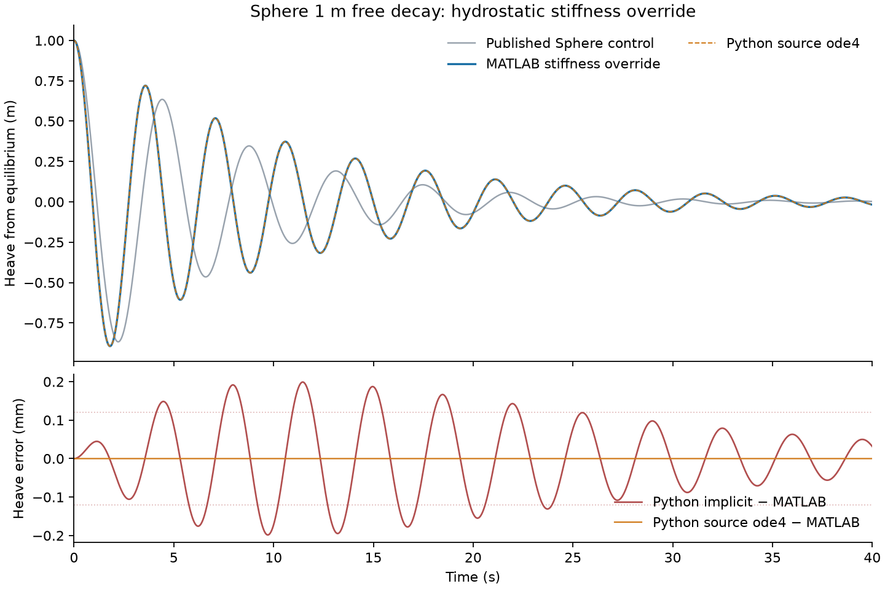

# Sphere hydrostatic stiffness override

This is a derived 40 s WEC-Sim Sphere `Free_Decay/1m` source case. The only
input change is `body(1).hydroStiffness = diag([0 0 1155583.665 0 0 0]);`
after `adjMassFactor`. The heave entry is 1.5 times the HDF5 restoring value
of 770,389.11 N/m. All-zero `hydroStiffness` retains WEC-Sim's HDF5 fallback.

- WEC-Sim core: `0753b2e47f2457c078751dcfe5d251d1767b80ab`
- Applications: `d53d4d4c9eda2581f04204f5d394a6ef84bb099e`
- Local MATLAB: R2025b on macOS ARM64
- Modified input SHA-256: `bbe6813ed3ffcfbdd6afbd6a1491de064b8c30d9409198d04670a4f44279ec5c`
- Pinned `sphere.slx` SHA-256: `116549a496a9ba3b396e61ed95435a31cdb38346b47d6e98fe82dde1224ca485`
- Bundled `examples/data/sphere.h5` SHA-256: `7287c5b02c74616e385f0d582df6a4679d7a4ceb93d8c663833a944838598e06`
- Exported 4,001-row CSV SHA-256: `34b9f2e6cf60d696f532bc3e3fb86ac63487a5af3e103d1a309488de5ac140e3`

The source run used an isolated copy of the pinned model and Sphere STL at
their published relative paths, with the bundled HDF5 at
`_Common_Input_Files/Sphere/hydroData/sphere.h5`. Call
`sphere_hydrostatic_stiffness_reference(caseDir, sourceDir, outputCsv)` from
`tests/matlab` after adding the single input line above. The committed
`source.npz` contains time, six body positions and speeds, and the override
matrix. It is a comparison target, never a Python solver input.

The new stiffness changes source heave by 0.936762 m relative to the pinned
published control. The predeclared 0.12 mm position and 0.16 mm/s speed limits
**failed** for Python's default implicit convolution: its maximum errors were
0.199 mm and 0.356 mm/s. With the new opt-in public
`WEC.run(..., solver="wecsim_ode4")` one-body CIC path, full-duration maximum
errors fall to `1.28e-10` m and `2.39e-10` m/s, below the separate `1e-8`
source-numerical gates. The default integrator and its failed limits were not
changed. This variant adds no published case or badge count.

