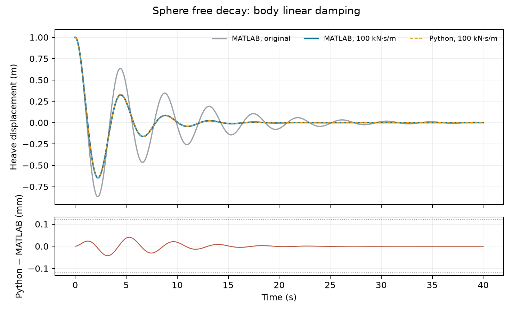

# Sphere body linear damping

This fixture is a derived full-duration MATLAB WEC-Sim source case. The
published `Free_Decay/1m` input is unchanged except for
`body(1).linearDamping = diag([0 0 100000 0 0 0]);` after `adjMassFactor`.
It retains the 40 s, 0.01 s, `noWaveCIC` simulation and 1 m initial heave.

- WEC-Sim core: `0753b2e47f2457c078751dcfe5d251d1767b80ab`
- Applications: `d53d4d4c9eda2581f04204f5d394a6ef84bb099e`
- MATLAB: R2025b Update 7 on macOS ARM64
- Modified input SHA-256: `c4d00995440f1cfa262af867a2438f8515a1e83f18468fbe662845dc6487fb43`
- Model SHA-256: `116549a496a9ba3b396e61ed95435a31cdb38346b47d6e98fe82dde1224ca485`
- HDF5 SHA-256: `7287c5b02c74616e385f0d582df6a4679d7a4ceb93d8c663833a944838598e06` (the bundled `examples/data/sphere.h5`)
- Source CSV SHA-256: `6de9dcd57c17b78068b6f3a0e0889f98e08ab65ac2d874ee1571a65644c4207e`

The local source directory contained the pinned `sphere.slx`,
`wecSimInputFile.m`, and Sphere STL at their published relative paths. The
HDF5 above was placed at `_Common_Input_Files/Sphere/hydroData/sphere.h5`.
Run `sphere_linear_damping_reference(caseDir, sourceDir, outputCsv)` from
`tests/matlab` to regenerate the 4,001-row source CSV. The committed
`source.npz` preserves its time, six body positions, six velocities, and the
damping matrix without using saved motion as a Python solver input.

An independent local run of the unchanged 1 m source input with the same
model and HDF5 matches the archived published heave within `1.03e-14` m
and speed within `1.21e-15` m/s. The added damper changes source heave by
up to 0.310164 m and speed by 0.440456 m/s relative to that control. The
independent public Python run differs from this new source by at most 0.0426 mm heave
and 0.0621 mm/s speed over 40 s. The paired gates are 0.12 mm and
0.16 mm/s. This derived configuration check does not add a published case
or change a badge.

