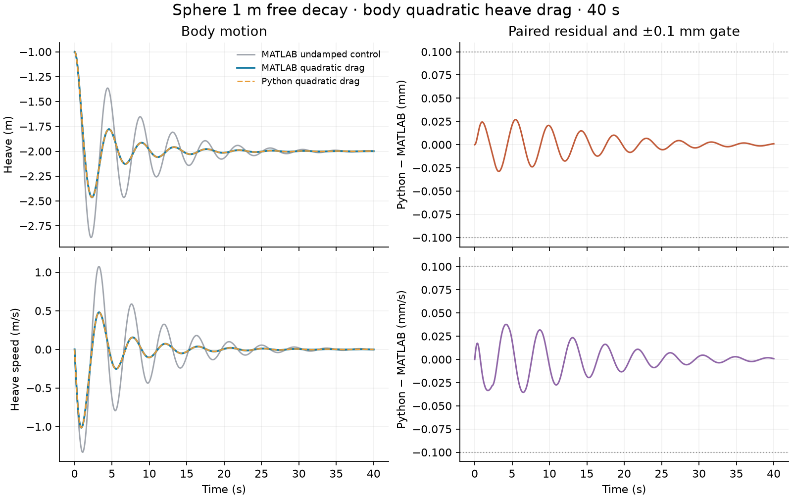
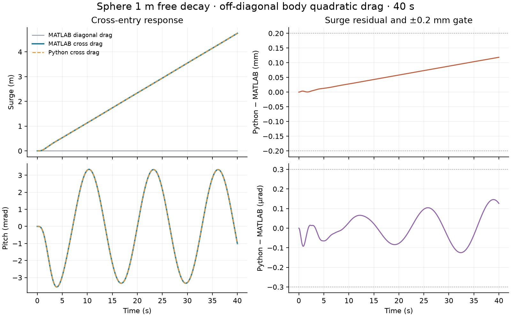

# Sphere body quadratic drag

This fixture is a derived full-duration MATLAB WEC-Sim source case. The
published `Free_Decay/1m` input is unchanged except for
`body(1).quadDrag.drag = diag([0 0 250000 0 0 0]);` after `adjMassFactor`.
It retains the 40 s, 0.01 s, `noWaveCIC` simulation and 1 m initial heave.

- WEC-Sim core: `0753b2e47f2457c078751dcfe5d251d1767b80ab`
- Applications: `d53d4d4c9eda2581f04204f5d394a6ef84bb099e`
- MATLAB: R2025b Update 7 on macOS ARM64
- Modified input SHA-256: `de8cc34a26d63ec6852aaa019c72064389ee064975a02610636ccb5c9dfaf0be`
- Model SHA-256: `116549a496a9ba3b396e61ed95435a31cdb38346b47d6e98fe82dde1224ca485`
- HDF5 SHA-256: `7287c5b02c74616e385f0d582df6a4679d7a4ceb93d8c663833a944838598e06` (bundled `examples/data/sphere.h5`)
- Source motion CSV SHA-256: `824c674a2f6b82b5edd89a0b36dc5771827cd6b6e0dcfa530e4e73b3d9e1c6e6`
- Source viscous-force CSV SHA-256: `0b5ad390cd5d10a56ead60e9492d0e104a727e7d92edbdc1d34da02d3fbff461`

The local source directory contained the pinned `sphere.slx`,
`wecSimInputFile.m`, and Sphere STL at their published relative paths. The
HDF5 above was placed at `_Common_Input_Files/Sphere/hydroData/sphere.h5`.
Run `sphere_quadratic_drag_reference(caseDir, sourceDir, motionCsv, forceCsv)`
from `tests/matlab` to regenerate both 4,001-row source CSVs. A second local
run with this generator reproduced both files exactly. The committed
`source.npz` preserves time, six body positions, six velocities, the logged
viscous-force components, and the drag matrix. Saved source motion and force
are comparison targets, never Python solver inputs.

The unchanged local 1 m source input with the same model and HDF5 matches
the archived published heave within `1.03e-14` m and speed within
`1.21e-15` m/s. The added drag changes source heave by `0.42654` m and speed
by `0.59460` m/s. MATLAB's logged viscous force equals
`D @ (velocity * abs(velocity))` within `2.5e-9` N; its body block subtracts
that term from applied force. Independent public Python motion differs from
this source by at most `0.0289` mm heave and `0.0377` mm/s speed over 40 s.
The paired CI limits are `0.1` mm and `0.1` mm/s. This derived
configuration check does not add a published case or change a badge.

The companion `source_cross.npz` checks a full matrix with
`D[heave, heave] = 250000` and `D[surge, heave] = 50000`. The other entries
are zero. This synthetic cross-coordinate setting is a numerical API stress
test, not a published device setting or a passivity claim. Its input SHA-256
is `e2cc0d32f14a8da631bb1adf18bee27e123f6581b78d0fb0fe9e6bb86dc357bc`,
motion CSV SHA-256 is
`45fd027c82d827c15a393717eed87a4b4a4b7a7e24fe1b51f0003d29c793a623`,
and viscous-force CSV SHA-256 is
`0b41b7a3ace37a36eefc0a182247f4c6ab656d7903878c138675ced94eba78ac`.
Pass the corresponding 6×6 matrix as the generator's fifth argument to
reproduce it; a fresh local run matched both CSVs exactly. MATLAB's logged
six-component viscous force matches the matrix law within `2.5e-9` N. Across
all 4,001 samples, independent Python surge, heave, and pitch positions
differ by at most `0.1184` mm, `0.0289` mm, and `1.46e-7` rad; corresponding
speed gaps are `0.00611` mm/s, `0.0377` mm/s, and `1.54e-7` rad/s. The CI
limits are `0.2`/`0.1` mm surge/heave, `3e-7` rad pitch, `0.02`/`0.1`
mm/s surge/heave speed, and `3e-7` rad/s pitch speed. The case remains a
derived configuration gate with no published-case badge change.
The synthetic matrix drives surge from the heave transient while leaving
surge without a restoring or drag term, so the resulting free surge drift
is expected for this test input. It is not evidence about the RM3 surge
cases or a proposed physical body default.

## Coefficient and area input

The `source_cd_area.npz` fixture uses the same pinned 40 s Sphere case, model,
HDF5, and local R2025b installation. Its only input change after
`adjMassFactor` is `body(1).quadDrag.cd = [0 0 1 0 0 0]` and
`body(1).quadDrag.area = [0 0 500 0 0 0]`. The explicit drag matrix remains
zero, so WEC-Sim computes the heave entry from `0.5 * rho * cd * area` at
its default `rho=1000` kg/m³. The modified input SHA-256 is
`37e7060050ae659249b476267c44850ce8bc19c87019460aac1d78cfdc66a883`;
the model and HDF5 hashes are the same as above. Run
`sphere_quadratic_drag_reference(caseDir, sourceDir, motionCsv, forceCsv,
zeros(6), [0 0 1 0 0 0], [0 0 500 0 0 0])` to reproduce the export.
The runner adds only pinned WEC-Sim `source/` to the MATLAB path because
`stopWecSim` invokes any unrelated `userDefinedFunctions.m` it can find.

The 4,001-row motion and viscous-force CSVs are **byte-identical** to the
explicit-matrix source files above, with SHA-256 values
`824c674a2f6b82b5edd89a0b36dc5771827cd6b6e0dcfa530e4e73b3d9e1c6e6`
and `0b5ad390cd5d10a56ead60e9492d0e104a727e7d92edbdc1d34da02d3fbff461`.
The committed coefficient/area fixture SHA-256 is
`c7e711916bab0c46bcd8b18153174e3772979e04a655a91327865e682161de5a`.
MATLAB's logged force matches the density-scaled diagonal law within
`2.45e-9` N. Independent public Python heave and speed differ by at most
`0.0289` mm and `0.0377` mm/s over 40 s, below predeclared `0.1` mm and
`0.1` mm/s gates. A separate public-API invariant checks that changing
`rho` to 1025 scales the effective matrix accordingly; it is not a second
MATLAB source run. This derived input-form gate does not promote a published
case badge or establish coupled Cable or nonlinear-hydro motion parity.
